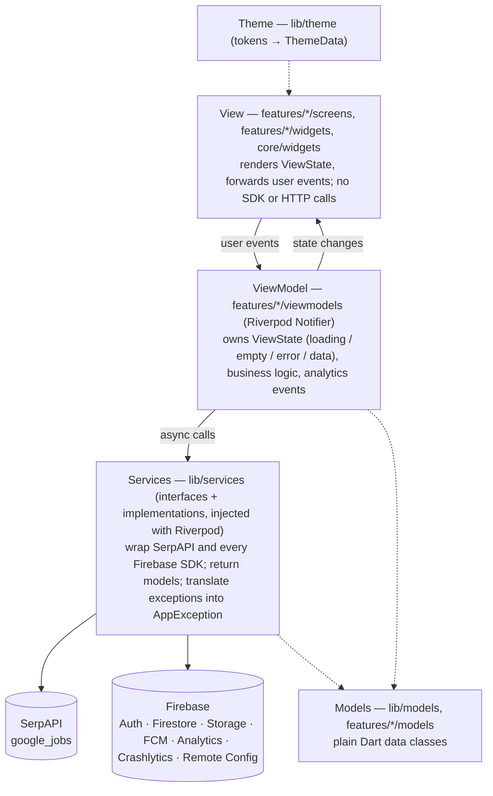
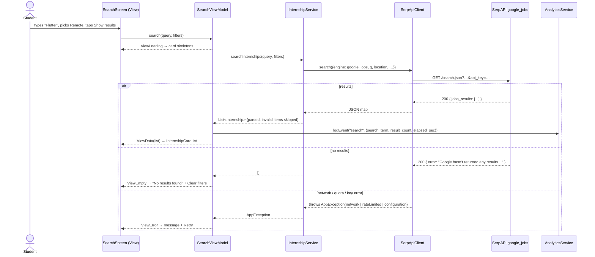

# Internly architecture

Internly is a Flutter app (Android graded, iOS also builds) built with **MVVM**, **Riverpod 3** for state management and dependency injection, **go_router** for navigation, **SerpAPI (Google Jobs)** for internship listings, and **Firebase** for identity, user data, files, messaging, analytics, crash reporting and remote configuration. Written before feature work (Lab 3 §4 stage 2); every feature PR keeps it true to the code.

## 1. Layers

Dependencies point **down only**; a layer never imports from the layer above it.



| Layer | May depend on | Must not |
|---|---|---|
| **View** | ViewModels, `core/widgets`, `theme` | Import Firebase / `http`, call services, contain business logic (filtering, ranking, validation) in `build()` |
| **ViewModel** | Services (through providers), models, `core/state`, `core/errors`, `core/utils` | Import widgets (except `foundation`), hold a `BuildContext`, navigate |
| **Service** | SDKs, `http`, models, `core/errors`, `core/utils` | Know about screens or UI state |
| **Model** | `core/utils` (parsing) | Import Firebase SDKs (except `Timestamp` via `FirestoreReader`) |

## 2. Folder structure

```
lib/
  main.dart                  entry point → app/bootstrap.dart
  firebase_options.dart      generated by `flutterfire configure` (placeholder until then)
  app/                       bootstrap (Firebase, Crashlytics, Remote Config), MaterialApp, router + auth guard, bottom-nav shell
  theme/                     design tokens → ThemeData (colors, typography, spacing, radii, elevation, sizes)
  core/errors/               AppException, AppErrorKind (the only error type above services)
  core/state/                ViewState sealed class (loading / empty / error / data)
  core/utils/                FirestoreReader (safe parsing), Validators
  core/widgets/              Lab 2 components as reusable widgets (button, field, card, app bar, dialog, states…)
  models/                    models shared by several features (AppUser)
  services/                  service interfaces + implementations + Riverpod providers (auth, SerpAPI, analytics, crashlytics, remote config; feature services added here)
  features/<feature>/
    screens/                 one file per screen (View)
    viewmodels/              Notifier classes + providers (ViewModel)
    widgets/                 widgets used by this feature only
assets/fonts/                Inter (OFL)
firebase/                    firestore.rules, storage.rules, firestore.indexes.json, remote-config-defaults.json
e2e_test/                    ARTEMIS pytest suite (conftest.py, pyproject.toml, test_*.py)
test/                        Flutter unit, ViewModel, widget and routing tests (mirrors lib/)
docs/                        design traceability, architecture, plans, logs, Lab 2 snapshot
evidence/                    console, DebugView, Crashlytics, ARTEMIS screenshots and traces
android/, ios/               platform projects (android/app/google-services.json is committed)
```

### Why this differs from the suggested structure

Lab 3 suggests `lib/{models, services, firebase, viewmodels, screens, widgets, utils}`. We keep the same layers but group Views and ViewModels **by feature**:

| Suggested | Here | Reason |
|---|---|---|
| `screens/`, `viewmodels/` at the top level | `features/<feature>/screens`, `features/<feature>/viewmodels` | Each feature has one owner; their screens and ViewModels stay together, so PRs do not collide. |
| `widgets/` | `core/widgets/` (shared Lab 2 components) + `features/*/widgets/` (private) | Lab 2 components are shared by every feature; feature-only widgets stay with their feature. |
| `firebase/` inside `lib/` | Firebase wrappers live in `services/`; `firebase/` at the repo root holds rules and Remote Config defaults | One rule: every external call (HTTP or Firebase) goes through `services/`. |
| `utils/` | `core/utils/`, plus `core/errors/` and `core/state/` | Errors and the state model are cross-cutting contracts, not helpers. |

## 3. State management and dependency injection (Riverpod 3)

- **Riverpod only.** No Provider, Bloc, GetX, or `setState` for shared state. No singletons accessed from widgets.
- **Services** are `Provider<Interface>` next to their interface (e.g. `serpApiClientProvider`). Tests override them with fakes (`overrideWithValue`).
- **Data screens** expose a `ViewState<T>` (`core/state/view_state.dart`): `ViewLoading`, `ViewEmpty`, `ViewError(AppException)`, `ViewData(T)`. Views switch over it exhaustively and render the shared skeleton / `StateView.empty` / `StateView.error` + Retry.
- **One-shot actions** (sign in, submit, save) use `AsyncValue<void>`; `AsyncError` carries an `AppException` whose message is safe to show.
- **Async rules:** read every provider before the first `await`; check `ref.mounted` before setting state after an `await`; ignore repeated taps while loading.
- **User-scoped state** (Firestore listeners, caches, profile) must `ref.watch(currentUserIdProvider)`, so all local user data is dropped when the user signs out (Lab 3 §6).
- **Bootstrap** creates the `ProviderContainer` and passes it to `UncontrolledProviderScope`, so services are ready before `runApp`.

### ViewModels and the services they use

| ViewModel | Screen | Services | Status |
|---|---|---|---|
| `LoginViewModel` | Login | `AuthService`, `AnalyticsService` | Done |
| `SignOutViewModel` | Profile | `AuthService`, `AnalyticsService` | Done |
| `HomeViewModel` | Home | `InternshipService`, `UserProfileService`, `RemoteConfigService`, `AnalyticsService` | Planned |
| `SearchViewModel` | Search, Search Results | `InternshipService`, `AnalyticsService` | Planned |
| `InternshipDetailViewModel` | Internship Detail | `InternshipService`, `SavedInternshipService`, `ApplicationService`, `AnalyticsService` | Planned |
| `SavedViewModel` | Saved Internships | `SavedInternshipService`, `AnalyticsService` | Planned |
| `ApplyViewModel` | Application Form, CV Match Check, Review, Success | `ApplicationService`, `UserProfileService`, `FileStorageService`, `RemoteConfigService`, `AnalyticsService`, `CrashlyticsService` | Planned |
| `MyApplicationsViewModel` | My Applications | `ApplicationService` | Planned |
| `ApplicationDetailViewModel` | Application Detail | `ApplicationService`, `AnalyticsService` | Planned |
| `ProfileViewModel` | Profile | `UserProfileService`, `FileStorageService` | Planned |
| `FirebaseDemoViewModel` | Firebase demo area | `RemoteConfigService`, `CrashlyticsService`, `NotificationService` | Planned |
| `NotificationCenterViewModel` | Notification Center | `NotificationService`, `AnalyticsService` | Planned |
| `ReportExportViewModel` | Report export | `ReportExportService`, `FileStorageService`, `ApplicationService`, `AnalyticsService` | Planned |

Services that exist today: `AuthService`, `SerpApiClient`, `FileStorageService` (Cloudinary), `AnalyticsService`, `CrashlyticsService`, `RemoteConfigService`. The others are added by their feature in `lib/services/`.

## 4. Sequence: Flow 1 search (planned implementation)



## 5. Navigation

- `go_router` with `StatefulShellRoute.indexedStack`: five tab branches (Home, Search, Saved, Applications, Profile), each with its own stack, so Back works per tab.
- **Auth routing** (`authRedirect`): Splash until the first auth event; signed-out users only reach `/login`; signed-in users never see Login or Splash.
- Nested routes and their names are listed in [`design-traceability.md`](design-traceability.md). The Apply flow uses `parentNavigatorKey: rootNavigatorKey` to hide the bottom navigation.
- Every named route is logged as `screen_view` and stored as the Crashlytics custom key `last_screen`.

## 6. Data sources and ownership

| Data | Source | Owner | Access |
|---|---|---|---|
| Internship listings | **SerpAPI** `google_jobs` (real-time, read-only) | External | Through `SerpApiClient` → `InternshipService` only |
| Profile, saved internships, applications, notifications, report metadata | **Cloud Firestore** under `users/{uid}/…` | The signed-in user | Owner only, with field-validated rules (`firebase/firestore.rules`) |
| CVs, generated PDF reports | **Cloudinary** (free plan) `internly/cvs/{uid}/…`, `internly/reports/{uid}/…`; metadata in Firestore `users/{uid}/…` | The signed-in user | Enforced in `CloudinaryStorageService`: own folder only, signed in, PDF ≤ 10 MB, random ids; listing only via owner-only Firestore metadata (G-12) |
| Feature switches, limits | **Remote Config** (defaults in `firebase/remote-config-defaults.json`) | App team | Read-only in the app; real-time updates |

Rules for feature owners:

1. Listings are not stored in Firestore. Saved items and applications keep a **snapshot** of the listing fields they show (title, company, location, apply link), because SerpAPI listings expire (G-25).
2. Firestore document IDs use a short, URL-safe key derived from the SerpAPI `job_id` (the raw ID is long and may contain `/`).
3. Validate every Firestore write in the rules (keys, types, sizes, `request.time` timestamps). `allow write: if isOwner(uid)` alone is not acceptable.
4. Parse defensively with `FirestoreReader`; skip and log (Crashlytics non-fatal) malformed documents instead of failing a list.
5. Read server timestamps in listeners with `ServerTimestampBehavior.estimate`.

## 7. Firebase and API integration points

| Concern | Where | Failure handling |
|---|---|---|
| Initialization | `app/bootstrap.dart` | Placeholder config → "Firebase is not configured" screen |
| Auth (Google) | `services/auth_service.dart` | Cancelled picker → info message; network / config → error message |
| SerpAPI | `services/serp_api_client.dart` | Missing / invalid key, quota (429), network, timeout → `AppException`; no results → empty |
| File storage (Cloudinary) | `services/file_storage_service.dart` | Signed out → permission denied; not a PDF / too large → invalid input; preset / quota / network errors → message; progress reported |
| Analytics | `services/analytics_service.dart` | Failures swallowed; names validated in debug |
| Crashlytics | `services/crashlytics_service.dart` | Global handlers at bootstrap; user ID + `last_screen` key; `crashForTesting()` only from the demo area |
| Remote Config | `services/remote_config_service.dart` | Defaults from JSON before `runApp`; fetch and real-time updates in the background |
| Firestore, FCM, PDF generation | Added by their features | Each shows a visible message for offline, permission denied and cancel |

## 8. Secrets and configuration

- Firebase config files are app configuration and are committed (Lab 3 §9).
- The SerpAPI key and the Cloudinary cloud name / unsigned preset come from the untracked `.env` via `flutter run --dart-define-from-file=.env`. They are compiled into the APK, so use free-plan values only (G-12, G-25). The Cloudinary API secret is never used by the app.
- Never commit service-account JSON, keystores, `.p8` keys, model API keys or test-account credentials.

## 9. Testing

| Level | Location | Tools |
|---|---|---|
| Unit (utils, services, models) | `test/core`, `test/services` | `flutter_test`, `package:http/testing.dart` |
| ViewModel | `test/features/<feature>` | `ProviderContainer.test` + fakes (`test/helpers/fakes.dart`) |
| Widget (components, screens at 360 / 412 dp) | `test/core/widgets`, `test/features` | `pumpThemed`, `checkWidths`, real Inter font |
| App routing | `test/app` | Full `InternlyApp` with overridden services |
| End-to-end | `e2e_test/` | Google ARTEMIS ([`test-plan.md`](test-plan.md)) |
