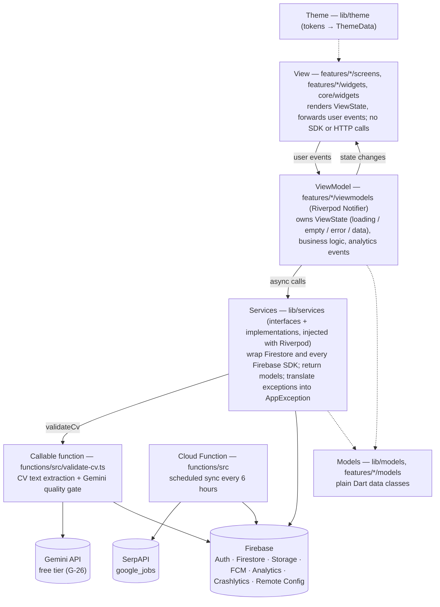
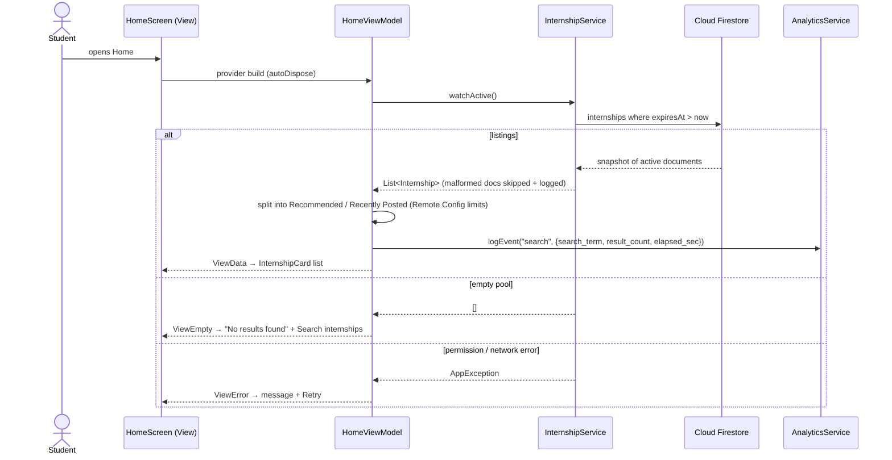

# Internly architecture

Internly is a Flutter app (Android graded, iOS also builds) built with **MVVM**, **Riverpod 3** for state management and dependency injection, **go_router** for navigation, **SerpAPI (Google Jobs)** behind a scheduled Cloud Function, and **Firebase** for identity, the shared listing pool, user data, files, messaging, analytics, crash reporting and remote configuration. The function mirrors SerpAPI into Firestore every six hours; the app only reads Firestore. A second, callable function (`validateCv`) reads the student's own CV from Storage and asks **Gemini** (free tier, G-26) whether it is a usable CV, so no model key ships in the app. Written before feature work (Lab 3 §4 stage 2); every feature PR keeps it true to the code.

## 1. Layers

Dependencies point **down only**; a layer never imports from the layer above it.



| Layer | May depend on | Must not |
|---|---|---|
| **View** | ViewModels, `core/widgets`, `theme` | Import Firebase SDKs, call services, contain business logic (filtering, ranking, validation) in `build()` |
| **ViewModel** | Services (through providers), models, `core/state`, `core/errors`, `core/utils` | Import widgets (except `foundation`), hold a `BuildContext`, navigate |
| **Service** | SDKs, models, `core/errors`, `core/utils` | Call SerpAPI, know about screens or UI state |
| **Model** | `core/utils` (parsing) | Import Firebase SDKs (except `Timestamp` via `FirestoreReader`) |

## 2. Folder structure

```
lib/
  main.dart                  entry point → app/bootstrap.dart
  firebase_options.dart      generated by `flutterfire configure` (placeholder until then)
  app/                       bootstrap (Firebase, Crashlytics, Remote Config), MaterialApp, router + auth guard, bottom-nav shell
  theme/                     design tokens → ThemeData (colors, typography, spacing, radii, elevation, sizes)
  core/errors/               AppException, AppErrorKind (the only error type above services)
  core/state/                ViewState sealed class (loading / empty / error / data)
  core/utils/                FirestoreReader (safe parsing), Validators
  core/widgets/              Lab 2 components as reusable widgets (button, field, card, app bar, dialog, states…)
  models/                    models shared by several features (AppUser)
  services/                  service interfaces + implementations + Riverpod providers (auth, Firestore listings, analytics, crashlytics, remote config; feature services added here)
  features/<feature>/
    screens/                 one file per screen (View)
    viewmodels/              Notifier classes + providers (ViewModel)
    widgets/                 widgets used by this feature only
assets/fonts/                Inter (OFL)
firebase/                    firestore.rules, storage.rules, firestore.indexes.json, remote-config-defaults.json
functions/                   scheduled SerpAPI → Firestore sync + callable CV validation (TypeScript, Node 22)
e2e_test/                    ARTEMIS pytest suite (conftest.py, pyproject.toml, test_*.py)
test/                        Flutter unit, ViewModel, widget and routing tests (mirrors lib/)
docs/                        design traceability, architecture, plans, logs, Lab 2 snapshot
evidence/                    console, DebugView, Crashlytics, ARTEMIS screenshots and traces
android/, ios/               platform projects (android/app/google-services.json is committed)
```

### Why this differs from the suggested structure

Lab 3 suggests `lib/{models, services, firebase, viewmodels, screens, widgets, utils}`. We keep the same layers but group Views and ViewModels **by feature**:

| Suggested | Here | Reason |
|---|---|---|
| `screens/`, `viewmodels/` at the top level | `features/<feature>/screens`, `features/<feature>/viewmodels` | Each feature has one owner; their screens and ViewModels stay together, so PRs do not collide. |
| `widgets/` | `core/widgets/` (shared Lab 2 components) + `features/*/widgets/` (private) | Lab 2 components are shared by every feature; feature-only widgets stay with their feature. |
| `firebase/` inside `lib/` | Firebase wrappers live in `services/`; `firebase/` at the repo root holds rules and Remote Config defaults | One rule: every external call (HTTP or Firebase) goes through `services/`. |
| `utils/` | `core/utils/`, plus `core/errors/` and `core/state/` | Errors and the state model are cross-cutting contracts, not helpers. |

## 3. State management and dependency injection (Riverpod 3)

- **Riverpod only.** No Provider, Bloc, GetX, or `setState` for shared state. No singletons accessed from widgets.
- **Services** are `Provider<Interface>` next to their interface (e.g. `serpApiClientProvider`). Tests override them with fakes (`overrideWithValue`).
- **Data screens** expose a `ViewState<T>` (`core/state/view_state.dart`): `ViewLoading`, `ViewEmpty`, `ViewError(AppException)`, `ViewData(T)`. Views switch over it exhaustively and render the shared skeleton / `StateView.empty` / `StateView.error` + Retry.
- **One-shot actions** (sign in, submit, save) use `AsyncValue<void>`; `AsyncError` carries an `AppException` whose message is safe to show.
- **Async rules:** read every provider before the first `await`; check `ref.mounted` before setting state after an `await`; ignore repeated taps while loading.
- **User-scoped state** (Firestore listeners, caches, profile) must `ref.watch(currentUserIdProvider)`, so all local user data is dropped when the user signs out (Lab 3 §6).
- **Bootstrap** creates the `ProviderContainer` and passes it to `UncontrolledProviderScope`, so services are ready before `runApp`.

### ViewModels and the services they use

| ViewModel | Screen | Services | Status |
|---|---|---|---|
| `LoginViewModel` | Login | `AuthService`, `AnalyticsService` | Done |
| `SignOutViewModel` | Profile | `AuthService`, `AnalyticsService` | Done |
| `HomeViewModel` | Home | `InternshipService`, `UserProfileService` (preferred location), `RemoteConfigService`, `AnalyticsService` | Done |
| `SearchViewModel` | Search, Search Results | `InternshipService`, `AnalyticsService` | Planned |
| `InternshipDetailViewModel` | Internship Detail | `InternshipService`, `SavedInternshipService`, `ApplicationService`, `AnalyticsService` | Planned |
| `SavedViewModel` | Saved Internships | `SavedInternshipService`, `AnalyticsService` | Planned |
| `ApplyFormViewModel` | Application Form (CV pick/upload, profile prefill) | `UserProfileService`, `FileStorageService`, `DocumentPickerService`, `ExternalLinkService`, `InternshipService`, `RemoteConfigService`, `AnalyticsService` | Done |
| `CvValidationViewModel` | Validate CV step (Apply, pre-submit) | `CvValidationService`, `AnalyticsService` | Done (service, ViewModel, step widget, tests) |
| `ApplicationReviewViewModel` | Application Review → Success | `ApplicationService`, `InternshipService`, `UserProfileService`, `AnalyticsService`, `CrashlyticsService` | Done (Application Success is a stateless recap screen, no ViewModel) |
| `MyApplicationsViewModel` | My Applications | `ApplicationService` | Done (list, status filter, retry; no writes, no detail) |
| `ApplicationDetailViewModel` | Application Detail | `ApplicationService`, `InternshipService`, `ExternalLinkService`, `AnalyticsService` | Done (load, tracker, withdraw/undo, preview, tests) |
| `ProfileViewModel` | Profile | `UserProfileService` (+ auth for email and photo) | Done |
| `EditProfileViewModel` | Edit profile | `UserProfileService`, `AnalyticsService` | Done |
| `EditSkillsViewModel`, `EditPreferencesViewModel` | Profile sheets | `UserProfileService`, `AnalyticsService` | Done |
| `UpdateCvViewModel` | Update CV sheet | `DocumentPickerService`, `FileStorageService`, `UserProfileService`, `AnalyticsService` | Done |
| `OpenCvViewModel` | Profile (View CV) | `ExternalLinkService` | Done |
| `FirebaseDemoViewModel` | Firebase demo area | `RemoteConfigService`, `CrashlyticsService`, `NotificationService` | Planned |
| `NotificationCenterViewModel` | Notification Center | `NotificationService`, `AnalyticsService` | Planned |
| `ReportExportViewModel` | Report export | `ReportExportService`, `FileStorageService`, `ApplicationService`, `AnalyticsService` | Planned |

Services that exist today: `AuthService`, `InternshipService` (Firestore `internships` listener), `ApplicationService` (Firestore `users/{uid}/applications` listener, read-only), `UserProfileService` (Firestore `users/{uid}` listener + merge writes per section), `FileStorageService` (Cloud Storage for Firebase), `DocumentPickerService` (system file picker, `file_selector`), `ExternalLinkService` (opens a URL in another app, `url_launcher`), `CvValidationService` (callable `validateCv`), `AnalyticsService`, `CrashlyticsService`, `RemoteConfigService`. The others are added by their feature in `lib/services/`. SerpAPI is called only by the scheduled function in `functions/`; Gemini is called only by the callable `validateCv` function.

## 4. Sequence: Home feed (shared Firestore pool)



The pool itself is filled by `syncInternshipsJob` every six hours (Plan → backfill all keywords once, then one keyword per run). The function writes `/internships/{jobKey}` with the raw SerpAPI job, `searchKeyword`, `searchRank`, `syncedAt` and `expiresAt`; clients can read but never write it.

## 5. Navigation

- `go_router` with `StatefulShellRoute.indexedStack`: five tab branches (Home, Search, Saved, Applications, Profile), each with its own stack, so Back works per tab.
- **Auth routing** (`authRedirect`): Splash until the first auth event; signed-out users only reach `/login`; signed-in users never see Login or Splash.
- Nested routes and their names are listed in [`design-traceability.md`](design-traceability.md). The Apply flow uses `parentNavigatorKey: rootNavigatorKey` to hide the bottom navigation.
- Every named route is logged as `screen_view` and stored as the Crashlytics custom key `last_screen`.

## 6. Data sources and ownership

| Data | Source | Owner | Access |
|---|---|---|---|
| Internship listings | **Cloud Firestore** `internships/{jobKey}`, mirrored from SerpAPI `google_jobs` every 6 hours (read-only in the app) | Scheduled Cloud Function (Admin SDK) | Signed-in users read; client writes are denied. App reads through `InternshipService` only |
| Profile, saved internships, applications, notifications, report metadata | **Cloud Firestore** under `users/{uid}/…` | The signed-in user | Owner only: `users/{uid}/**` (`firebase/firestore.rules`, final) |
| CVs, generated PDF reports | **Cloud Storage for Firebase** `cvs/{uid}/…`, `reports/{uid}/…` (Blaze, US bucket, no-cost quota); metadata in Firestore `users/{uid}/…` | The signed-in user | `firebase/storage.rules`: owner only, PDF ≤ 10 MB; the service checks the same before uploading (G-12) |
| CV text for the quality gate | Read server-side from `cvs/{uid}/…` by the callable `validateCv`, then sent to Gemini as plain text | Callable Cloud Function (Admin SDK) | Only the caller's own `cvs/${request.auth.uid}/…` path; the key is a Secret Manager secret (`GEMINI_API_KEY`), never in the app |
| Feature switches, limits | **Remote Config** (defaults in `firebase/remote-config-defaults.json`) | App team | Read-only in the app; real-time updates |

Rules for feature owners:

1. The shared pool lives in `/internships`, not under `users/{uid}`. Saved items and applications still keep a **snapshot** of the listing fields they show (title, company, location, apply link), because listings expire (G-25).
2. Firestore document IDs use a short, URL-safe key derived from the SerpAPI `job_id` (the raw ID is long and may contain `/`).
3. The rules are final and generic: owner-only `users/{uid}/**`, read-only `/internships`, and `/sync/**` denied to clients. Features never change them. Validation of field values happens in ViewModels and services (statuses are self-tracked, G-25).
4. Parse defensively with `FirestoreReader`; skip and log (Crashlytics non-fatal) malformed documents instead of failing a list.
5. Read server timestamps in listeners with `ServerTimestampBehavior.estimate`.

**Profile document `users/{uid}`** (`UserProfile`, `lib/models/user_profile.dart`; every field optional, the document exists only after the first save). Apply reads it for prefill, the CV from Profile and the skills used by CV Match Check.

| Field | Type | Written by |
|---|---|---|
| `fullName`, `headline`, `university`, `major`, `phone`, `city`, `bio` (≤ 300) | string or null | Edit profile |
| `yearOfStudy` (1–6), `graduationYear` | int or null | Edit profile (Academic standing picker) |
| `skills` | string[] (values from `knownSkills`) | Edit skills sheet |
| `preferences` | map: `targetRoles` (`software_engineer` / `mobile` / `frontend` / `backend` / `qa_tester`, the frame's roles), `workModes` (`hybrid` / `remote` / `on_site`), `location` (string or null) | Update preferences sheet |
| `cv` | map: `fileName`, `url`, `storagePath`, `sizeBytes`, `uploadedAt` (only from a real `FileStorageService` upload) | Update CV sheet |
| `updatedAt` | server timestamp | every write (merge per section) |

Email and photo are never copied here; they come from the Google account. `city` (where the student lives) and `preferences.location` (where they want an internship) are both kept; Update preferences starts from `city` when its location is empty (G-30). Replacing the CV keeps the old file in Storage because submitted applications may still link to it.

**Application document `users/{uid}/applications/{jobKey}`** (`InternshipApplication`, `lib/models/internship_application.dart`). The document ID is the listing key, so one student can have at most one application per listing. The Apply flow writes the snapshot; My Applications and Application Detail read it.

| Field | Type | Written by |
|---|---|---|
| `title`, `companyName` | string (required) | Apply flow (snapshot of the listing, which expires from the pool, G-25) |
| `appliedAt` | timestamp (required) | Apply flow |
| `status` | `submitted` / `under_review` / `interview` / `accepted` / `rejected` / `withdrawn` (required, `ApplicationStatus`) | Apply flow; withdraw / undo (Flow 3d) |
| `nextStepAt` | timestamp or null (optional) | Interview slot or the employer's reply deadline, when the student records one |
| `withdrawnAt`, `previousStatus` | timestamp / status or null (optional) | `ApplicationService.withdraw` keeps the status it replaced so `undoWithdrawal` can restore it |
| `cvFileName`, `cvUrl`, `cvStoragePath`, `cvSizeBytes` | string / string / string / int or null (optional) | Apply flow; the CV that was sent, read-only afterwards (`Preview` opens `cvUrl`; `cvSizeBytes` backs the `{size} • Uploaded {date}` CV tile on Application Detail) |
| `applicant` | map: `fullName` (required), `email`, `phone`, `university`, `yearOfStudy`, `skills`, `shortIntroduction` | Apply flow; the profile values at submission time |

A required field that is missing or has the wrong type makes the document malformed: the service skips and logs it. A stored status outside the six `ApplicationStatus` values is malformed too. The optional `applicant` / CV snapshot is parsed defensively — a malformed map becomes `null` and the rest of the application still loads (Application Detail hides that card). My Applications sorts by `appliedAt` descending and derives the count line and the status chips from the documents it received, so no index beyond the default is needed.

Application Detail subscribes to `ApplicationService.watchApplications()` and picks the document whose `jobKey` equals the route parameter, so the screen follows status, withdraw and undo writes live; it also watches `InternshipService.watchByKey(jobKey)` for the live listing facts (logo, pay, work mode, location, posted age) while the listing is still in the shared pool. `view_application` is logged once per opened detail (analytics-plan row 11).

## 7. Firebase and API integration points

| Concern | Where | Failure handling |
|---|---|---|
| Initialization | `app/bootstrap.dart` | Placeholder config → "Firebase is not configured" screen |
| Auth (Google) | `services/auth_service.dart` | Cancelled picker → info message; network / config → error message |
| SerpAPI sync | `functions/src/sync.ts` (scheduled) | Missing secret / quota / network → logged + `sync/state.lastError`; the app keeps serving the last good pool |
| CV validation (Gemini) | `functions/src/validate-cv.ts` (callable) + `services/cv_validation_service.dart` | Wrong/other user's path → `permission-denied`; unreadable PDF or < 50 extracted characters → invalid result (no Gemini call); model output that is not JSON → fail open; download / Gemini failure → `HttpsError` with a safe message, mapped to `AppException` + Retry in the app |
| Listings | `services/internship_service.dart` | permission denied / offline → `AppException` with Retry; malformed documents skipped and logged |
| Applications | `services/application_service.dart` | permission denied / offline → `AppException` with Retry on My Applications; malformed documents (missing fields, unknown status) skipped and logged |
| File storage | `services/file_storage_service.dart` | Signed out → permission denied; not a PDF / too large → invalid input; `unauthorized` / `quota-exceeded` / `retry-limit-exceeded` → message; progress reported |
| Analytics | `services/analytics_service.dart` | Failures swallowed; names validated in debug |
| Crashlytics | `services/crashlytics_service.dart` | Global handlers at bootstrap; user ID + `last_screen` key; `crashForTesting()` only from the demo area |
| Remote Config | `services/remote_config_service.dart` | Defaults from JSON before `runApp`; fetch and real-time updates in the background |
| Profile | `services/user_profile_service.dart` | permission denied / offline → `AppException` (Retry on load, message in the form or sheet on save); malformed `cv` map ignored and logged |
| File picking, external links | `services/document_picker_service.dart`, `services/external_link_service.dart` | Closed picker → no change; unreadable file or no app to open a link → message |
| Firestore (other collections), FCM, PDF generation | Added by their features | Each shows a visible message for offline, permission denied and cancel |

## 8. Secrets and configuration

- Firebase config files are app configuration and are committed (Lab 3 §9).
- The SerpAPI key lives in **Secret Manager** as `SERPAPI_KEY` and is read only by the scheduled function. It is not part of the APK or the Flutter `.env` (G-25).
- The Gemini key lives in **Secret Manager** as `GEMINI_API_KEY`, bound only to the `validateCv` function (least privilege). It is the same free-tier Google AI Studio key as ARTEMIS (G-26) but a separate secret binding. Set it with `firebase functions:secrets:set GEMINI_API_KEY`.
- Never commit service-account JSON, keystores, `.p8` keys, model API keys or test-account credentials.

## 9. Testing

| Level | Location | Tools |
|---|---|---|
| Unit (utils, services, models) | `test/core`, `test/services`, `functions/src` | `flutter_test`, Node `node:test` |
| ViewModel | `test/features/<feature>` | `ProviderContainer.test` + fakes (`test/helpers/fakes.dart`) |
| Widget (components, screens at 360 / 412 dp) | `test/core/widgets`, `test/features` | `pumpThemed`, `checkWidths`, real Inter font |
| App routing | `test/app` | Full `InternlyApp` with overridden services |
| End-to-end | `e2e_test/` | Google ARTEMIS ([`test-plan.md`](test-plan.md)) |
