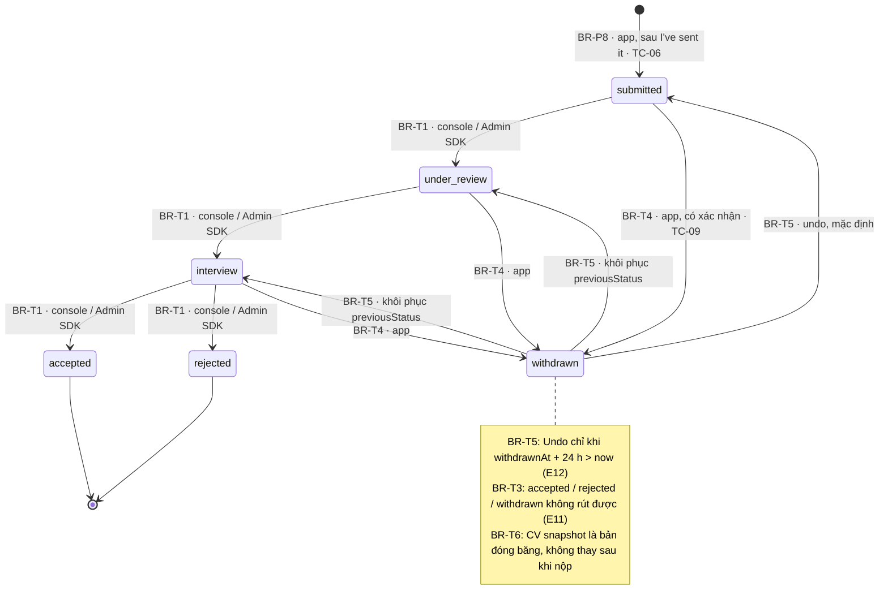

# Business process swimlane — the whole operation on one page

Council-facing view of how Internly runs: **who does what, where**, the main steps,
every branch point with its `BR-xx` code, the important exception branches, and how
each branch connects to the application state machine and to a test case.

**Source of truth.** `BR-xx` rule text, the exception catalogue and the full
53-rule traceability matrix live in [`business-rules.md`](business-rules.md). This
page is the presentation view of the same rules and must be updated in the same PR
as that file. Apply is the **email-based Compose flow** (DC-31); the older Apply
Form in `design/user-flow.md` is superseded (DC-27).

**Reading the diagrams.** Each subgraph is a swimlane. A diamond is a **branch
point** and carries its rule ID. An edge labelled `E…` is an **exception branch**.
`TC-…` is the test case in [`test-plan.md`](test-plan.md) §3.

## 1. Actors and systems in one diagram

```mermaid
flowchart LR
  subgraph ACT["Actors"]
    U["Học sinh (User)<br/>đã đăng nhập"]
    A["Admin<br/>người vận hành, máy local"]
  end

  subgraph CLIENT["Client surfaces"]
    APP["Flutter app<br/>MVVM · Riverpod · go_router"]
    DASH["Admin dashboard<br/>Node server trên 127.0.0.1"]
  end

  subgraph FB["Firebase project"]
    AUTH["Firebase Auth<br/>Google Sign-In"]
    FS["Cloud Firestore<br/>internships + users/&#123;uid&#125;<br/>+ users/&#123;uid&#125;/cvs"]
    ST["Cloud Storage<br/>cvs/&#123;uid&#125; + reports/&#123;uid&#125;"]
    RC["Remote Config"]
    FCM["FCM + Crashlytics"]
  end

  subgraph CF["Cloud Functions"]
    SYNC["syncInternshipsJob<br/>mỗi 6 giờ"]
    VAL["validateCv<br/>Gemini"]
    MATCH["matchCv<br/>Groq"]
    LETTER["composeCoverLetter<br/>Groq"]
    SELECT["selectCv<br/>Groq, chưa nối UI"]
  end

  subgraph EXT["Hệ thống ngoài"]
    SERP["SerpAPI Google Jobs"]
    GEM["Gemini API"]
    GROQ["Groq API"]
    MAIL["Mail app của máy"]
    EMP["Website nhà tuyển dụng"]
  end

  U --> APP
  A --> DASH
  APP --> AUTH
  APP --> FS
  APP --> ST
  APP --> RC
  APP --> FCM
  APP -->|callable| VAL
  APP -->|callable| MATCH
  APP -->|callable| LETTER
  APP -->|callable| SELECT
  APP -->|mailto| MAIL
  APP -->|external link| EMP
  DASH --> FS
  DASH --> AUTH
  DASH --> FCM
  SYNC --> SERP
  SYNC --> FS
  VAL --> ST
  VAL --> GEM
  MATCH --> ST
  MATCH --> FS
  MATCH --> GROQ
  LETTER --> ST
  LETTER --> FS
  LETTER --> GROQ
  SELECT --> ST
  SELECT --> FS
  SELECT --> GROQ
```

| Actor / system | Does | Where | Never does |
|---|---|---|---|
| Học sinh (User) | Đăng nhập, tìm/lọc, lưu, soạn và gửi email ứng tuyển, ghi nhận đã nộp, theo dõi, rút đơn, quản lý thư viện CV | App: Login, Home, Search, Detail, Saved, Compose, My Applications, Application Detail, Profile | Ghi pool tin tuyển dụng, sửa dữ liệu người khác, gửi FCM |
| Admin | Mở dashboard local, chọn người nhận, gửi thông báo, đọc/xoá lịch sử, bắn lệnh test crash | `tools/admin-dashboard`, chỉ `127.0.0.1` | Xác thực người dùng cuối, ghi tin tuyển dụng, deploy |
| Flutter app | Auth guard, UI + ViewState, validate, đọc/ghi Firestore-Storage, gọi callable, deep link | `lib/app`, `features/*/viewmodels`, `lib/services` | Gọi SerpAPI trực tiếp, giữ secret server |
| Admin dashboard server | Giữ service account, phân giải người nhận, gọi FCM, đọc/xoá history | `tools/admin-dashboard/server.js` | Trả key về browser, bind ngoài `127.0.0.1` |
| Cloud Functions | Sync SerpAPI 6 giờ/lần; `validateCv`, `matchCv`, `composeCoverLetter`, `selectCv` | `functions/src` | Ghi dữ liệu user ngoài UID đã xác thực |
| Firebase | Auth, pool Firestore, dữ liệu user, file, Remote Config, FCM, Crashlytics | Console + rules | — |
| Hệ thống ngoài | SerpAPI (tin tuyển dụng), Gemini/Groq (nội dung AI), mail app, website employer | — | — |

## 2. End-to-end student process

Five phases, one process. The diagram is one swimlane across four bands; the
phases are read left to right.

| Phase | Main step | Result | Rules |
|---|---|---|---|
| **P1 Chuẩn bị hồ sơ** | Profile, thư viện CV, chọn CV mặc định | `users/{uid}/cvs` + `users/{uid}.cv` mirror | BR-C1 … BR-C5 |
| **P2 Khám phá** | Home → Search → Filters → Detail (hoặc Saved) | Tin tuyển dụng đang chọn | BR-D1 … BR-D6, BR-S1 … BR-S4 |
| **P3 Nộp đơn** | Compose → email app → `I've sent it` → Success | `applications/{jobKey}` với `status = submitted` | BR-P1 … BR-P12 |
| **P4 Theo dõi** | My Applications → Application Detail → rút / undo | `withdrawn` hoặc khôi phục `previousStatus` | BR-T1 … BR-T7 |
| **P5 Vận hành** | Token FCM, gửi thông báo, lịch sử, crash, Remote Config | Notification + history | BR-N1 … BR-N13 |

```mermaid
flowchart LR
  subgraph STUDENT["① Học sinh (User)"]
    direction TB
    S0(["Mở app"])
    S1{"Đã đăng nhập?<br/>BR-A1"}
    S2["Đăng nhập Google<br/>BR-A2"]
    S3["Cấp quyền thông báo<br/>BR-N9"]
    S4["Home · Search · Filters<br/>BR-D2 / D3 / D4"]
    S5{"Có kết quả?<br/>BR-D4"}
    S6["Xoá bộ lọc<br/>BR-D4 · E1"]
    S7["Internship Detail<br/>BR-D5 · E2"]
    S8{"Đã ứng tuyển?<br/>BR-P2"}
    S9{"Lưu để sau?<br/>BR-S1"}
    S10["Saved Internships<br/>unsave + Undo · BR-S3"]
    S11["Compose application<br/>BR-P3 · CV mặc định BR-C5"]
    S12{"Email + draft hợp lệ?<br/>BR-P4 / P5"}
    S13["Dùng template<br/>BR-P5 · E5"]
    S14["Huỷ giữa chừng<br/>không ghi gì · BR-P12"]
    S15["Open email app<br/>BR-P6"]
    S16{"Mail app mở được?<br/>BR-P6"}
    S17["Copy letter<br/>BR-P6 · E6"]
    S18["I've sent it<br/>BR-P7"]
    S19{"Có họ tên?<br/>BR-P7"}
    S20["Bổ sung tên ở Profile<br/>E7"]
    S21["Application Success<br/>BR-P11"]
    S22["My Applications<br/>BR-T2"]
    S23["Application Detail<br/>BR-T7"]
    S24{"Được rút đơn?<br/>BR-T3"}
    S25{"Xác nhận rút?<br/>BR-T4"}
    S26["Withdrawn<br/>BR-T4"]
    S27{"Còn hạn Undo 24 h?<br/>BR-T5"}
    S28["Khôi phục previousStatus<br/>BR-T5"]
    S29["View application"]
    S30["Profile · thư viện CV<br/>BR-C1"]
    S31{"Hành động"}
    S32["Thêm CV: PDF ≤ 10 MB,<br/>CV đầu tiên thành mặc định<br/>BR-C2 · E19 / E20"]
    S33["Đặt mặc định: defaultCvId + mirror<br/>BR-C3"]
    S34{"Đơn đã nộp tham chiếu file?<br/>BR-C4"}
    S35["Xoá mục, giữ file Storage<br/>BR-C4 · E21"]
    S36["Xoá mục + file; nếu là mặc định<br/>thăng cấp CV mới nhất<br/>BR-C4 · E22"]
    S37["CV mặc định dùng khi nộp<br/>BR-C5"]
    S38["Đăng xuất<br/>clear session · BR-A3"]
  end

  subgraph APP["② Flutter app (MVVM · Riverpod)"]
    direction TB
    A1["authRedirect + AuthService<br/>BR-A1 / A3"]
    A2["NotificationService: quyền + fcmToken<br/>BR-N9 / N10"]
    A3["InternshipService.watchActive<br/>ranking, dedupe, Remote Config<br/>lỗi → Retry · BR-D1 / D2 / D3 / D6 / N12"]
    A4["Lọc trong bộ nhớ<br/>BR-D4"]
    A5["watchByKey<br/>BR-D5"]
    A6["Kiểm tra application theo jobKey<br/>BR-P2"]
    A7["SavedInternshipService, snapshot<br/>BR-S1 / S2 / S4"]
    A8["composeCoverLetter → Groq<br/>fallback template · BR-P3 / P5"]
    A9["Validate email + dựng mailto<br/>BR-P4 / P6"]
    A10["createApplication<br/>doc id = jobKey · BR-P1 / P8"]
    A11["watchApplications<br/>BR-T2 / T7"]
    A12["withdraw / undoWithdrawal<br/>BR-T4 / T5"]
    A13["CvLibraryService<br/>add / setDefault / remove<br/>BR-C1 … C4"]
  end

  subgraph DATA["③ Firebase (Auth · Firestore · Storage)"]
    direction TB
    F1["Auth session"]
    F2["internships<br/>chỉ đọc, expiresAt còn hạn"]
    F3["users/&#123;uid&#125;/savedInternships"]
    F4["users/&#123;uid&#125;/applications<br/>status: 6 giá trị"]
    F5["users/&#123;uid&#125;<br/>+ users/&#123;uid&#125;/cvs<br/>+ cvs/&#123;uid&#125;/*"]
  end

  subgraph BACKEND["④ Cloud Functions + hệ thống ngoài"]
    direction TB
    X1["syncInternshipsJob · mỗi 6 h<br/>BR-D1"]
    X2[("SerpAPI Google Jobs")]
    X3[("Groq")]
    X4[("Gemini")]
    X5["Mail app của máy"]
    X6["Nhà tuyển dụng"]
    X7["validateCv / matchCv<br/>tuỳ chọn, không chặn nộp<br/>BR-P9 / P10 · E8 / E9 / E10"]
  end

  S0 --> S1
  S1 -- "chưa" --> S2
  S2 -.-> A1 --> F1
  S2 --> S3
  S3 -.-> A2 --> F5
  S3 --> S4
  S1 -- "rồi" --> S4
  S4 -.-> A3 --> F2
  X2 --> X1 --> F2
  S4 -.-> A4
  S4 --> S5
  S5 -- "không · E1" --> S6 --> S4
  S5 -- "có" --> S7
  S7 -.-> A5 --> F2
  S7 -.-> A6 --> F4
  S7 --> S8
  S8 -- "rồi · E3" --> S29 --> S23
  S8 -- "chưa" --> S9
  S9 -- "có" --> S10
  S10 --> S11
  S9 -- "không" --> S11
  S10 -.-> A7 --> F3
  S11 --> S12
  S11 -.-> A8 --> X3
  S11 -.-> X7
  X7 --> X4
  X7 --> X3
  S12 -- "email sai · E4" --> S11
  S12 -- "AI lỗi · E5" --> S13 --> S15
  S12 -- "huỷ · BR-P12" --> S14
  S12 -- "ok" --> S15
  S15 -.-> A9 --> X5 --> X6
  S15 --> S16
  S16 -- "không · E6" --> S17 --> S16
  S16 -- "có" --> S18
  S18 -.-> A10 --> F4
  S18 --> S19
  S19 -- "không · E7" --> S20 --> S19
  S19 -- "có" --> S21
  S21 --> S22
  F4 -.-> S22
  S22 --> S23
  S23 -.-> A11 --> F4
  S23 --> S24
  S24 -- "không · E11" --> S23
  S24 -- "có" --> S25
  S25 -- "huỷ" --> S23
  S25 -- "xác nhận · BR-T4" --> S26
  S26 -.-> A12 --> F4
  S26 --> S27
  S27 -- "còn · BR-T5" --> S28 --> S23
  S27 -- "hết · E12" --> S23
  S4 -- "tab Profile" --> S30
  S30 -.-> A13 --> F5
  S30 --> S31
  S31 -- "thêm" --> S32 --> S37
  S31 -- "đặt mặc định" --> S33 --> S37
  S31 -- "xoá" --> S34
  S34 -- "có · E21" --> S35 --> S37
  S34 -- "không" --> S36 --> S37
  S37 -.-> S11
  S37 --> S30
  S30 -- "Sign out" --> S38 --> S2
```

Notes on the diagram:

- **Save is a sub-flow of Apply** (DC-08): `Saved` opens Detail and applies from there;
  unsave shows the `Undo` snackbar (BR-S3), and a failed write never shows `Saved` (BR-S4).
- **The app records, the employer does not report back.** `submitted` is the only status
  the app writes (BR-P8); `under_review`, `interview`, `accepted`, `rejected` come from
  the Firebase console or an Admin SDK script (BR-T1, G-25 #6). Nothing in the app
  invents a status.
- **Optional checks never block**: `validateCv` (BR-P9) and `matchCv` (BR-P10) are
  advisory; every provider failure falls back and `Continue` stays enabled.
- **CV file retention**: removing a CV that a submitted application references deletes
  only the library entry, not the Storage file (BR-C4, E21). The application snapshot is
  independent of later library edits (BR-T6).

## 3. Back-office process: notifications and operations

```mermaid
flowchart LR
  subgraph ADMIN["① Admin (người vận hành)"]
    D0(["Mở dashboard<br/>127.0.0.1 · BR-N1"])
    D1{"Chọn tác vụ"}
    D2["Chọn 1 user hoặc all<br/>BR-N3"]
    D3["Nhập title, body, route<br/>BR-N4"]
    D4["Gửi"]
    D5["Đọc / xoá lịch sử<br/>BR-N7"]
    D6["Tick xác nhận + hộp thoại<br/>BR-N8"]
    D7["409 + lý do<br/>BR-N3 · E13"]
    D8["400 + rule<br/>BR-N4 · E14"]
  end

  subgraph SERVER["② Dashboard server (Node, local)"]
    direction TB
    V1["resolveRecipients<br/>1 uid hoặc all"]
    V2["validateRoute + requireText"]
    V3["deliver theo lô 500<br/>BR-N5"]
    V4["Ghi history theo message ID<br/>lỗi → historyError · BR-N6 · E15"]
  end

  subgraph FIREBASE["③ Firebase"]
    direction TB
    B1["Auth + users<br/>BR-N2"]
    B2["FCM<br/>token · BR-N10 · E17"]
    B3["users/&#123;uid&#125;/notifications"]
  end

  subgraph DEVICE["④ Máy học sinh / app"]
    direction TB
    P1["Nhận notification<br/>hoặc data-only command"]
    P2{"Route hợp lệ?<br/>BR-N11"}
    P3["Mở đúng tab"]
    P4["Notification Center<br/>badge · BR-N7 / N13 · E26"]
    P5["Crashlytics fatal ở lần mở sau<br/>BR-N8"]
    P6["Không nhận thông báo<br/>BR-N9 · E16"]
  end

  D0 --> D1
  D1 -- "Send" --> D2
  D2 -.-> V1 --> B1
  V1 -- "0 người nhận" --> D7 --> D2
  D2 --> D3 --> D4
  D3 -.-> V2
  V2 -- "sai" --> D8 --> D3
  D4 -.-> V3
  V3 --> B2
  V3 -.-> V4 --> B3
  D1 -- "History" --> D5 -.-> B3
  D1 -- "Crash" --> D6
  D6 -.->|"data-only test_crash, không history"| V3
  B2 --> P1
  P1 --> P2
  P2 -- "hợp lệ" --> P3
  P2 -- "sai / URL ngoài" --> P4
  P1 --> P4
  B2 -.-> P5
  B2 -.-> P6
```

Admin never authenticates a student and never writes a listing (BR-N1); the dashboard
binds `127.0.0.1`, has no login and is never deployed, which is why the missing auth is
accepted (BR-N1, open by design).

## 4. Application state machine

This is what the `BR-P*` / `BR-T*` branches in the swimlane write. Only the arrow marked
**app** is written by the mobile app; the rest are console/Admin SDK writes used for demos.

## 5. Exception branches that matter

Every row is a real edge in the swimlane above; the full 26-row catalogue is
[`business-rules.md` §4](business-rules.md#4-important-exception-branches).

| # | Branch | Detected by | Required behaviour | BR | Test |
|---|---|---|---|---|---|
| E1 | Không có kết quả | Danh sách rỗng | `No internships found` + `Clear filters` | BR-D4 | TC-04 |
| E2 | Tin đã hết hạn / bị xoá | `watchByKey` trả `null` | Bản đã lưu nếu có, ngược lại báo không còn + Back | BR-D5 | TC-05 |
| E3 | Đã ứng tuyển | Có document cho `jobKey` | `You applied on …` + `View application`, không có `Apply now` | BR-P2 | TC-07 |
| E4 | Email người nhận sai | Validator email | Lỗi inline, **không** mở mailto | BR-P4 | TC-19 |
| E5 | AI không soạn được | Key trống / model lỗi / JSON hỏng | Template cố định, vẫn gửi được | BR-P5 | TC-18 |
| E6 | Không có mail app | `url_launcher` lỗi | Thông báo + copy thư, **không ghi đơn** | BR-P6 | TC-06 |
| E7 | Thiếu họ tên | Profile và account đều trống | Chặn ghi đơn, yêu cầu bổ sung ở Profile | BR-P7 | TC-06 |
| E8–E10 | CV check (tuỳ chọn) | < 50 ký tự / provider lỗi / output không phải JSON | Invalid có lý do · `unavailable` (không bao giờ "invalid") · fail open | BR-P9 | function tests |
| E11 | Trạng thái không được rút | `accepted` / `rejected` / `withdrawn` | Không hiện nút rút | BR-T3 | TC-09 |
| E12 | Hết hạn Undo | `now ≥ withdrawnAt + 24 h` | Không còn nút Undo, giữ `withdrawn` | BR-T5 | widget tests |
| E13 | Admin: người nhận không có token | `fcmToken` rỗng | HTTP 409 + lý do, không gửi | BR-N3 | TC-13, dashboard tests |
| E14 | Admin: route sai | Prefix/URL không hợp lệ | HTTP 400, không gửi | BR-N4 | dashboard tests |
| E15 | Admin: ghi history lỗi | Batch Firestore lỗi | Trả `historyError`; lần gửi đã thành công vẫn báo thành công | BR-N6 | dashboard tests |
| E16 | Không được cấp quyền thông báo | Permission denied | App vẫn chạy, không có thông báo | BR-N9 | TC-15 |
| E18 | Document hỏng | Thiếu field / enum lạ | Skip + log, phần còn lại vẫn render | BR-A5 | model tests |
| E19 | CV sai loại / > 10 MB | Kiểm tra PDF + size | Từ chối trước khi upload, thư viện không đổi | BR-C2 | Profile tests |
| E21 | Xoá CV đang được đơn đã nộp dùng | `cvStoragePaths` chứa path | Chỉ xoá entry, **giữ** file Storage + thông báo | BR-C4 | Profile tests |

## 6. Branch ↔ state ↔ test

Compact view; the complete 53-row matrix (with code file per rule) is
[`business-rules.md` §5](business-rules.md#5-traceability-br--state--test--code).

| Branch in swimlane | `BR` | State / result | Test |
|---|---|---|---|
| Đã đăng nhập? / Đăng nhập / Đăng xuất | BR-A1, A2, A3 | signed out / signed in | TC-01, TC-14 |
| Quyền thông báo, token | BR-N9, N10 | permission granted / token saved | TC-15, TC-13 |
| Có kết quả? (Clear filters) | BR-D4 | empty ↔ results | TC-03, TC-04 |
| Thứ hạng Home, dedupe, Remote Config | BR-D2, D3, N12 | Home feed | TC-16, TC-12 |
| Detail hết hạn / lỗi tải | BR-D5, D6 | unavailable / error + Retry | TC-05, TC-04, TC-10 |
| Lưu để sau / unsave + Undo | BR-S1 … S4 | saved / removed | TC-08 |
| Thư viện CV: thêm, mặc định, xoá | BR-C1 … C4 | default CV trong `users/{uid}/cvs` + mirror | Profile tests (**no E2E**, gap) |
| Email + draft hợp lệ? | BR-P3, P4, P5 | draft / template / inline error | TC-06, TC-18, TC-19 |
| Mail app mở được? | BR-P6 | mailto / copy, no record | TC-06 |
| Có họ tên? | BR-P7 | record / blocked | TC-06 |
| Ghi đơn | BR-P1, P8 | `submitted` | TC-06 |
| Huỷ giữa chừng | BR-P12 | no record | widget tests |
| Đã ứng tuyển? | BR-P2 | `submitted` (idempotent doc id) | TC-07 |
| Success | BR-P11 | `submitted` + recap | TC-06 |
| Được rút? / Xác nhận? | BR-T3, T4 | `withdrawn` + `previousStatus` | TC-09 |
| Còn hạn Undo? | BR-T5 | `previousStatus` restored | widget tests (DC-29) |
| Status ngoài app (console) | BR-T1 | `under_review` → `accepted`/`rejected` | manual / no app writer |
| Danh sách, detail live | BR-T2, T6, T7 | list + read-only CV snapshot | TC-09, TC-10 |
| Admin: gửi, 409, 400, history, crash | BR-N1 … N8 | FCM delivered / history doc | TC-13, dashboard tests |
| Deep link, badge, history read | BR-N7, N11, N13 | route opened / unread count | TC-13 |

Test status caveat: TC-01 … TC-10, TC-12, TC-13, TC-14, TC-15, TC-16, TC-17 are Done
(3/3 runs); TC-06, TC-18, TC-19 are `Ready` after the email-flow rewrite and not run
yet; TC-11 is `Planned`; the CV library has unit/widget tests only
([`test-plan.md`](test-plan.md) §3).

## 7. What to say at the council

1. **One operation, two actors, one backend.** Student acts in the app; Admin acts only
   on a local dashboard; the app never writes the shared listing pool — a scheduled
   function fills it every 6 h, so a SerpAPI outage degrades to the last good pool, not
   to an empty screen.
2. **Three writes decide the business**: the default CV (BR-C3), the saved snapshot
   (BR-S1), and the application record after `I've sent it` (BR-P8). Everything else is
   read or presentation.
3. **Every branch has an ID and a test**: 53 `BR-xx`, 26 catalogue exceptions, and each
   branch point in the swimlane carries the ID used by the state machine and by `TC-xx`.
4. **Honest limits**: `under_review` … `rejected` have no in-app writer (G-25 #6), the
   email flow records the student's confirmation rather than an employer receipt
   (DC-31), the admin dashboard has no auth because it is local-only (BR-N1), and the CV
   library has no E2E case yet.
