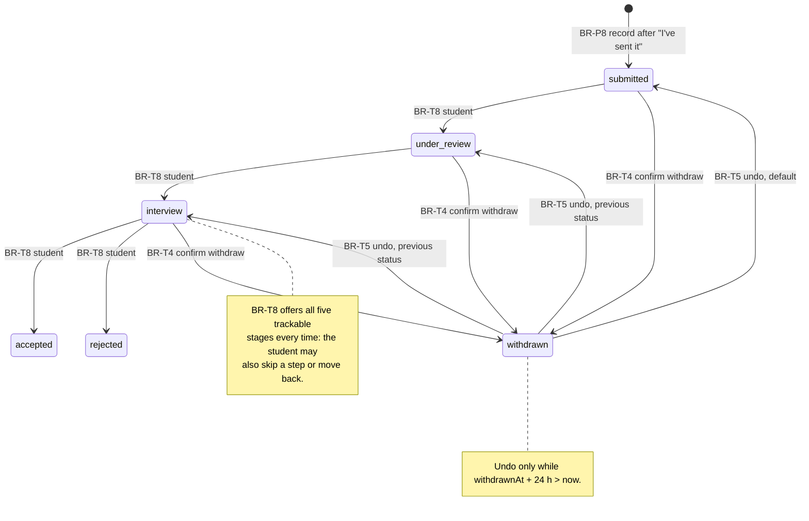

# Business Rules — User and Admin

Business rules for the two actors in Internly: the **student (User)** and the
**local Admin operator**. This document is the single place that ties actors,
swimlanes, branch points (`BR-xx`), the application state machine and the
tests together.

**Precedence.** Code is the source of truth. `docs/design/user-flow.md` still
describes the superseded Apply Form / blocking Validate CV gate (DC-27); the
current flow is the **email-based Compose application** (DC-31, architecture
§3). Where the two disagree, this document follows the code and links the
decision. Update this file in the same PR as the code or test.

Legend: **User** = signed-in student. **Admin** = operator of
`tools/admin-dashboard` on the local machine. **System** = app, Firebase,
Cloud Functions, external APIs.

The council-facing end-to-end view of these same rules — one actor/system map, the
student and admin swimlanes drawn as a single process, the exception branches, the
state machine and a branch ↔ state ↔ test table — is
[`business-process-swimlane.md`](business-process-swimlane.md). The rule text and the
full traceability matrix below stay the single source of truth.

## 1. Actors and systems in one diagram

```mermaid
flowchart LR
  subgraph ACT["Actors"]
    U["User (student)"]
    A["Admin (operator)"]
  end

  subgraph CLIENT["Client surfaces"]
    APP["Flutter app<br/>MVVM + Riverpod + go_router"]
    DASH["Admin dashboard<br/>Node server on 127.0.0.1"]
  end

  subgraph FB["Firebase project"]
    AUTH["Firebase Auth<br/>Google Sign-In"]
    FS["Cloud Firestore<br/>internships + users/&#123;uid&#125;<br/>incl. users/&#123;uid&#125;/cvs"]
    ST["Cloud Storage<br/>cvs/&#123;uid&#125; + reports/&#123;uid&#125;<br/>removed CV file kept while referenced"]
    RC["Remote Config"]
    FCM["FCM + Crashlytics"]
  end

  subgraph CF["Cloud Functions"]
    SYNC["syncInternshipsJob<br/>every 6 hours"]
    VAL["validateCv<br/>Gemini"]
    MATCH["matchCv<br/>Groq"]
    LETTER["composeCoverLetter<br/>Groq"]
    SELECT["selectCv<br/>Groq"]
  end

  subgraph EXT["External systems"]
    SERP["SerpAPI Google Jobs"]
    GEM["Gemini API"]
    GROQ["Groq API"]
    MAIL["Device email app"]
    EMP["Employer website"]
  end

  U --> APP
  A --> DASH

  APP --> AUTH
  APP --> FS
  APP --> ST
  APP --> RC
  APP --> FCM
  APP -->|callable| VAL
  APP -->|callable| MATCH
  APP -->|callable| LETTER
  APP -->|callable| SELECT
  APP -->|mailto| MAIL
  APP -->|external link| EMP

  DASH --> FS
  DASH --> AUTH
  DASH --> FCM

  SYNC --> SERP
  SYNC --> FS
  VAL --> ST
  VAL --> GEM
  MATCH --> ST
  MATCH --> FS
  MATCH --> GROQ
  LETTER --> ST
  LETTER --> FS
  LETTER --> GROQ
  SELECT --> ST
  SELECT --> FS
  SELECT --> GROQ
```

| Actor / system | Responsibility | Never does |
|---|---|---|
| User (student) | Signs in, searches, saves, applies by email, tracks and withdraws applications, manages Profile/CV library (add, set default, remove) | Writes the shared listing pool, changes another user's data, sends FCM |
| Admin (operator) | Runs the local dashboard: lists users, sends notifications to one/all, reads/deletes history, triggers a test crash | Authenticates end users, writes listings, publishes the server |
| Flutter app | Auth guard, UI, ViewModels, local validation, Firestore/Storage access, callables, deep links | Calls SerpAPI directly; holds server secrets |
| Admin dashboard server | Holds the service account, resolves recipients, calls FCM, reads/deletes history | Exposes the key to the browser; binds beyond `127.0.0.1` |
| Firebase | Auth, Firestore (`users/{uid}/cvs` included), Storage, Remote Config, FCM, Crashlytics | — |
| Cloud Functions | Scheduled SerpAPI sync; `validateCv`, `matchCv`, `composeCoverLetter`, `selectCv` | Write user data outside the verified caller UID |
| External | SerpAPI listings, Gemini/Groq model output, email app, employer site | — |

## 2. Swimlanes and branch points

### 2.1 User swimlane — Search → Apply (email) → Track

```mermaid
flowchart LR
  subgraph USER["User"]
    direction TB
    U0(["Open app"]) --> U1["Sign in with Google"]
    U1 --> U2["Home / Search / Filters"]
    U2 --> U3{"Listings found?"}
    U3 -- "No — BR-D4" --> U4["Clear filters"]
    U4 --> U2
    U3 -- "Yes" --> U5["Internship Detail"]
    U5 --> U6{"Already applied?<br/>BR-P2"}
    U6 -- "Yes" --> U7["View application"]
    U6 -- "No" --> U8["Apply now"]
    U8 --> U9["Review email draft"]
    U9 --> U10{"Recipient and draft ok?<br/>BR-P4 / BR-P5"}
    U10 -- "Invalid email" --> U9
    U10 -- "AI failed" --> U11["Template draft"]
    U11 --> U12
    U10 -- "Ok" --> U12["Open email app"]
    U12 --> U13{"Email app opened?<br/>BR-P6"}
    U13 -- "No" --> U14["Copy letter"]
    U14 --> U13
    U13 -- "Yes" --> U15["I've sent it"]
    U15 --> U16{"Name available?<br/>BR-P7"}
    U16 -- "No" --> U17["Add name in Profile"]
    U16 -- "Yes" --> U18["My Applications"]
    U18 --> U19["Application Detail"]
    U19 --> U20{"Update the stage?<br/>BR-T8"}
    U20 -- "Yes" --> U24["Update status → Save status"]
    U24 --> U19
    U20 -- "No" --> U25{"Withdraw?<br/>BR-T3"}
    U25 -- "Confirm — BR-T4" --> U21["Withdrawn"]
    U25 -- "Cancel" --> U19
    U21 --> U22{"Undo within 24 h?<br/>BR-T5"}
    U22 -- "Yes" --> U23["Previous status restored"]
    U22 -- "No" --> U19
    U7 --> U19
  end

  subgraph APP["Flutter app"]
    direction TB
    A1["authRedirect"]
    A2["Watch active listings"]
    A3["composeCoverLetter / template"]
    A4["Validate recipient + build mailto"]
    A5["createApplication"]
    A6["withdraw / undoWithdrawal"]
    A7["updateStatus"]
  end

  subgraph DATA["Firebase"]
    direction TB
    F1["Auth session"]
    F2["internships (read-only)"]
    F3["users/&#123;uid&#125;/applications"]
  end

  subgraph EXTERNAL["External"]
    direction TB
    X1["Scheduled SerpAPI sync"]
    X2["Groq draft"]
    X3["Email app"]
  end

  U1 -.-> A1 --> F1
  U2 -.-> A2 --> F2
  X1 --> F2
  U9 -.-> A3 --> X2
  U12 -.-> A4 --> X3
  U15 -.-> A5 --> F3
  U24 -.-> A7 --> F3
  U21 -.-> A6 --> F3
  F3 -.-> U18
```

The Compose flow starts from the **default** CV (`users/{uid}.cv`), asks
`selectCv` for the best match when the library has 2+ CVs, and lets the student
override the choice with `Change CV`; the Profile library in §2.3 is how the
default itself is chosen (BR-C5, BR-C6).

### 2.2 Admin swimlane — Notify, History, Crash

```mermaid
flowchart LR
  subgraph ADMIN["Admin"]
    direction TB
    D0["Open dashboard<br/>127.0.0.1"] --> D1{"Choose action"}
    D1 -- "Send" --> D2["Choose one user or all"]
    D2 --> D3{"Recipient has a token?<br/>BR-N3"}
    D3 -- "No" --> D4["409 + reason"]
    D3 -- "Yes" --> D5["Fill title, body, route"]
    D5 --> D6{"Route valid?<br/>BR-N4"}
    D6 -- "No" --> D7["400 + rule"]
    D6 -- "Yes" --> D8["Send"]
    D8 --> D9["Per-recipient result"]
    D1 -- "History" --> D10["Read or delete history"]
    D1 -- "Crash" --> D11{"Acknowledged and confirmed?<br/>BR-N8"}
    D11 -- "No" --> D1
    D11 -- "Yes" --> D12["Send data-only test_crash"]
  end

  subgraph SERVER["Dashboard server"]
    direction TB
    S1["resolveRecipients"]
    S2["deliver in chunks of 500"]
    S3["write history by message ID"]
  end

  subgraph FIREBASE["Firebase"]
    direction TB
    FB1["Auth + users collection"]
    FB2["FCM"]
    FB3["users/&#123;uid&#125;/notifications"]
  end

  subgraph DEVICE["User device"]
    direction TB
    V1["Notification or data-only command"]
    V2["Open route / Notification Center"]
    V3["Crashlytics fatal on next launch"]
  end

  D2 -.-> S1 --> FB1
  D8 -.-> S2 --> FB2
  S2 -.-> S3 --> FB3
  FB2 --> V1
  V1 --> V2
  D12 -.-> S2
  FB2 -.-> V3
```

### 2.3 User swimlane — Profile CV library

```mermaid
flowchart LR
  subgraph USER["User"]
    direction TB
    U0["Open Profile"] --> U1["CV library"]
    U1 --> U2{"Action"}
    U2 -- "Add CV" --> U3["Pick PDF"]
    U3 --> U4{"PDF ≤ 10 MB?<br/>BR-C2"}
    U4 -- "No" --> U5["Error: PDF ≤ 10 MB"]
    U5 --> U1
    U4 -- "Yes" --> U6["Upload and add to library"]
    U6 --> U7{"First CV?<br/>BR-C2"}
    U7 -- "Yes" --> U8["Becomes default"]
    U7 -- "No" --> U1
    U2 -- "Set as default" --> U9["Update defaultCvId + legacy mirror<br/>BR-C3"]
    U2 -- "Remove" --> U10{"Used by a submitted application?<br/>BR-C4"}
    U10 -- "Yes" --> U11["Remove entry, keep Storage file"]
    U10 -- "No" --> U12["Remove entry and Storage file"]
    U11 --> U13{"Was default?<br/>BR-C4"}
    U12 --> U13
    U13 -- "Yes" --> U14["Promote newest remaining"]
    U13 -- "No" --> U1
    U8 --> U1
    U9 --> U1
    U14 --> U1
  end

  subgraph APP["Flutter app"]
    direction TB
    A1["watchCvs"]
    A2["mergeLegacyCv + defaultCv"]
    A3["addCv / setDefaultCv / removeCv"]
  end

  subgraph DATA["Firebase"]
    direction TB
    F1["users/&#123;uid&#125;/cvs"]
    F2["cvs/&#123;uid&#125; (Storage)"]
  end

  U1 -.-> A1 --> F1
  A1 --> A2 --> U1
  U6 -.-> A3
  U9 -.-> A3
  U10 -.-> A3
  A3 --> F1
  U6 -.-> F2
  U12 -.-> F2
```

### 2.4 Application state machine

Only `submitted` is written by the Apply flow. `under_review`, `interview`,
`accepted` and `rejected` are **student-reported** from Application Detail
(`Update status`, BR-T8): the app has no employer or admin side, so it never
claims a transition on the company's behalf.

The picker lists every trackable stage, so the BR-T8 transitions are **not** a
strict ladder — only the forward arrows are drawn above to keep the diagram
readable. In practice the student can:

- jump a step (`Submitted → Interview`) when a company replies faster than the
  student updates the app;
- move back to correct a mistake (`Accepted → Under review`);
- change `accepted` / `rejected` to any other trackable stage, which is why
  neither has a terminal marker.

`withdrawn` is never offered by the picker: Withdraw (BR-T4) and Undo (BR-T5)
own that transition because they also write `withdrawnAt` and `previousStatus`.

## 3. Business rules

Each rule carries the branch point shown in the swimlanes. `BR-xx` is the ID
used by tests and code comments.

### 3.1 Access, identity and data ownership

| ID | Point | Rule | Exception / failure | Links |
|---|---|---|---|---|
| BR-A1 | App launch | Splash until the first auth event. Signed out → only `/login`. Signed in → app shell; Login and Splash are unreachable | Auth stream error → stay signed out and show Login | TC-01, TC-14 |
| BR-A2 | Google sign-in | Cancelled picker → info message, no error. Missing token / config / network → plain-language error. Capture `given_name` for the Home greeting | Any failure leaves the user signed out | TC-01 |
| BR-A3 | Sign-out | Clear the Firebase and Google sessions; every user-scoped provider rebuilds; Back or relaunch never shows a signed-in screen | Sign-out failure → error; do not fake success | TC-14 |
| BR-A4 | Data access | A user reads/writes only `users/{uid}/**` (Profile, `users/{uid}/cvs`, saved, applications, notifications); `/internships` is read-only; `/sync/**` is function-only; CV/report files are owner-only PDF ≤ 10 MB. A removed library CV keeps its Storage file while a submitted application references it | Rules deny → permission error with Retry/message; never retry with another path | `firebase/*.rules` |
| BR-A5 | Document parsing | Missing/wrong required field or unknown enum → skip + log (non-fatal); one malformed doc never hides the list. Malformed optional map → `null`, rest still loads | Non-fatal Crashlytics record; list continues | Model/service unit tests |

### 3.2 Discovery (Home, Search, Detail)

| ID | Point | Rule | Exception / failure | Links |
|---|---|---|---|---|
| BR-D1 | Listing pool | Only listings with `expiresAt > now` are readable. The scheduled function writes the pool every 6 h; the app never writes it | Empty pool → empty state, not an error | architecture §6, G-25 |
| BR-D2 | Home ranking | Recommended = preferred location (when set), then target roles, shared skills, experience tiebreak, then sync rank/recency. Limits come from Remote Config (`home_recommended_limit`, `home_recent_limit`). No profile → sync order | Remote Config unavailable → in-app defaults | TC-12, TC-16 |
| BR-D3 | Dedupe | Duplicate listing keys are removed before Home/Search renders | All duplicates → empty state | `distinctListings` tests |
| BR-D4 | Search / filters | Keyword, work mode, job type and skills (from the current pool) filter in memory. No result → `No internships found` + `Clear filters`, which restores the unfiltered list | Filter data missing → the filter is not offered | TC-03, TC-04 |
| BR-D5 | Detail unavailable | Expired/deleted listing → saved copy when one exists, otherwise `This internship is no longer available` + Back | Malformed listing treated as unavailable | TC-05 |
| BR-D6 | Load failure | Any list/detail failure → explicit error state + `Retry`; loading uses skeletons | Offline applications list may still show the Firestore cache (TC-10); no fake data | TC-04, TC-10 |

### 3.3 Saved internships

| ID | Point | Rule | Exception / failure | Links |
|---|---|---|---|---|
| BR-S1 | Save | Requires sign-in and the listing still existing in the pool. Saves a snapshot of the shown fields under `users/{uid}/savedInternships/{key}` | Listing gone → `This internship is no longer available`; no partial write | TC-08 |
| BR-S2 | Save idempotency | Document ID = listing key, so saving twice overwrites the same document; no duplicates. One job synced under several keys is one saved job (`jobIdentity`: folded title + company): a card or Detail of any copy shows `Saved`, and unsaving removes every saved copy (CR-07) | — | Saved service tests, `saved_viewmodel_test.dart` (CR-07 group), Search Results screen test |
| BR-S3 | Unsave + Undo | Unsave removes the item and shows a snackbar with `Undo`; Undo restores it | Undo after the snackbar expires is unavailable | TC-08, widget tests |
| BR-S4 | Save failure | Network/permission failure → message + `Retry`; the UI never shows `Saved` before the write succeeds | Repeated taps ignored while loading | TC-08 |

### 3.4 CV library (Profile)

| ID | Point | Rule | Exception / failure | Links |
|---|---|---|---|---|
| BR-C1 | Library read | Profile reads `users/{uid}/cvs` newest first and merges the legacy `users/{uid}.cv` mirror by `storagePath` (dedupe). Default = `defaultCvId` when it still exists, else the legacy mirror, else the newest CV. An unknown `defaultCvId` is ignored, never hides the library | Malformed CV document → skipped + logged; empty library → upload prompt | `cv_library.dart`, `user_profile_service.dart`, Profile tests |
| BR-C2 | Add CV | Accept PDF only, ≤ 10 MB, metadata under `users/{uid}/cvs`. With no library document the added CV becomes the default, unless a legacy `users/{uid}.cv` is migrated on that first write (the migrated CV keeps its default role). A malformed mirror is not migrated but adding still works | Oversize/wrong type rejected before upload (`The file must be a PDF of at most 10 MB`); upload/write failure → message + retry, no partial entry | `cv_library_viewmodel.dart`, `FileStorageService` |
| BR-C3 | Set default | Updates `defaultCvId` and mirrors the chosen CV into `users/{uid}.cv`, which is what Apply prefills. Only a document from the caller's own library can be chosen; the legacy pseudo-id sets `defaultCvId = null` | CV no longer in the library → not-found message; write failure → error, default unchanged | `setDefaultCv`, `cv_library_change` analytics |
| BR-C4 | Remove CV | Removes the entry (library document or legacy mirror). The Storage file is deleted **only** when no submitted application references its `storagePath` (`cvStoragePaths` guard); otherwise the file stays and the UI says it was kept for the application. Removing the default promotes the newest remaining CV (a surviving legacy mirror stays the default) | Reference check or metadata write fails → removal aborts with a message and the file stays; Storage delete failure after removal → entry already gone, orphan logged, no rollback | `removeCv`, `application_service.cvStoragePaths()` |
| BR-C5 | Apply CV choice and snapshot | Compose starts from the **default** CV (`users/{uid}.cv` mirror). With 2+ CVs it calls `selectCv` once and adopts the best match, showing the reason as a suggestion; `Change CV` lets the student choose another library CV for this application only and never changes the Profile default. With 0/1 CV, or when `selectCv` fails, the default applies. The chosen CV is snapshotted; with no CV the student can still send and CV checks remain optional | Default CV removed → new default (or none) is used next time; a CV removed while the screen is open falls back to the current default; already submitted applications keep their snapshot | BR-P3, BR-P8, BR-P9, BR-C6, TC-18, TC-19, `apply_compose_viewmodel.dart` |
| BR-C6 | `selectCv` callable | Server accepts 1–10 caller-owned `cvs/{uid}/…` paths, loads the internship and Profile skills, scores each readable CV deterministically and breaks ties toward the default; Groq only writes the reason and any model failure falls back to a deterministic sentence. Never blocks applying | Invalid/foreign path → `permission-denied`; 0 or >10 paths / missing internship → `invalid-argument` / `not-found`; client falls back to the default CV | `functions/src/select-cv.ts`, `cv_select_service.dart`, callable tests, `apply_compose_viewmodel.dart` |

### 3.5 Apply (email flow, DC-31)

| ID | Point | Rule | Exception / failure | Links |
|---|---|---|---|---|
| BR-P1 | One per listing | Document ID = `jobKey` under `users/{uid}/applications`; writing again overwrites, so a student cannot have two applications for one listing | Signed out → permission error | TC-06, application service tests |
| BR-P2 | Already applied | Detail shows `You applied on …` + `View application` instead of `Apply now`; cards show the `Applied` badge | Duplicate submit cannot start | TC-07 |
| BR-P3 | Compose prefill | Recipient is extracted from the JD only; a student-typed recipient wins. Applicant email = account email; name = Profile full name, else account display name; CV/profile fields used when present (CV = the auto-selected best match or the student's `Change CV` choice, default fallback, BR-C5) | No recipient found → empty `To`, allowed | TC-06, TC-18, TC-19 |
| BR-P4 | Recipient validation | A non-empty recipient must be a valid email before the mailto draft opens; invalid → inline error, no draft | Empty recipient is allowed; the letter can be copied | `apply_compose_viewmodel_test.dart` |
| BR-P5 | Draft generation | Groq drafts subject + letter from JD + Profile + CV. Blank key, model failure or unparseable output → deterministic template. Failure never blocks sending and never invents a recipient | User can edit the text before sending | TC-06, TC-18 |
| BR-P6 | Open email | `mailto:` carries To/Subject/Body. No email app → message + copy the letter; never claim it was sent | Failure does not record an application | TC-06, TC-18 |
| BR-P7 | Mark sent gate | `I've sent it` requires sign-in and a non-empty full name. If Profile and account have no name → `Add your name in Profile to record this application` | Listing missing → no record | TC-06, TC-18 |
| BR-P8 | Record application | On `I've sent it`: `status = submitted`, server `appliedAt`, snapshot of `title`/`companyName`, `applicant` snapshot, `appliedVia = email`, optional `recipientEmail`, and the chosen CV snapshot (auto-selected, manually changed, or default) only when a CV exists. The snapshot is independent of later library edits | Write failure → message + `Retry`; screen stays open | TC-06, TC-18, BR-C5 |
| BR-P9 | Validate CV (optional) | Current flow: an optional check from Compose, not a blocking gate. Server reads only the caller's own `cvs/{uid}/…`. Text < 50 chars or unreadable PDF → invalid without calling Gemini. Unparseable model output → fail open (valid). Provider failure → `unavailable`, never `invalid`. Text truncated to 12,000 chars | Wrong/other path → `permission-denied`; retry keeps the student on the step | `validate-cv` tests, DC-19/DC-31 |
| BR-P10 | CV match (optional) | Deterministic score plus local skill vocabulary; Groq only extracts/commentates. Model failure → vocabulary fallback; unreadable CV → Profile skills only. `Continue` is always enabled | `cv_match_enabled = false` hides the entry point | TC-06 note, match tests |
| BR-P11 | Success | Success appears only after the write is accepted; it recaps title + company and links to My Applications | Write rejected → no success screen | TC-06, TC-18 |
| BR-P12 | Cancel / back | Leaving Compose before `I've sent it` persists nothing; no application is recorded | — | Widget tests |

### 3.6 Track and withdraw

| ID | Point | Rule | Exception / failure | Links |
|---|---|---|---|---|
| BR-T1 | Status values | Exactly six: `submitted`, `under_review`, `interview`, `accepted`, `rejected`, `withdrawn`. Any other stored value makes the document malformed | Malformed → skipped + logged | TC-09, model tests |
| BR-T2 | List view | My Applications sorts by `appliedAt` descending. Count and status chips are derived from the loaded documents; a chip appears only for a status that exists | Empty → `You have not applied yet` + `Find internships` | TC-09 |
| BR-T3 | Withdraw eligibility | Withdraw is allowed only from `submitted`, `under_review` or `interview`; `accepted`, `rejected` and `withdrawn` cannot be withdrawn | Ineligible → no action button | TC-09, widget tests |
| BR-T4 | Withdraw write | Requires confirmation. Writes `status = withdrawn`, `withdrawnAt`, and keeps the replaced `previousStatus` | Write failure → named message ("could not withdraw…") + Retry | TC-09, widget tests |
| BR-T5 | Undo window | Undo is available only while `withdrawnAt + 24 h > now`. It restores `previousStatus` (default `submitted`) and clears `withdrawnAt`/`previousStatus` | After 24 h the Undo control is gone | Widget tests, DC-29 |
| BR-T6 | Submitted CV | The CV snapshot opens view-only; there is no `Replace CV` after submission. Removing that CV from the library never invalidates the snapshot: the Storage file is kept while any submitted application references it | File unavailable → viewer message; a removed library entry is not shown as an error | TC-07, TC-09, BR-C4 |
| BR-T7 | Live detail | Detail follows the live application document; `view_application` is logged once per open; load failure → error + Retry | Offline cache may keep the list (TC-10) | TC-09, TC-10 |
| BR-T8 | Student-reported stage | `Update status` on Application Detail writes one of `submitted`, `under_review`, `interview`, `accepted`, `rejected` plus server `statusUpdatedAt`, and logs `application_update`. The picker never offers `withdrawn` (Withdraw/Undo own it, so `previousStatus` stays meaningful), `Save status` is disabled while the picked stage equals the stored one, and a tracked application's tracker shows the date the student set the current step | Write failure → message in the sheet + the sheet stays open; signed out or a stale document → the write is refused, nothing is faked | TC-09, `application_detail_viewmodel_test.dart`, `application_detail_screen_test.dart` |

### 3.7 Admin and notifications

| ID | Point | Rule | Exception / failure | Links |
|---|---|---|---|---|
| BR-N1 | Admin security | The dashboard binds `127.0.0.1` only, has **no authentication** and is never deployed. The service-account key lives outside the repo; the browser never receives it | Missing key → header `No credential`; API returns 503 with the expected path | dashboard README |
| BR-N2 | Users list | Firestore `users` joined with Firebase Auth. Signed-in accounts without a profile are shown with `token = null`; Auth API failure still returns Firestore users plus a warning | No token is shown, never hidden | `GET /api/users` |
| BR-N3 | Recipient resolution | Exactly one valid `uid`, or `all`. `all` reads at most 1,000 user documents and keeps only non-empty unique tokens; duplicate tokens are sent once. Zero recipients → HTTP 409 with the reason | Missing/invalid uid → HTTP 400 | TC-13, dashboard tests |
| BR-N4 | Message validation | Title required and ≤ 200 chars; body optional and ≤ 1,000 chars. Route is optional, must be an absolute in-app path under `/home`, `/search`, `/saved`, `/applications` or `/profile`; URLs or other prefixes → HTTP 400 | Invalid route would open the wrong screen, so it is rejected | dashboard tests |
| BR-N5 | Delivery | Messages are sent in chunks of 500 (FCM multicast limit). Each recipient gets a success/failure result; one failure does not abort the batch | FCM error codes are returned per recipient | dashboard tests |
| BR-N6 | History write | When history is enabled (default), one document per successful send, ID = trailing FCM message ID, `read = false`. Server and app writes merge | History write failure is returned as `historyError`; the already-delivered send is not reported as failed | TC-13, dashboard tests |
| BR-N7 | History read/delete/read state | App reads newest first, limit 50; tapping an item marks it read after opening (never blocks opening, a failed write leaves the dot and can be retried). `Mark all as read` is offered only while something is unread and writes one batch (at most the 50 shown, under the 500-write limit) so either all dots clear or none do. Admin reads up to 500 and can delete one entry or clear a list in batches of 500 | Malformed history doc → skipped; a failed batch leaves every dot and the action available | TC-13, notification tests, DC-34 |
| BR-N8 | Crash command | `POST /api/test-crash` sends a data-only FCM message `type = test_crash`, `source = admin_dashboard`, no `notification` block. The UI requires an acknowledgement checkbox and a confirmation dialog. No notification/history document is written. The app crashes before its notification handlers run; the fatal report uploads on the next launch | Offline / no Play services → command not delivered; no fake crash | Run 33, admin crash tests |
| BR-N9 | Permission | Android 13+ runtime prompt; denied → no notifications, the rest of the app still works | Permission request failure → treated as denied | TC-15 |
| BR-N10 | Token lifecycle | Store `fcmToken` + `fcmTokenUpdatedAt` on `users/{uid}` at sign-in and on refresh. Sign-out drops user-scoped data | No token / stale token → dashboard 409 or `registration-token-not-registered` | TC-13, FCM evidence |
| BR-N11 | Deep link | A tapped notification opens the route only when it is an absolute path under a known tab; otherwise the Notification Center | External URL / unknown path → Notification Center | TC-13 |
| BR-N12 | Remote Config | Defaults load before `runApp`; fetched values update in the background. Flags used: `home_recommended_limit`, `home_recent_limit`, `cv_match_enabled` | Fetch failure → in-app defaults, no crash | TC-12 |
| BR-N13 | Unread badge | Every tab header bell shows the unread count from the **same** newest-50 history stream as the Notification Center, so badge and list always agree. Count 1–9 shows the number, > 9 shows `9+`, 0 hides the badge. The dot is never the only unread signal: the tile semantics say `Unread` and the title is bolded | History load error → no badge (the Notification Center shows the error + Retry); sign-out → 0 | DC-34, `unread_notifications_provider.dart`, `main_tab_app_bar.dart` |

## 4. Important exception branches

| # | Branch | Detection | Required behaviour | BR |
|---|---|---|---|---|
| E1 | No search results | Result list empty | `No internships found` + `Clear filters`; clearing restores results | BR-D4 |
| E2 | Listing expired | `watchByKey` returns `null` | Saved copy if present, else unavailable + Back | BR-D5 |
| E3 | Already applied | Application document exists for `jobKey` | Replace `Apply now` with `You applied on …` + `View application` | BR-P2 |
| E4 | Invalid recipient | Email validator fails | Inline error; mailto is not opened | BR-P4 |
| E5 | AI draft unavailable | Blank key / model error / unparseable JSON | Deterministic template; sending stays possible | BR-P5 |
| E6 | No email app | `url_launcher` failure | Message + copy letter; nothing recorded | BR-P6 |
| E7 | Missing applicant name | Profile name and account name empty | Block recording, ask for the name in Profile | BR-P7 |
| E8 | Unusable CV (optional check) | < 50 extracted chars or unreadable PDF | Invalid + reason + retry; no Gemini call | BR-P9 |
| E9 | CV check provider down | Gemini call fails | `CV validation is unavailable` + Retry; never "invalid" | BR-P9 |
| E10 | Model output not JSON | Parse fails | Fail open (do not block the student) | BR-P9 |
| E11 | Withdraw ineligible | Status accepted/rejected/withdrawn | No withdraw action | BR-T3 |
| E12 | Undo window closed | `now >= withdrawnAt + 24 h` | No Undo control; status stays withdrawn | BR-T5 |
| E13 | Admin: no token | `fcmToken` empty | HTTP 409 with the reason; send is not attempted | BR-N3 |
| E14 | Admin: bad route | Prefix/URL validation fails | HTTP 400; message is not sent | BR-N4 |
| E15 | Admin: history write fails | Firestore batch error | Return `historyError`; the delivered send is still reported as delivered | BR-N6 |
| E16 | Notification denied | Permission denied | App works without notifications | BR-N9 |
| E17 | Stale token | FCM returns registration-token-not-registered | Per-recipient error; app refreshes the token on next launch | BR-N10 |
| E18 | Malformed document | Required field/enum invalid | Skip + log; the rest of the list renders | BR-A5 |
| E19 | CV too large / wrong type | PDF check or `> 10 MB` fails | Reject before upload; library unchanged; show the size/type message | BR-C2 |
| E20 | Legacy CV mirror malformed | `users/{uid}.cv` fails to parse | Do not migrate it; adding the new CV still succeeds | BR-C2 |
| E21 | Remove a CV used by an application | `cvStoragePaths` contains the path | Remove only the library entry, keep the Storage file, show the "kept for that application" notice | BR-C4, BR-T6 |
| E22 | Remove the default CV | Removing the default and another CV remains | Promote the newest remaining CV; a surviving legacy mirror stays the default | BR-C4 |
| E23 | `selectCv` invalid paths | 0 or > 10 paths, or a path outside `cvs/{uid}/` | `invalid-argument` / `permission-denied`; use the default CV; applying is not blocked | BR-C6 |
| E24 | `selectCv` model/library failure | Internship missing or Groq fails | `not-found` or deterministic fallback reason; never blocks applying | BR-C6 |
| E25 | Mark all as read fails | Firestore batch commit fails | Every dot stays; the action remains available for a retry | BR-N7 |
| E26 | History load fails | Notifications stream error | No unread badge; the Notification Center shows error + Retry | BR-N13 |

## 5. Traceability: BR ↔ state ↔ test ↔ code

| BR | State / result | Test case or test file | Code / doc |
|---|---|---|---|
| BR-A1 | signed out / signed in | TC-01, TC-14 | `lib/app/router.dart` (`authRedirect`) |
| BR-A2 | signed in / cancelled | TC-01 | `lib/services/auth_service.dart` |
| BR-A3 | signed out | TC-14 | `lib/services/auth_service.dart`, providers watching `currentUserIdProvider` |
| BR-A4 | — | Rules tests / manual | `firebase/firestore.rules`, `firebase/storage.rules` |
| BR-A5 | — | Model/service unit tests | `lib/core/firestore_reader.dart` and model tests |
| BR-D1 | pool active | TC-03, TC-05 | `lib/services/internship_service.dart`, `functions/src/sync.ts` |
| BR-D2 | Home feed | TC-12, TC-16 | `lib/features/home/viewmodels/home_viewmodel.dart` |
| BR-D3 | deduped list | Search/Home tests | `lib/core/utils/recommendation.dart` |
| BR-D4 | empty / results | TC-03, TC-04 | `lib/features/internships/` |
| BR-D5 | unavailable | TC-05 | `lib/services/internship_service.dart` |
| BR-D6 | loading / error | TC-04, TC-10 | Shared `ViewState` + `StateView` |
| BR-S1 | saved | TC-08 | `lib/services/saved_internship_service.dart` |
| BR-S2 | saved (idempotent) | Saved service tests | same |
| BR-S3 | removed / restored | TC-08, widget tests | `lib/features/saved/` |
| BR-S4 | error | TC-08 | same |
| BR-C1 | library + default | `cv_library_test.dart`, `profile_viewmodels_test.dart` | `lib/core/utils/cv_library.dart`, `user_profile_service.dart` |
| BR-C2 | added / first default | `profile_viewmodels_test.dart`, `profile_screen_test.dart` | `cv_library_viewmodel.dart`, `addCv` |
| BR-C3 | default changed | `profile_viewmodels_test.dart` | `setDefaultCv`, `cv_library_change` analytics |
| BR-C4 | removed / file kept | `profile_viewmodels_test.dart`, `profile_screen_test.dart` | `removeCv`, `ApplicationService.cvStoragePaths` |
| BR-C5 | auto-select / manual choice / default fallback | TC-06, TC-18, TC-19, `profile_viewmodels_test.dart`, `apply_compose_viewmodel_test.dart`, `apply_compose_screen_test.dart` | `apply_compose_viewmodel.dart`, BR-P8 |
| BR-C6 | scored CV / fallback | `functions/src/select-cv.test.ts`, `apply_compose_viewmodel_test.dart` | `select-cv.ts`, `cv_select_service.dart`, `apply_compose_viewmodel.dart` |
| BR-P1 | submitted | TC-06 | `lib/services/application_service.dart` |
| BR-P2 | already applied | TC-07 | `lib/features/internships/` detail |
| BR-P3 | draft prefilled | TC-06, TC-18, TC-19 | `apply_compose_viewmodel.dart` |
| BR-P4 | invalid recipient | `apply_compose_viewmodel_test.dart` | `lib/core/utils/validators.dart` |
| BR-P5 | draft / template | TC-06, TC-18 | `functions/src/compose-cover-letter.ts` |
| BR-P6 | mail open / copy | TC-06, TC-18 | `lib/core/utils/mailto.dart`, `ExternalLinkService` |
| BR-P7 | name gate | TC-06, TC-18 | `apply_compose_viewmodel.dart` |
| BR-P8 | submitted | TC-06, TC-18 | `ApplicationService.createApplication` (chosen CV snapshot) |
| BR-P9 | valid / invalid / unavailable | `functions` `validate-cv` tests | `functions/src/validate-cv.ts`, `cv-shared.ts` |
| BR-P10 | match / fallback | Match tests | `functions/src/match-cv.ts`, `match-cv-score.ts` |
| BR-P11 | submitted | TC-06, TC-18 | Application Success screen |
| BR-P12 | no record | Widget tests | Compose screen |
| BR-T1 | six states | TC-09, model tests | `lib/models/internship_application.dart` |
| BR-T2 | list | TC-09 | `my_applications_viewmodel.dart` |
| BR-T3 | withdraw guard | TC-09, widget tests | `ApplicationStatus.canWithdraw` |
| BR-T4 | submitted → withdrawn | TC-09 | `ApplicationService.withdraw` |
| BR-T5 | withdrawn → previous | Widget tests | `ApplicationDetailViewModel.undoWithdrawal` |
| BR-T6 | view-only CV | TC-07, TC-09 | `ApplicantCard`; snapshot survives library removal (BR-C4) |
| BR-T7 | live detail | TC-09, TC-10 | `application_detail_viewmodel.dart` |
| BR-T8 | student-set stage | TC-09, `application_detail_viewmodel_test.dart`, `application_detail_screen_test.dart` | `ApplicationService.updateStatus`, `ApplicationStatus.trackable`, `UpdateStatusSheet` |
| BR-N1 | local only | Manual | `tools/admin-dashboard/README.md`, `server.js` |
| BR-N2 | users list | Dashboard tests | `GET /api/users` |
| BR-N3 | recipients | TC-13, dashboard tests | `resolveRecipients` |
| BR-N4 | message | Dashboard tests | `validateRoute`, `requireText` |
| BR-N5 | delivery | Dashboard tests | `deliver` (chunks of 500) |
| BR-N6 | history | TC-13, dashboard tests | `POST /api/send` |
| BR-N7 | history + read state | TC-13, `notification_center_viewmodel_test.dart` | `GET/DELETE /api/notifications`, `markRead`, `markAllRead` |
| BR-N8 | crash | Run 33, crash coordinator test | `POST /api/test-crash`, `NotificationService` |
| BR-N9 | permission | TC-15 | `NotificationService.requestPermission` |
| BR-N10 | token | TC-13, FCM evidence | `NotificationService.saveToken` |
| BR-N11 | deep link | TC-13 | `lib/core/utils/notification_target.dart` |
| BR-N12 | flags | TC-12 | `lib/services/remote_config_service.dart` |
| BR-N13 | unread badge | `unread_notifications_provider_test.dart`, `notification_center_screen_test.dart` | `unread_notifications_provider.dart`, `main_tab_app_bar.dart` |

## 6. Known gaps and decisions

| Item | Impact on these rules | Status |
|---|---|---|
| G-25 #6: no employer/admin screen sets `under_review` … `rejected` | Resolved for the app: BR-T8 adds the student-facing `Update status` writer, so the stages no longer need the console (DC-35). The app still never claims an employer event, it only records what the student reports | Resolved (app writer) |
| BR-T8 writes only `status` + `statusUpdatedAt` | A status change does not touch the CV/applicant snapshot or `appliedAt`, so tracking never rewrites what was sent; `withdrawn` stays on BR-T4/T5 | Applied |
| DC-31: email-based Apply replaces the Apply Form and the blocking Validate CV gate | BR-P9 is optional/advisory, unlike the older `user-flow.md` wording | Applied (code is current) |
| Admin dashboard has no authentication (BR-N1) | Acceptable only because it is local and never deployed; do not expose the port | Open by design |
| DC-29: tracker, withdraw and undo follow the student's own status | BR-T5 restores the status that was replaced | Applied |
| G-24: job-specific CV suggestions | BR-P10 is a quality aid only, not a requirement | Resolved |
| CV library decision (recorded as G-33 on `feat/cv-library`) | BR-C1..C5 describe the library and the legacy `users/{uid}.cv` mirror; BR-C5/BR-C6 are now wired into Compose auto-select and `Change CV` | Applied |
| G-33 ID collision in `dev` docs | `handoff-gaps.md` G-33 is the email-Apply decision, while `architecture.md` cites G-33 for the CV library; the CV-library entry was lost in the merge. BR-C1..C5 therefore stand on their own | Open (docs cleanup) |
| DC-31 / DC-34 definition rows missing from `design-traceability.md` §4 | Both IDs are referenced by other docs (Compose, unread badge) but have no §4 row after the merge; DC-35 records the Compose CV choice | Open (docs cleanup) |
| `selectCv` callable and `CvSelectService` had no screen caller | Compose now calls `selectCv` once before drafting when the library has 2+ CVs (BR-C5/BR-C6) | Resolved |
| CV library has unit/widget tests but no ARTEMIS E2E | BR-C1..C5 are verified by `profile_viewmodels_test.dart` / `profile_screen_test.dart` only | Open |
| DC-34: unread badge and `Mark all as read` | BR-N7 and BR-N13; badge and list share the same newest-50 stream | Applied (definition row missing, see above) |

## 7. Maintenance

1. Change a rule in code + this document in the same PR; keep the `BR-xx` ID
   stable once a test or code comment references it.
2. Add the new test case to `docs/test-plan.md` (TC-xx) and the row in §5.
3. If a branch in the swimlane changes, update the diagram and the exception
   catalogue together.
4. Never renumber `BR-xx`; deprecate it instead and add a replacement ID.
