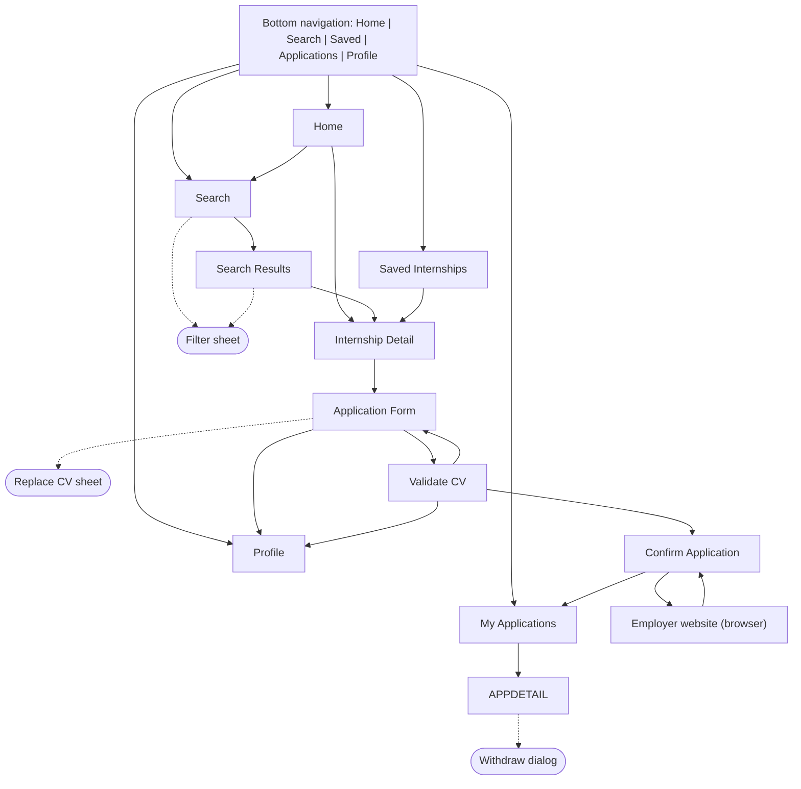
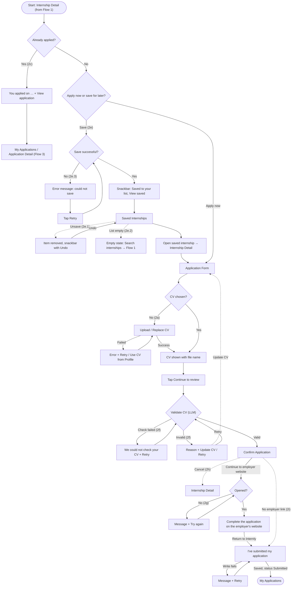

# Internship Finder — UX Analysis, Information Architecture and User Flows

> **Lab 3 revision (2026-10-21, DC-08 / DC-09).** This copy no longer matches Lab 2 commit `03f4aa3`. The three main flows are now **Search → Apply → Track**. *Save Internship* is a sub-flow inside Apply (2e): students save after searching and apply from Saved before tracking. Apply gained a **CV match check** step (2d) that shows unmatched requirements and suggests improvements. The CV match check needs Figma frames (handoff-gaps G-24). **Update 2026-11-03 (DC-27):** the Apply flow now continues with the generic **Validate CV** gate (LLM) and **Confirm Application**, then finishes on the employer's own website and returns to My Applications. The separate CV Match Check / Application Review / Application Success screens are no longer part of the flow.

This document follows `persona.md` (persona Minh, problem statement and success criterion), `DESIGN.md` (navigation and component rules) and `screen-spec.md` (screen purposes).

| Flow | Name | Main path | Goal | Alternative / error path |
|---|---|---|---|---|
| Flow 1 | Search Internship | Home → Search → Filter → Search Results → Internship Detail | Find an internship that matches skills and work mode | No results → Clear filters; results or detail fail to load → Retry |
| Flow 2 | Apply Internship | Internship Detail → Apply → Application Form → CV → CV Match Check → Review → Submit → Success | Submit a complete application with a CV that fits the role | CV upload failed → Retry; empty profile → inline validation; already applied; CV gaps → improve or continue; **save for later → Saved Internships → apply later (sub-flow)** |
| Flow 3 | Track Application | My Applications → Application Detail → View Application Status | Track the status of a submitted application | No applications → Empty state → Browse internships; load errors → Retry; withdraw + Undo |

Alternative and error branches are numbered under their main flow (Flow 1a, 1b, …). Sub-steps of a sub-flow use a second level (2e.1, 2e.2, …).

## 1. Information Architecture

### 1.1 Screen inventory

| # | Screen | Level | Reached from | Used by flow |
|---|---|---|---|---|
| 1 | Home | Top-level (tab: Home) | App launch, bottom navigation, Application Success → `Back to Home` | 1 (start), 2e |
| 2 | Search | Top-level (tab: Search) | Bottom navigation, Home search field, empty states (`Search internships`, `Find internships`) | 1, 2e.2, 3a |
| 3 | Search Results | Nested under Search | Search (submit query or apply filters) | 1, 2e |
| 4 | Internship Detail | Nested | Search Results card, Home card, Saved card | 1 (end), 2 (start), 2e |
| 5 | Saved Internships | Top-level (tab: Saved) | Bottom navigation, Save confirmation snackbar | 2e |
| 6 | Application Form | Nested under Internship Detail | Internship Detail → `Apply now` | 2 |
| 7 | Validate CV *(Lab 3, replaces CV Match Check)* | Nested under Application Form | Application Form → `Continue to review` | 2 (2f) |
| 8 | Confirm Application | Nested under Validate CV | Validate CV (valid CV continues automatically) | 2 |
| 9 | Employer website *(external)* | Device browser | Confirm Application → `Continue to employer website` | 2 (end, returns to 8) |
| 10 | My Applications | Top-level (tab: Applications) | Bottom navigation, Confirm Application → `I've submitted my application` | 3 (start) |
| 11 | Application Detail | Nested under My Applications | My Applications card, Internship Detail (already applied) → `View application` | 2 (optional), 3 (end) |
| 12 | Profile | Top-level (tab: Profile) | Bottom navigation, Application Form → `Edit profile` | 2 (alternative) |

Overlays and states (not counted as separate screens): Filter bottom sheet (Search, Search Results), Replace CV sheet used for CV upload (Application Form, Validate CV), University picker (Application Form), Document viewer for CV preview (Application Form, Confirm Application; view only from Application Detail because the submitted CV can no longer be replaced), Withdraw confirmation dialog (Application Detail).

### 1.2 Navigation structure

Rules:

- Five top-level destinations stay in the bottom navigation with the same names and order on every top-level screen: Home, Search, Saved, Applications, Profile.
- Nested screens use the app bar back button. Back returns to the previous screen in the same flow.
- During Application Form, Validate CV and Confirm Application the bottom navigation is hidden to keep the student focused on finishing the application.
- Every screen above is used by at least one flow (see section 3).

## 2. User Flows

All flows target persona Minh (third-year IT student, one-handed Android use, unstable campus network). The flows form one journey: **search** (Flow 1) → **apply**, now or later via Saved (Flow 2) → **track** (Flow 3).

### Flow 1 — Search Internship

| Item | Description |
|---|---|
| Start | Home |
| Goal | Find an internship that matches the student's skills and work mode |
| End | Internship Detail, where the student decides to apply now or save for later (both continue in Flow 2) |
| Happy path | Home → Search → type a keyword or skill → Filter sheet (work mode, skills) → `Show results` → Search Results → tap an Internship Card → Internship Detail |
| Flow 1a — Alternative | No results → empty state `No results found` → `Clear filters` → results |
| Flow 1b — Error / recovery | Search Results fail to load → error state + `Retry` → loading skeleton → Search Results |
| Flow 1c — Error / recovery | Internship Detail fails to load → error state + `Retry` → loading skeleton → Internship Detail |

### Flow 2 — Apply Internship (includes the Save sub-flow, Validate CV and the employer website)

| Item | Description |
|---|---|
| Start | Internship Detail (end of Flow 1), or a saved internship opened from Saved Internships (2e) |
| Goal | Submit an application with a usable CV, finish it on the employer's website, and keep a trackable record |
| End | My Applications, with the application recorded as `Submitted` (optional next step: Application Detail, Flow 3) |
| Happy path | Internship Detail → `Apply now` → Application Form prefilled from Profile, CV from Profile → `Continue to review` → **Validate CV** (LLM gate, valid) → **Confirm Application** → `Continue to employer website` → complete the form on the employer's site → return to Internly → `I've submitted my application` → My Applications |
| Flow 2a — Error / recovery | CV upload fails → plain-language error + `Retry` (or `Use CV from Profile`) → upload succeeds → continue |
| Flow 2b — Alternative | Profile has no saved data → the CV section asks for a CV → student uploads one → continue |
| Flow 2c — Alternative | Student opens an internship they already applied to → Internship Detail shows `You applied on …` and `View application` instead of `Apply now` (no duplicate application) → My Applications; the submitted CV opens view only. In Search Results the card shows an `Applied` badge |
| Flow 2e — Sub-flow: Save for later | After searching, the student saves instead of applying: bookmark on a Home / Search Results card or `Save` in Internship Detail → snackbar `Saved to your list` + `View saved` (hides after 3 s) → **Saved Internships** → open the saved internship → Internship Detail → `Apply now` → continues on the happy path |
| Flow 2e.1 — Alternative | Saved Internships → `Unsave` → item removed, snackbar `Removed from Saved` + `Undo` → `Undo` puts the item back |
| Flow 2e.2 — Alternative | No saved internships → empty state `No saved internships yet` → `Search internships` → Search (Flow 1) |
| Flow 2e.3 — Error / recovery | Save fails (network) → error message → `Retry` → saved |
| Flow 2f — Error / recovery | **CV invalid or unreadable** → Validate CV shows the reason with `Update CV` (back to the Apply Form) and `Retry`; the student replaces the CV and the check runs again. If the check itself cannot run (no connection) → `We could not check your CV` + `Retry`, never “invalid” |
| Flow 2g — Error / recovery | **Redirect fails** (no browser, bad link) → Confirm Application shows the message + `Try again` |
| Flow 2h — Alternative | **User cancels** on Validate CV or Confirm Application → back to Internship Detail; no application is recorded |
| Flow 2i — Alternative | The listing shares **no employer link** → Confirm Application says so; `Mark as applied` still records the application (and `Open listing on Google Jobs` opens `share_link` when present) |
| Other alternatives | Preview the CV in Document viewer; update stored data in Profile |

#### Validate CV: what it checks (G-24, DC-19)

| Item | Rule |
|---|---|
| How | The selected PDF's text is read server-side by the callable `validateCv` and judged by Gemini (free tier) with a fixed, non-job-specific rubric |
| Valid | Readable text that clearly comes from a CV: contact details plus at least one of work experience, education, projects or skills |
| Invalid | A cover letter, an unrelated document, random text or unreadable text → one short reason in plain language |
| Shown | `Checking your CV…` → `Your CV looks good` (continues automatically on Confirm Application) or `We could not use this CV` + reason + `Update CV` / `Retry`; a check that cannot run says `We could not check your CV`, never “invalid” |
| Blocking | Yes: an unusable CV cannot reach Confirm Application until it is replaced or the check is retried |
| Privacy | The step says `For this check, text from your CV is sent to our server.` |
| Job matching | Not part of this gate. The Skill match on Internship Detail compares Profile skills with the listing; job-specific CV suggestions remain open (G-24) |

### Flow 3 — Track Application

| Item | Description |
|---|---|
| Start | Bottom navigation → Applications (or `View application` at the end of Flow 2) |
| Goal | Track the status of a submitted application |
| End | Application Detail showing the status label |
| Happy path | My Applications → Application Detail → view the application status |
| Flow 3a — Alternative | No applications yet → empty state → `Find internships` → Search (start of Flow 1) |
| Flow 3b — Error / recovery | My Applications fails to load → error state + `Retry` → loading skeleton → My Applications |
| Flow 3c — Error / recovery | Application Detail fails to load → error state + `Retry` → loading skeleton → Application Detail |
| Flow 3d — Alternative | Withdraw an application → confirmation dialog (`Confirm` or `Cancel`) → status `Withdrawn`, snackbar `Application withdrawn` + `Undo` |

## 3. Flow-to-Screen Mapping

| Screen | Flow 1: Search | Flow 2: Apply (incl. 2e Save) | Flow 3: Track | Overlay or state used |
|---|---|---|---|---|
| Home | Yes (start) | 2e (save from card) | — | Loading, populated, error |
| Search | Yes | 2e.2 (empty Saved target) | 3a (empty-state target) | Default, Filter sheet |
| Search Results | Yes | 2c (applied badge), 2e (save from card) | — | Loading, populated, empty, error, applied badge, saved card, Filter sheet |
| Internship Detail | Yes (end) | Yes (start), 2c, 2e | — | Loading, populated, expanded, saved, already applied, error |
| Saved Internships | — | 2e (sub-flow) | — | Loading, populated, empty, removed + Undo |
| Application Form | — | Yes | — | Prefilled, no CV, CV uploading, CV upload failed, Replace CV sheet, University picker, Document viewer |
| Validate CV | — | Yes (2f) | — | Checking, valid (continues), invalid + reason, check failed |
| Confirm Application | — | Yes, 2g–2i | — | Ready, opening the website, waiting for return, returned, saving, redirect failed, save failed |
| Employer website *(external)* | — | Yes (end) | — | Device browser, outside Internly |
| My Applications | — | Yes (end, recorded `Submitted`) | Yes (start) | Loading, populated, empty, error |
| Application Detail | — | Optional (`View application`; 2c) | Yes (end) | Loading, populated (submitted, under review), error, Withdraw dialog, Document viewer (view only) |
| Profile | — | Alternative (`Edit profile`) | — | Populated, validation error |

## 4. Success Criterion Check

| Persona success criterion | Where it is tested |
|---|---|
| Find an internship by skill and work mode in under 30 seconds | Flow 1: Home → Search → Filter sheet → Search Results |
| Submit an application from Internship Detail in under 2 minutes | Flow 2: Internship Detail → Validate CV → Confirm Application → My Applications (the LLM check must not push the flow over 2 minutes) |

## 5. Error and Recovery Summary

| Where | What goes wrong | Recovery |
|---|---|---|
| Search Results | No matching results (Flow 1a) | `Clear filters` |
| Search Results | List fails to load (Flow 1b) | Error state + `Retry` |
| Internship Detail | Detail fails to load (Flow 1c) | Error state + `Retry`, then loading skeleton |
| Internship Detail | Student opens an internship they already applied to (Flow 2c) | `Apply now` is replaced by `You applied on …` + `View application`, so a duplicate application cannot be sent |
| Application Detail | Student tries to change the CV after submitting | Submitted CV opens in a view-only Document viewer (no `Replace CV`) |
| Application Form | CV upload fails (Flow 2a) | Plain-language cause + `Retry`, or `Use CV from Profile` |
| Validate CV | CV is not a usable CV (Flow 2f) | Reason + `Update CV` (back to the form) / `Retry`; Confirm is unreachable until it passes |
| Validate CV | The check cannot run (Flow 2f) | `We could not check your CV` + `Retry` (never “invalid”) |
| Confirm Application | The employer website cannot open (Flow 2g) | Message + `Try again` |
| Confirm Application | The student cancels (Flow 2h) | Returns to Internship Detail; nothing is recorded |
| Confirm Application | Listing has no employer link (Flow 2i) | `Mark as applied` records the application; `Open listing on Google Jobs` when `share_link` exists |
| Confirm Application | Recording the application fails | Message + `Retry`; the screen stays open |
| Internship Detail, cards | Save fails (Flow 2e.3) | Error message + `Retry` |
| Saved Internships | Unsave by mistake (Flow 2e.1) | Undo snackbar |
| My Applications | List fails to load (Flow 3b) | `Retry` |
| Application Detail | Detail fails to load (Flow 3c) | Error state + `Retry`, then loading skeleton |
| Application Detail | Withdraw by mistake (Flow 3d) | Confirmation dialog with `Cancel`; after confirming, `Undo` in the snackbar |
