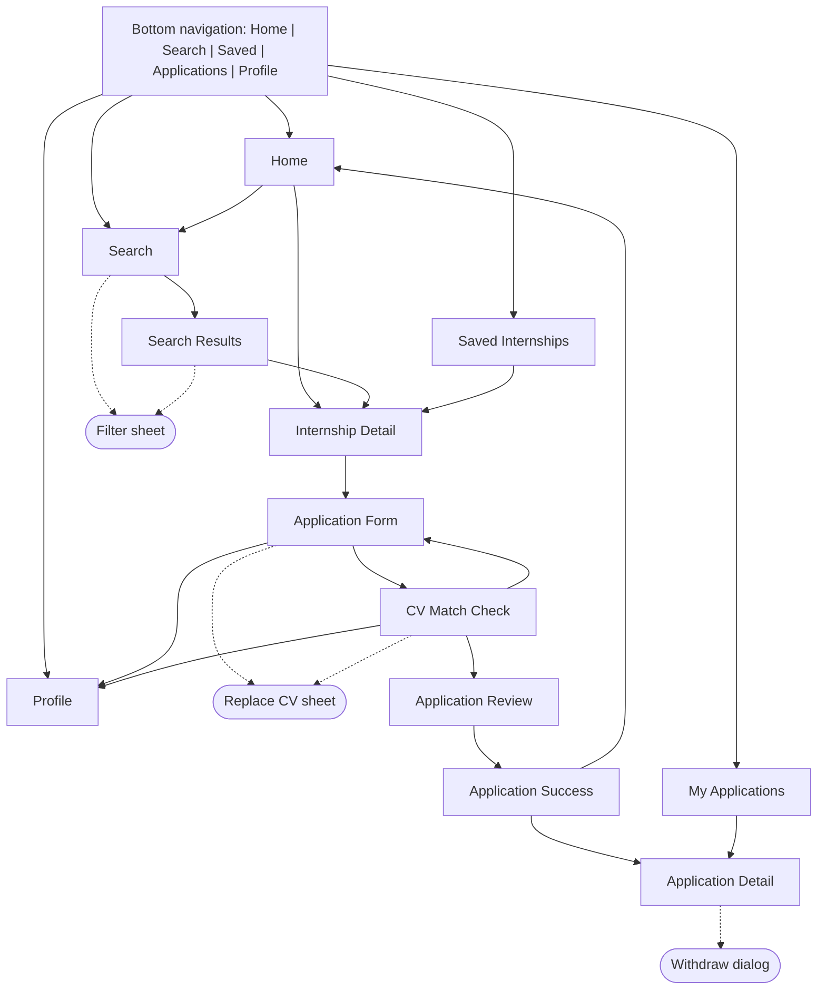
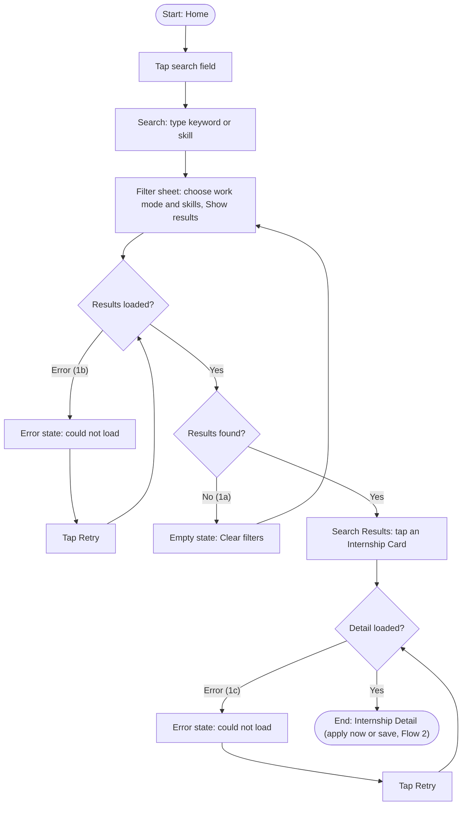
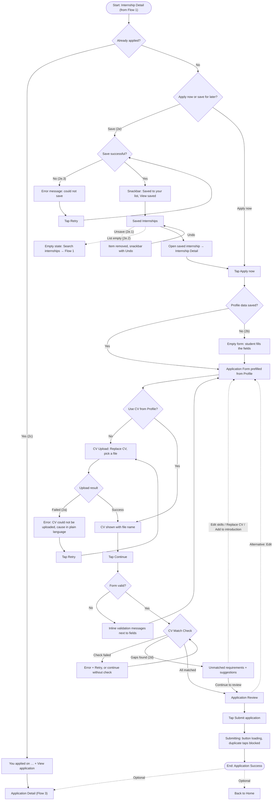
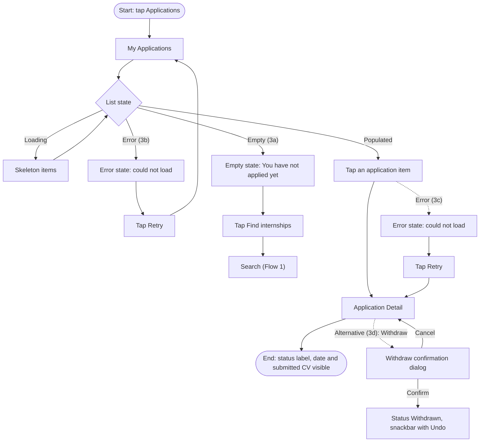

# Internship Finder — UX Analysis, Information Architecture and User Flows

> **Lab 3 revision (2026-10-21, DC-08 / DC-09).** This copy no longer matches Lab 2 commit `03f4aa3`. The three main flows are now **Search → Apply → Track**. *Save Internship* is a sub-flow inside Apply (2e): students save after searching and apply from Saved before tracking. Apply gained a **CV match check** step (2d) that shows unmatched requirements and suggests improvements. The CV match check needs Figma frames (handoff-gaps G-24).

This document follows `persona.md` (persona Minh, problem statement and success criterion), `DESIGN.md` (navigation and component rules) and `screen-spec.md` (screen purposes).

| Flow | Name | Main path | Goal | Alternative / error path |
|---|---|---|---|---|
| Flow 1 | Search Internship | Home → Search → Filter → Search Results → Internship Detail | Find an internship that matches skills and work mode | No results → Clear filters; results or detail fail to load → Retry |
| Flow 2 | Apply Internship | Internship Detail → Apply → Application Form → CV → CV Match Check → Review → Submit → Success | Submit a complete application with a CV that fits the role | CV upload failed → Retry; empty profile → inline validation; already applied; CV gaps → improve or continue; **save for later → Saved Internships → apply later (sub-flow)** |
| Flow 3 | Track Application | My Applications → Application Detail → View Application Status | Track the status of a submitted application | No applications → Empty state → Browse internships; load errors → Retry; withdraw + Undo |

Alternative and error branches are numbered under their main flow (Flow 1a, 1b, …). Sub-steps of a sub-flow use a second level (2e.1, 2e.2, …).

## 1. Information Architecture

### 1.1 Screen inventory

| # | Screen | Level | Reached from | Used by flow |
|---|---|---|---|---|
| 1 | Home | Top-level (tab: Home) | App launch, bottom navigation, Application Success → `Back to Home` | 1 (start), 2e |
| 2 | Search | Top-level (tab: Search) | Bottom navigation, Home search field, empty states (`Search internships`, `Find internships`) | 1, 2e.2, 3a |
| 3 | Search Results | Nested under Search | Search (submit query or apply filters) | 1, 2e |
| 4 | Internship Detail | Nested | Search Results card, Home card, Saved card | 1 (end), 2 (start), 2e |
| 5 | Saved Internships | Top-level (tab: Saved) | Bottom navigation, Save confirmation snackbar | 2e |
| 6 | Application Form | Nested under Internship Detail | Internship Detail → `Apply now` | 2 |
| 7 | CV Match Check *(new in Lab 3)* | Nested under Application Form | Application Form → `Continue` | 2 (2d) |
| 8 | Application Review | Nested under CV Match Check | CV Match Check → `Continue to review` | 2 |
| 9 | Application Success | Nested (end of apply flow) | Application Review → `Submit application` | 2 (end) |
| 10 | My Applications | Top-level (tab: Applications) | Bottom navigation | 3 (start) |
| 11 | Application Detail | Nested under My Applications | My Applications card, Application Success → `View application`, Internship Detail (already applied) → `View application` | 2 (optional), 3 (end) |
| 12 | Profile | Top-level (tab: Profile) | Bottom navigation, Application Form → `Edit profile`, CV Match Check → `Edit skills` | 2 (alternative) |

Overlays and states (not counted as separate screens): Filter bottom sheet (Search, Search Results), Replace CV sheet used for CV upload (Application Form, CV Match Check), University picker (Application Form), Document viewer for CV preview (Application Form, Review; view only from Application Detail because the submitted CV can no longer be replaced), Withdraw confirmation dialog (Application Detail).

### 1.2 Navigation structure

Rules:

- Five top-level destinations stay in the bottom navigation with the same names and order on every top-level screen: Home, Search, Saved, Applications, Profile.
- Nested screens use the app bar back button. Back returns to the previous screen in the same flow.
- During Application Form, CV Match Check, Review and Success the bottom navigation is hidden to keep the student focused on finishing the application.
- Every screen above is used by at least one flow (see section 3).

## 2. User Flows

All flows target persona Minh (third-year IT student, one-handed Android use, unstable campus network). The flows form one journey: **search** (Flow 1) → **apply**, now or later via Saved (Flow 2) → **track** (Flow 3).

### Flow 1 — Search Internship

| Item | Description |
|---|---|
| Start | Home |
| Goal | Find an internship that matches the student's skills and work mode |
| End | Internship Detail, where the student decides to apply now or save for later (both continue in Flow 2) |
| Happy path | Home → Search → type a keyword or skill → Filter sheet (work mode, skills) → `Show results` → Search Results → tap an Internship Card → Internship Detail |
| Flow 1a — Alternative | No results → empty state `No results found` → `Clear filters` → results |
| Flow 1b — Error / recovery | Search Results fail to load → error state + `Retry` → loading skeleton → Search Results |
| Flow 1c — Error / recovery | Internship Detail fails to load → error state + `Retry` → loading skeleton → Internship Detail |

### Flow 2 — Apply Internship (includes the Save sub-flow and the CV match check)

| Item | Description |
|---|---|
| Start | Internship Detail (end of Flow 1), or a saved internship opened from Saved Internships (2e) |
| Goal | Submit a complete application with a CV that fits the role |
| End | Application Success (optional next step: `View application` → Application Detail, start of tracking) |
| Happy path | Internship Detail → `Apply now` → Application Form prefilled from Profile, CV from Profile → `Continue` → **CV Match Check** (all requirements matched) → `Continue to review` → Application Review → `Submit application` → Application Success |
| Flow 2a — Error / recovery | CV upload fails → plain-language error + `Retry` (or `Use CV from Profile`) → upload succeeds → continue |
| Flow 2b — Alternative | Profile has no saved data → empty form → `Continue` shows inline validation errors → student fills the fields → continue |
| Flow 2c — Alternative | Student opens an internship they already applied to → Internship Detail shows `You applied on …` and `View application` instead of `Apply now` (no duplicate application) → Application Detail; the submitted CV opens view only. In Search Results the card shows an `Applied` badge |
| Flow 2d — Alternative (new) | **CV Match Check finds gaps** → lists the requirements the CV / profile does not show yet (e.g. a missing skill), with one suggestion each → student improves (`Edit skills`, `Replace CV`, `Add to introduction`) → check runs again, **or** student taps `Continue to review` anyway (the check never blocks applying). If the check cannot run (e.g. no connection) → error + `Retry`, or `Continue to review` without it |
| Flow 2e — Sub-flow: Save for later | After searching, the student saves instead of applying: bookmark on a Home / Search Results card or `Save` in Internship Detail → snackbar `Saved to your list` + `View saved` (hides after 3 s) → **Saved Internships** → open the saved internship → Internship Detail → `Apply now` → continues on the happy path |
| Flow 2e.1 — Alternative | Saved Internships → `Unsave` → item removed, snackbar `Removed from Saved` + `Undo` → `Undo` puts the item back |
| Flow 2e.2 — Alternative | No saved internships → empty state `No saved internships yet` → `Search internships` → Search (Flow 1) |
| Flow 2e.3 — Error / recovery | Save fails (network) → error message → `Retry` → saved |
| Other alternatives | Preview the CV in Document viewer; edit a section from Review; update stored data in Profile |

#### CV Match Check: what it checks (proposal, see G-24)

| Item | Rule |
|---|---|
| Compared | The internship's required skills and "Must have" requirements vs the student's skills (profile / form) and the selected CV |
| Shown | `N of M requirements matched`, matched items with a check icon, unmatched items with a label (never color alone) |
| Suggestions | One per unmatched item, plain language, never asking the student to claim experience they do not have. For example: "Add REST API to your skills if you have used it", "Mention your Flutter project in the short introduction", "Upload a CV that lists your Git experience" |
| "Nice to have" | Shown as optional, never as a gap |
| Blocking | Never blocks: `Continue to review` is always available |
| Speed | Must not break the < 2 minute apply target; the check runs while the screen opens |

### Flow 3 — Track Application

| Item | Description |
|---|---|
| Start | Bottom navigation → Applications (or `View application` at the end of Flow 2) |
| Goal | Track the status of a submitted application |
| End | Application Detail showing the status label |
| Happy path | My Applications → Application Detail → view the application status |
| Flow 3a — Alternative | No applications yet → empty state → `Find internships` → Search (start of Flow 1) |
| Flow 3b — Error / recovery | My Applications fails to load → error state + `Retry` → loading skeleton → My Applications |
| Flow 3c — Error / recovery | Application Detail fails to load → error state + `Retry` → loading skeleton → Application Detail |
| Flow 3d — Alternative | Withdraw an application → confirmation dialog (`Confirm` or `Cancel`) → status `Withdrawn`, snackbar `Application withdrawn` + `Undo` |

## 3. Flow-to-Screen Mapping

| Screen | Flow 1: Search | Flow 2: Apply (incl. 2e Save) | Flow 3: Track | Overlay or state used |
|---|---|---|---|---|
| Home | Yes (start) | 2e (save from card) | — | Loading, populated, error |
| Search | Yes | 2e.2 (empty Saved target) | 3a (empty-state target) | Default, Filter sheet |
| Search Results | Yes | 2c (applied badge), 2e (save from card) | — | Loading, populated, empty, error, applied badge, saved card, Filter sheet |
| Internship Detail | Yes (end) | Yes (start), 2c, 2e | — | Loading, populated, expanded, saved, already applied, error |
| Saved Internships | — | 2e (sub-flow) | — | Loading, populated, empty, removed + Undo |
| Application Form | — | Yes | — | Prefilled, empty profile, validation error, CV uploading, CV upload failed, Replace CV sheet, University picker, Document viewer |
| CV Match Check *(new)* | — | Yes (2d) | — | Checking, all matched, gaps + suggestions, check failed |
| Application Review | — | Yes | — | Populated, submitting |
| Application Success | — | Yes (end) | — | Success |
| My Applications | — | — | Yes (start) | Loading, populated, empty, error |
| Application Detail | — | Optional (`View application`; 2c) | Yes (end) | Loading, populated (submitted, under review), error, Withdraw dialog, Document viewer (view only) |
| Profile | — | Alternative (`Edit profile`, 2d `Edit skills`) | — | Populated, validation error |

## 4. Success Criterion Check

| Persona success criterion | Where it is tested |
|---|---|
| Find an internship by skill and work mode in under 30 seconds | Flow 1: Home → Search → Filter sheet → Search Results |
| Submit an application from Internship Detail in under 2 minutes | Flow 2: Internship Detail → CV Match Check → Application Success (the check must not push the flow over 2 minutes) |

## 5. Error and Recovery Summary

| Where | What goes wrong | Recovery |
|---|---|---|
| Search Results | No matching results (Flow 1a) | `Clear filters` |
| Search Results | List fails to load (Flow 1b) | Error state + `Retry` |
| Internship Detail | Detail fails to load (Flow 1c) | Error state + `Retry`, then loading skeleton |
| Internship Detail | Student opens an internship they already applied to (Flow 2c) | `Apply now` is replaced by `You applied on …` + `View application`, so a duplicate application cannot be sent |
| Application Detail | Student tries to change the CV after submitting | Submitted CV opens in a view-only Document viewer (no `Replace CV`) |
| Application Form | CV upload fails (Flow 2a) | Plain-language cause + `Retry`, or `Use CV from Profile` |
| Application Form, Review | Required field missing or invalid (Flow 2b) | Inline message next to the field, focus on first error |
| CV Match Check | Requirements not matched (Flow 2d) | Suggestions + `Edit skills` / `Replace CV` / `Add to introduction`, or `Continue to review` |
| CV Match Check | Check cannot run (Flow 2d) | Error + `Retry`, or `Continue to review` without the check |
| Internship Detail, cards | Save fails (Flow 2e.3) | Error message + `Retry` |
| Saved Internships | Unsave by mistake (Flow 2e.1) | Undo snackbar |
| My Applications | List fails to load (Flow 3b) | `Retry` |
| Application Detail | Detail fails to load (Flow 3c) | Error state + `Retry`, then loading skeleton |
| Application Detail | Withdraw by mistake (Flow 3d) | Confirmation dialog with `Cancel`; after confirming, `Undo` in the snackbar |
