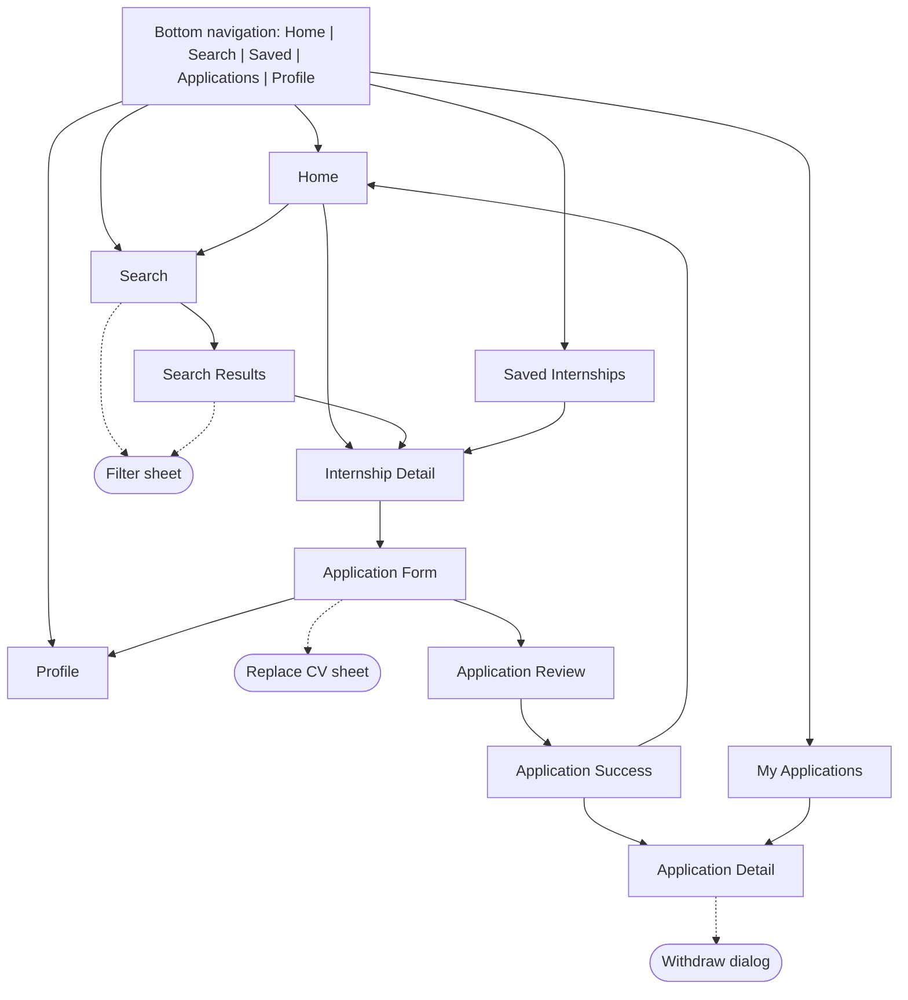
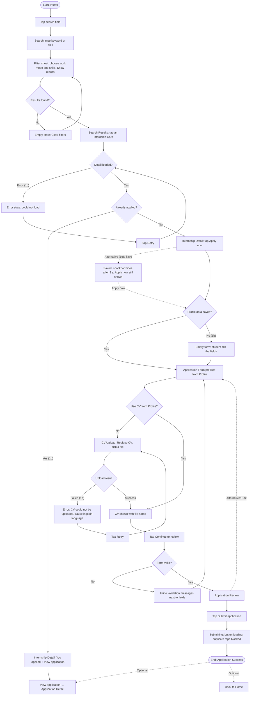
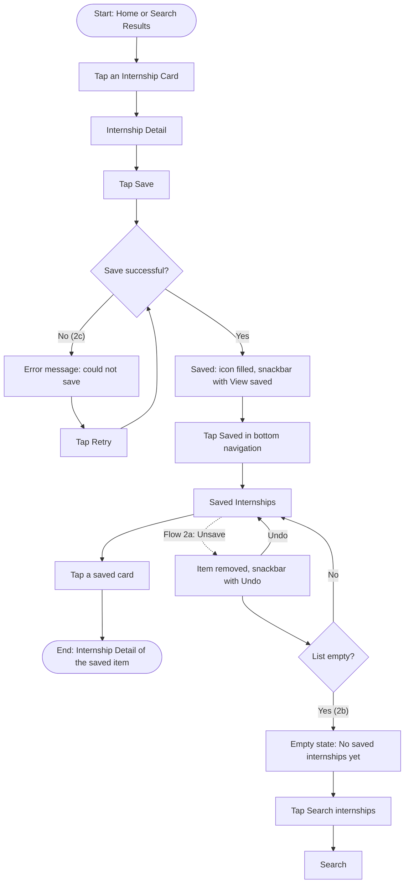
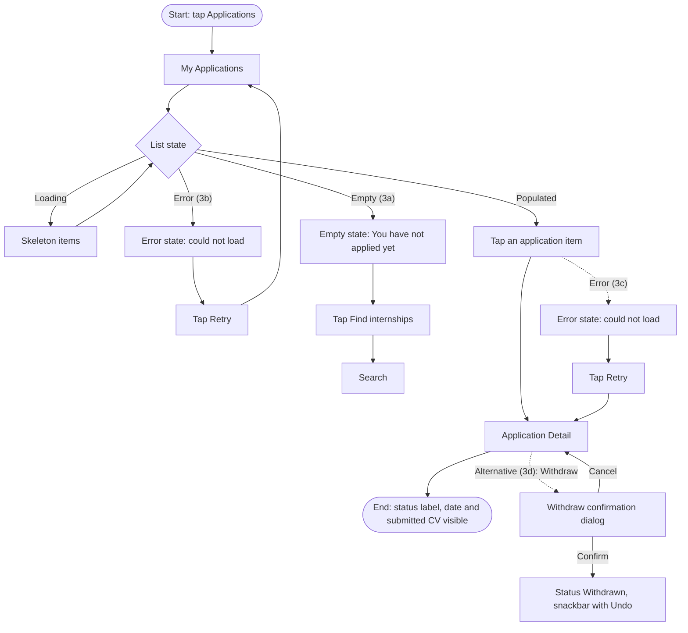

# Internship Finder — UX Analysis, Information Architecture and User Flows

This document follows `ux/persona.md` (persona Minh, problem statement and success criterion), `design/DESIGN.md` (navigation and component rules) and `design/screen-spec.md` (screen purposes). Flow numbers and names follow the team task assignment (`Internship_Finder_Task_Assignment.xlsx`):

| Flow | Name | Main path | Goal | Alternative / error path |
|---|---|---|---|---|
| Flow 1 | Search & Apply Internship | Home → Search → Filter → Internship Detail → Apply → CV Upload → Submit → Success | Find a suitable internship and complete the application | CV Upload Failed → Retry → Upload Success → Submit |
| Flow 2 | Save Internship | Home/Search → Internship Detail → Save → Saved Internships → Open Saved Internship | Save an internship of interest to view later | Saved Internships → Unsave → Item removed |
| Flow 3 | Track Application | My Applications → Application Detail → View Application Status | Track the status of a submitted application | No applications → Empty state → Browse internships |

Alternative and error branches are numbered under their main flow (Flow 1a, 1b, …). The same names are used for the flow starting points on Figma page 06 Prototype.

## 1. Information Architecture

### 1.1 Screen inventory

| # | Screen | Level | Reached from | Used by flow |
|---|---|---|---|---|
| 1 | Home | Top-level (tab: Home) | App launch, bottom navigation, Application Success → `Back to Home` | 1, 2 |
| 2 | Search | Top-level (tab: Search) | Bottom navigation, Home search field | 1, 2, 3 |
| 3 | Search Results | Nested under Search | Search (submit query or apply filters) | 1, 2 |
| 4 | Internship Detail | Nested | Search Results card, Home card, Saved card | 1, 2 |
| 5 | Saved Internships | Top-level (tab: Saved) | Bottom navigation, Save confirmation snackbar | 2 |
| 6 | Application Form | Nested under Internship Detail | Internship Detail → `Apply now` | 1 |
| 7 | Application Review | Nested under Application Form | Application Form → `Continue to review` | 1 |
| 8 | Application Success | Nested (end of apply flow) | Application Review → `Submit application` | 1 |
| 9 | My Applications | Top-level (tab: Applications) | Bottom navigation | 3 |
| 10 | Application Detail | Nested under My Applications | My Applications card, Application Success → `View application`, Internship Detail (already applied) → `View application` | 1, 3 |
| 11 | Profile | Top-level (tab: Profile) | Bottom navigation, Application Form → `Edit profile` | 1 |

Overlays and states (not counted as separate screens): Filter bottom sheet (Search, Search Results), Replace CV sheet used for CV upload (Application Form), University picker (Application Form), Document viewer for CV preview (Application Form, Review; view only from Application Detail because the submitted CV can no longer be replaced), Withdraw confirmation dialog (Application Detail).

### 1.2 Navigation structure

Rules:

- Five top-level destinations stay in the bottom navigation with the same names and order on every top-level screen: Home, Search, Saved, Applications, Profile.
- Nested screens use the app bar back button. Back returns to the previous screen in the same flow.
- During Application Form, Review and Success the bottom navigation is hidden to keep the student focused on finishing the application.
- Every screen above is used by at least one flow (see section 3).

## 2. User Flows

All flows target persona Minh (third-year IT student, one-handed Android use, unstable campus network).

### Flow 1 — Search & Apply Internship (includes error and recovery path)

| Item | Description |
|---|---|
| Start | Home |
| Goal | Find a suitable internship and complete the application |
| End | Application Success (optional next step: `View application` → Application Detail) |
| Happy path | Home → Search → Filter sheet → Search Results → Internship Detail → `Apply now` → Application Form → CV Upload → `Continue to review` → Application Review → `Submit application` → Application Success |
| Flow 1a — Error / recovery | CV upload fails → plain-language error + `Retry` (or `Use CV from Profile`) → upload succeeds → continue to review and submit |
| Flow 1b — Alternative | Profile has no saved data → empty form → `Continue to review` shows inline validation errors → student fills the fields → continue |
| Flow 1c — Error / recovery | Internship Detail fails to load → error state + `Retry` → loading skeleton → Internship Detail |
| Flow 1d — Alternative | Student searches again after applying → the card in Search Results shows an `Applied` badge → Internship Detail shows `You applied on …` and `View application` instead of `Apply now` (no duplicate application) → Application Detail; the submitted CV opens view only |
| Flow 1e — Alternative | Student saves the internship while browsing: bookmark on the Search Results card, or `Save` in Internship Detail → snackbar `Saved to your list` (hides after 3 s) → saved state; reopening the card shows Internship Detail – Saved and going back shows the saved card. The full save journey is Flow 2 |
| Other alternatives | No results → `Clear filters`; preview the CV in Document viewer; edit a section from Review; update stored data in Profile |

### Flow 2 — Save Internship

| Item | Description |
|---|---|
| Start | Home or Search Results |
| Goal | Save an internship of interest to view later |
| End | Saved internship opened again in Internship Detail |
| Happy path | Home/Search → Internship Detail → `Save` → Saved Internships → open the saved internship |
| Flow 2a — Alternative | Saved Internships → `Unsave` → item removed, snackbar `Removed from Saved` + `Undo` → `Undo` puts the item back |
| Flow 2b — Alternative | No saved internships (list empty) → empty state → `Search internships` → Search |
| Flow 2c — Error / recovery | Save fails (network) → error message → `Retry` → saved |

### Flow 3 — Track Application

| Item | Description |
|---|---|
| Start | Bottom navigation → Applications |
| Goal | Track the status of a submitted application |
| End | Application Detail showing the status label |
| Happy path | My Applications → Application Detail → view the application status |
| Flow 3a — Alternative | No applications yet → empty state → `Find internships` → Search (start of Flow 1) |
| Flow 3b — Error / recovery | My Applications fails to load → error state + `Retry` → loading skeleton → My Applications |
| Flow 3c — Error / recovery | Application Detail fails to load → error state + `Retry` → loading skeleton → Application Detail |
| Flow 3d — Alternative | Withdraw an application → confirmation dialog (`Confirm` or `Cancel`) → status `Withdrawn`, snackbar `Application withdrawn` + `Undo` |

## 3. Flow-to-Screen Mapping

| Screen | Flow 1: Search & Apply | Flow 2: Save | Flow 3: Track | Overlay or state used |
|---|---|---|---|---|
| Home | Yes (start) | Yes (start) | — | Loading, populated, error |
| Search | Yes | Yes | Yes (empty-state target) | Default, Filter sheet |
| Search Results | Yes | Yes | — | Loading, populated, empty, error, applied badge, saved card, Filter sheet |
| Internship Detail | Yes | Yes | — | Loading, populated, expanded, saved, already applied, error |
| Saved Internships | — | Yes (end) | — | Loading, populated, empty, removed + Undo |
| Application Form | Yes | — | — | Prefilled, empty profile, validation error, CV uploading, CV upload failed, Replace CV sheet, University picker, Document viewer |
| Application Review | Yes | — | — | Populated, submitting |
| Application Success | Yes (end) | — | — | Success |
| My Applications | — | — | Yes (start) | Loading, populated, empty, error |
| Application Detail | Yes (optional, via `View application`; Flow 1d) | — | Yes (end) | Loading, populated (submitted, under review), error, Withdraw dialog, Document viewer (view only) |
| Profile | Yes (alternative: `Edit profile`) | — | — | Populated, validation error |

## 4. Success Criterion Check

| Persona success criterion | Where it is tested |
|---|---|
| Find an internship by skill and work mode in under 30 seconds | Flow 1: Home → Search → Filter sheet → Search Results |
| Submit an application from Internship Detail in under 2 minutes | Flow 1: Internship Detail → Application Success |

## 5. Error and Recovery Summary

| Where | What goes wrong | Recovery |
|---|---|---|
| Search Results | No matching results | `Clear filters` |
| Internship Detail | Detail fails to load (Flow 1c) | Error state + `Retry`, then loading skeleton |
| Internship Detail | Student opens an internship they already applied to (Flow 1d) | `Apply now` is replaced by `You applied on …` + `View application`, so a duplicate application cannot be sent |
| Application Detail | Student tries to change the CV after submitting | Submitted CV opens in a view-only Document viewer (no `Replace CV`) |
| Application Form | CV upload fails (Flow 1a) | Plain-language cause + `Retry`, or `Use CV from Profile` |
| Application Form, Review | Required field missing or invalid (Flow 1b) | Inline message next to the field, focus on first error |
| Internship Detail | Save fails (Flow 2c) | Error message + `Retry` |
| Search Results, Saved, My Applications | List fails to load (Flow 3b for My Applications) | `Retry` |
| Application Detail | Detail fails to load (Flow 3c) | Error state + `Retry`, then loading skeleton |
| Saved Internships | Unsave by mistake (Flow 2a) | Undo snackbar |
| Application Detail | Withdraw by mistake (Flow 3d) | Confirmation dialog with `Cancel`; after confirming, `Undo` in the snackbar |
