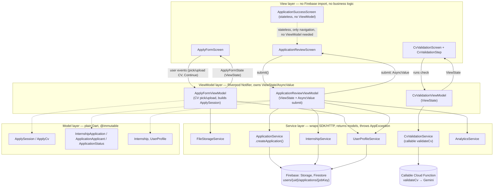

# Apply flow (Flow 2/4): architecture requirement & MVVM proof

This note documents the Apply submission slice (Apply Form → Validate CV →
Review → Success) that was added on top of `docs/architecture.md`, and shows
— with file and line evidence from the current `lib/` tree — that it follows
the same strict MVVM layering as the rest of Internly (AGENTS.md rule 2).
Nothing here redefines the architecture; it is the proof that the new code
obeys it.

## 1. Architecture requirement (recap)

From `docs/architecture.md` §1, dependencies point **down only**:

```
View → ViewModel → Service → Firebase / Cloud Function
         ↓              ↓
       Model          Model
```

| Layer | May depend on | Must not |
|---|---|---|
| View | ViewModels, `core/widgets`, `theme` | Import Firebase SDKs, call services, hold business logic in `build()` |
| ViewModel | Services (via Riverpod providers), models, `core/state`, `core/errors`, `core/utils` | Import widgets (except `foundation`), hold a `BuildContext`, navigate |
| Service | SDKs, models, `core/errors`, `core/utils` | Know about screens or UI state |
| Model | `core/utils` (parsing) | Import Firebase SDKs directly |

Riverpod 3 is the only DI/state mechanism; data screens expose
`ViewState<T>`, one-shot actions expose `AsyncValue<void>` (architecture.md
§3).

## 2. What was built for Flow 2 submission

```
lib/features/internships/screens/apply_form_screen.dart         (View)
lib/features/internships/viewmodels/apply_form_viewmodel.dart   (ViewModel)
lib/features/applications/screens/cv_validation_screen.dart     (View)
lib/features/applications/widgets/cv_validation_step.dart       (View, shared)
lib/features/applications/viewmodels/cv_validation_viewmodel.dart (ViewModel)
lib/features/internships/screens/application_review_screen.dart (View)
lib/features/internships/viewmodels/application_review_viewmodel.dart (ViewModel)
lib/features/internships/screens/application_success_screen.dart (View, stateless)
lib/services/application_service.dart                           (Service)
lib/services/cv_validation_service.dart                         (Service)
lib/models/internship_application.dart                          (Model: InternshipApplication, ApplicationApplicant, ApplicationStatus)
```

### 2.1 Layered flowchart (this slice)



### 2.2 Sequence: submitting an application (Review → Success)

```mermaid
sequenceDiagram
    actor Student
    participant V as ApplicationReviewScreen (View)
    participant VM as ApplicationReviewViewModel
    participant AS as ApplicationService
    participant UP as UserProfileService
    participant AN as AnalyticsService
    participant FS as Cloud Firestore

    Student->>V: taps "Submit application"
    V->>VM: submit(session)
    VM->>VM: guard: state.submit.isLoading? ignore repeated tap
    VM->>VM: read providers BEFORE first await (AGENTS.md async rule)
    VM-->>V: state.submit = AsyncLoading() (button shows spinner, disabled)
    VM->>AS: createApplication(jobKey, title, companyName, cvStoragePath, cvFileName, cvUrl, applicant)
    AS->>FS: users/{uid}/applications/{jobKey}.set({...status: submitted...})
    alt write succeeds
        FS-->>AS: ack
        AS-->>VM: void
        VM->>AN: logEvent("application_create", {internship_id, cv_source, duration_sec})
        VM->>UP: updateApplyDetails(uid, details) / updateSkills(uid, skills)
        Note over VM,UP: profile sync failure is logged to Crashlytics only;<br/>it never turns a stored submission into an error
        VM->>VM: check ref.mounted before touching state
        VM-->>V: state.submit = AsyncData(null), returns submittedAt
        V->>V: context.go(success route) with recap (title, company, submittedAt)
    else Firestore/permission/network error
        FS-->>AS: FirebaseException
        AS-->>VM: throw AppException(kind, userMessage, cause)
        VM-->>V: state.submit = AsyncError(AppException)
        V->>V: shows error.message + "Retry" (no raw exception ever rendered)
    end
```

## 3. Proof: layering rules are respected (checked against the code)

The claims below were verified by reading the files, not assumed.

### 3.1 Views never import Firebase or call services directly

```
$ grep -rn "package:cloud_firestore\|package:firebase_" \
    lib/features/internships/screens/apply_form_screen.dart \
    lib/features/internships/screens/application_review_screen.dart \
    lib/features/internships/screens/application_success_screen.dart \
    lib/features/applications/screens/cv_validation_screen.dart
(no matches)
```

- `ApplyFormScreen`, `ApplicationReviewScreen`, `CvValidationScreen` only
  `ref.watch`/`ref.read` their own `*ViewModelProvider` (e.g.
  `application_review_screen.dart:54-57`) and render the `ViewState` /
  `AsyncValue` they get back with shared `core/widgets` (`StateView`,
  `AppButton`, `CvFileTile`, `AppTopBar`).
- `ApplicationSuccessScreen` is a plain `StatelessWidget` with **no**
  ViewModel at all — correct per architecture.md, because it only recaps
  data handed to it through the router `extra` and offers two `context.go`
  navigations; it has no business logic or state to own.

### 3.2 ViewModels never import widgets or hold a `BuildContext`

```
$ grep -n "^import" apply_form_viewmodel.dart application_review_viewmodel.dart
package:flutter/foundation.dart      ← @immutable only, not widgets
package:flutter_riverpod/flutter_riverpod.dart
core/errors, core/state, core/utils, models/*, services/*
```

```
$ grep -rn "BuildContext" apply_form_viewmodel.dart application_review_viewmodel.dart cv_validation_viewmodel.dart
(no matches)
```

`ApplicationReviewViewModel.submit()` (application_review_viewmodel.dart:84)
returns a `DateTime?` to the caller instead of navigating itself — the View
decides what to do with the result (push the success route). This is the
same pattern as `EditProfileViewModel.save()` returning `bool`.

### 3.3 Services are the only layer that touches Firebase/HTTP

- `ApplicationService.createApplication()` (`lib/services/application_service.dart:22-30`
  interface, implementation ~line 96-140) is the **only** place that writes
  to `users/{uid}/applications/{jobKey}`. It:
  - checks auth itself and throws `AppException(permissionDenied, ...)` if
    signed out (line 108-114),
  - wraps `FirebaseException` into `AppException` via `_toWriteAppException`
    (never lets a raw SDK exception escape the service boundary),
  - returns `void`/throws — no `ViewState` or widget type crosses into the
    service.
- `CvValidationService.validate()` (`lib/services/cv_validation_service.dart:13-16`)
  is the only caller of the `validateCv` Cloud Function; the Gemini key
  never reaches the app (G-26), consistent with architecture.md §8.

### 3.4 Models are plain, immutable data holders

- `InternshipApplication`, `ApplicationApplicant`, `ApplicationStatus`
  (`lib/models/internship_application.dart`) are `@immutable`, parse through
  `FirestoreReader.requireX/optionalX` (never raw `data['x'] as String`), and
  throw `FormatException` on a missing required field — the service, not the
  model, decides to skip and log it (architecture.md §6 rule 4).
- `ApplySession` / `ApplyCv` (`apply_form_viewmodel.dart:32-37, 77-92`) carry
  the in-memory form state from Apply Form to Review through the router
  `extra`, with no Firestore or Storage dependency.

### 3.5 Riverpod-only state, no singletons, user-scoped data

- Every Notifier here is `NotifierProvider.autoDispose(.family)` —
  `applyFormViewModelProvider`, `cvValidationViewModelProvider`,
  `applicationReviewViewModelProvider` — never a global singleton.
- `ApplicationReviewViewModel.build()` calls
  `ref.watch(currentUserIdProvider)` (line 67) purely to rebuild and drop
  state on sign-out, per AGENTS.md rule 11.
- Async rule compliance: `submit()` reads `applicationServiceProvider`,
  `analyticsServiceProvider`, `userProfileServiceProvider`,
  `crashlyticsServiceProvider`, `currentUserIdProvider` **before** the first
  `await` (lines 90-94), then checks `ref.mounted` after every `await`
  before touching `state` (lines 130, 134, 137).
- Repeated taps are ignored: `if (state.submit.isLoading) return null;`
  (line 85), matching the `SavedViewModel`/`EditProfileViewModel` pattern.

### 3.6 Navigation stays declarative and outside the ViewModel

`go_router` route names/paths for this slice
(`lib/app/router.dart:51-63`):

```
.../apply                → ApplyFormScreen
.../apply/validation      → CvValidationScreen
.../apply/review          → ApplicationReviewScreen
.../apply/review/success  → ApplicationSuccessScreen
```

All nested under `rootNavigatorKey` (hides bottom navigation during Apply,
per architecture.md §5). Every `context.go` / `context.push` call lives in a
**View** (`cv_validation_screen.dart:46-64`,
`application_review_screen.dart:76-83`,
`application_success_screen.dart:106-113`) — never inside a ViewModel.

## 4. Why this satisfies "there is an MVVM architecture requirement, and the implementation follows it"

1. **Requirement exists and is written down**: `docs/architecture.md` §1
   and AGENTS.md rule 2 define MVVM with the exact dependency direction and
   forbidden imports, before this feature was built.
2. **The new screens/ViewModels/services/models added for Apply submission
   map 1:1 onto the four layers** (table in §2), with no cross-layer
   shortcut (no Firebase in a View, no widget in a ViewModel, no UI state in
   a Service).
3. **Static evidence, not description**: the `grep` results in §3.1–3.2 show
   zero Firebase imports in Views and zero widget/BuildContext imports in
   ViewModels for every file touched by this slice.
4. **Behavioural evidence**: the sequence diagram in §2.2 traces a real user
   action (Submit) through exactly View → ViewModel → Service → Firebase and
   back, with errors translated to `AppException` only inside the Service
   and rendered only inside the View — never a raw SDK type crossing a
   layer boundary.
5. **Consistent with the rest of the codebase**: the same
   `ViewState`/`AsyncValue`, Riverpod `NotifierProvider.autoDispose`, and
   "read-before-await / check-ref.mounted-after-await" patterns used in
   `EditProfileViewModel`, `HomeViewModel` and `MyApplicationsViewModel` are
   reused here, not reinvented.

## 5. Open follow-ups (not blocking this proof)

- `docs/architecture.md` §3's ViewModel table still lists `ApplyViewModel`
  as one row covering Form/Match/Review/Success and marks it "Planned" — it
  should be split into `ApplyFormViewModel` (Done), `CvValidationViewModel`
  (Done) and `ApplicationReviewViewModel` (Done, Success has none by design)
  and the Status column updated in the same PR that lands this slice, per
  AGENTS.md "Documentation to update in the same PR".
- `docs/design-traceability.md` rows for Application Review (#8) and
  Application Success (#9) should move from ⬜ to ✅ with their actual
  route names.
