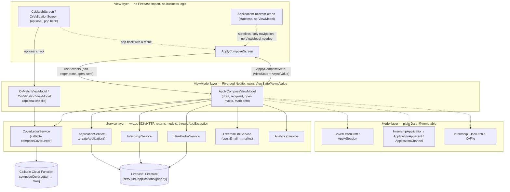

# Apply flow (Flow 2): architecture requirement & MVVM proof

This note documents the current Apply slice — **Compose application → email
draft → `I've sent it` → Success** (DC-31) — and shows, with file evidence
from the current `lib/` tree, that it follows the strict MVVM layering of the
rest of Internly (AGENTS.md rule 2). Nothing here redefines the architecture;
it is the proof that the new code obeys it.

The previous form-based slice (Application Form → Validate CV → Review →
Success) was removed in the same change; the optional CV Match / Validate
screens remain and pop back to the compose screen.

## 1. Architecture requirement (recap)

From `docs/architecture.md` §1, dependencies point **down only**:

```
View → ViewModel → Service → Firebase / Cloud Function
         ↓              ↓
       Model          Model
```

| Layer | May depend on | Must not |
|---|---|---|
| View | ViewModels, `core/widgets`, `theme` | Import Firebase SDKs, call services, hold business logic in `build()` |
| ViewModel | Services (via Riverpod providers), models, `core/state`, `core/errors`, `core/utils` | Import widgets (except `foundation`), hold a `BuildContext`, navigate |
| Service | SDKs, models, `core/errors`, `core/utils` | Know about screens or UI state |
| Model | `core/utils` (parsing) | Import Firebase SDKs directly |

Riverpod 3 is the only DI/state mechanism; data screens expose
`ViewState<T>`, one-shot actions expose `AsyncValue<void>` (architecture.md
§3).

## 2. What was built for Flow 2

```
lib/features/internships/screens/apply_compose_screen.dart      (View)
lib/features/internships/viewmodels/apply_compose_viewmodel.dart (ViewModel)
lib/features/internships/widgets/apply_compose_parts.dart        (View, feature-local)
lib/features/internships/widgets/apply_summary_card.dart         (View, feature-local)
lib/features/internships/models/apply_session.dart               (Model, optional CV checks)
lib/features/internships/models/cover_letter_draft.dart          (Model)
lib/features/applications/screens/cv_match_screen.dart           (View, optional)
lib/features/applications/screens/cv_validation_screen.dart      (View, optional)
lib/features/internships/screens/application_success_screen.dart (View, stateless)
lib/services/cover_letter_service.dart                           (Service)
lib/services/application_service.dart                            (Service)
lib/services/cv_match_service.dart                               (Service, optional)
lib/services/cv_validation_service.dart                          (Service, optional)
lib/services/external_link_service.dart                          (Service, opens mailto:)
lib/core/utils/contact_email.dart                                (pure helper)
lib/core/utils/mailto.dart                                       (pure helper)
lib/models/internship_application.dart                           (Model: channel, recipient, applicant)
functions/src/compose-cover-letter.ts                            (callable, Groq + template fallback)
```

### 2.1 Layered flowchart (this slice)



### 2.2 Sequence: composing and recording an application

```mermaid
sequenceDiagram
    actor Student
    participant V as ApplyComposeScreen (View)
    participant VM as ApplyComposeViewModel
    participant CL as CoverLetterService
    participant EL as ExternalLinkService
    participant AS as ApplicationService
    participant AN as AnalyticsService
    participant FS as Cloud Firestore

    Student->>V: taps "Apply now" (Internship Detail)
    V->>VM: provider build (autoDispose)
    VM->>VM: read providers BEFORE first await (AGENTS.md)
    Note over VM: wait for the listing + Profile, then draft once
    VM->>CL: compose(internshipKey, storagePath, studentName)
    CL->>FS: (server) read internships/{key} + users/{uid}
    CL->>CL: Groq draft, or deterministic template on any failure
    CL-->>VM: CoverLetterDraft(subject, body, usedAi)
    VM->>AN: cover_letter_generate {internship_id, source}
    VM-->>V: state (recipient from JD, subject, body)
    Student->>V: edits the draft / recipient (or Regenerate)
    V->>VM: setRecipient / setSubject / setBody / regenerate
    Student->>V: taps "Open email app"
    V->>VM: openEmail()
    VM->>VM: validate a non-empty address; buildMailtoUri()
    VM->>EL: openEmail(mailto:)
    EL-->>VM: opened / AppException
    VM->>AN: cover_letter_open_email {internship_id, has_recipient}
    VM-->>V: emailOpened = true
    Student->>V: taps "I've sent it"
    V->>VM: markSent()
    VM->>AS: createApplication(appliedVia: email, recipientEmail, applicant, CV?)
    AS->>FS: users/{uid}/applications/{jobKey}.set({...})
    alt write succeeds
        FS-->>AS: ack
        VM->>AN: application_create {internship_id, channel, cv_source, duration_sec}
        VM-->>V: ApplicationSent(submittedAt, internship)
        V->>V: pushReplacement('/…/apply/success', recap)
    else Firestore / permission / network error
        AS-->>VM: AppException(kind, userMessage)
        VM-->>V: send = AsyncError(AppException)
        V->>V: error.message in the bottom bar; "I've sent it" again
    end
```

## 3. Proof: layering rules are respected (checked against the code)

### 3.1 Views never import Firebase or call services directly

`apply_compose_screen.dart`, `cv_match_screen.dart`,
`cv_validation_screen.dart` and `application_success_screen.dart` import
only `flutter/material.dart`, `flutter_riverpod`, `go_router`,
`material_symbols_icons`, `core/widgets`, `theme`, models and their own
ViewModel/provider. No `package:cloud_firestore`, `package:firebase_*`,
`package:cloud_functions` or `package:url_launcher` import exists in any of
them. The compose screen forwards user events to
`applyComposeViewModelProvider` and renders the state with shared widgets
(`AppTopBar`, `ApplySummaryCard`, `DetailSectionCard`, `CvFileTile`,
`AppButton`, `FormMessage`, `StateView`, skeletons).

`ApplicationSuccessScreen` is a plain `StatelessWidget` with **no**
ViewModel: it recaps data handed through the router `extra` and offers two
`context.go` navigations.

### 3.2 ViewModels never import widgets or hold a `BuildContext`

`apply_compose_viewmodel.dart` imports:

```
package:flutter/foundation.dart       ← @immutable / debug only
package:flutter_riverpod/flutter_riverpod.dart
core/errors, core/state, core/utils, models/*, services/*
```

It has no `flutter/material.dart`, no `core/widgets`, and no
`BuildContext`. `markSent()` returns an `ApplicationSent?` record to the
caller instead of navigating; the View decides to
`pushReplacement('/…/apply/success')`. `openEmail()` returns nothing but
stores `openError` in the state; the View shows it. This is the same
pattern as `EditProfileViewModel.save()` returning `bool`.

### 3.3 Services are the only layer that touches Firebase / HTTP

- `CoverLetterService.compose()` is the only caller of the
  `composeCoverLetter` callable; it parses the result defensively and maps
  every `FirebaseFunctionsException.code` to an `AppException`. The Groq
  key never reaches the app (architecture §8).
- `ApplicationService.createApplication()` is the only writer of
  `users/{uid}/applications/{jobKey}`. It checks auth itself, writes
  `appliedVia` / `recipientEmail` / the optional CV snapshot, and wraps
  `FirebaseException` in `AppException`.
- `ExternalLinkService.openEmail()` is the only `mailto:` launcher; the
  ViewModel passes a `Uri` built by the pure `buildMailtoUri` helper.
- `contact_email.dart` / `mailto.dart` are pure `core/utils` functions with
  no SDK dependency.

### 3.4 Models are plain, immutable data holders

- `InternshipApplication`, `ApplicationApplicant`, `ApplicationStatus` and
  `ApplicationChannel` are `@immutable`, parse through
  `FirestoreReader.requireX/optionalX`, and throw `FormatException` on a
  missing required field; the service decides to skip and log it.
- `CoverLetterDraft` and `ApplySession` carry in-memory data only (no
  Firestore / Storage dependency). `ApplySession` is handed to the optional
  CV checks through the route `extra`.
- `appliedVia` defaults to `ApplicationChannel.inApp` when absent, so
  documents written before the email flow still load.

### 3.5 Riverpod-only state, no singletons, user-scoped data

- `applyComposeViewModelProvider` is
  `NotifierProvider.autoDispose.family` — never a global singleton.
- `build()` calls `ref.watch(currentUserIdProvider)` so another account
  drops the draft (AGENTS.md rule 11). The listing subscription is started
  once and the profile subscription is re-created only when the uid
  changes, so an auth-stream rebuild (null → signed-in) cannot cancel a
  subscription whose error is already in flight.
- Async rule compliance: `markSent()` reads
  `applicationServiceProvider`, `analyticsServiceProvider`,
  `currentUserIdProvider`, `authStateChangesProvider` and `_profile`
  **before** the first `await`, then checks `ref.mounted` after every
  `await` before touching `state`.
- Repeated taps are ignored: `if (state.isSending) return null;` and
  `if (state.generate.isLoading) return;`.

### 3.6 Navigation stays declarative and outside the ViewModel

`go_router` routes for this slice (`lib/app/router.dart`):

```
.../apply                   → ApplyComposeScreen   ({tab}_apply_email)
.../apply/match             → CvMatchScreen        ({tab}_cv_match, optional)
.../apply/validation        → CvValidationScreen   ({tab}_cv_validation, optional)
.../apply/success           → ApplicationSuccessScreen ({tab}_application_success)
```

All nested under `rootNavigatorKey` (hides the bottom navigation during
Apply). Every `context.push` / `context.pushReplacement` / `context.go`
call lives in a **View** (`apply_compose_screen.dart`,
`cv_match_screen.dart`, `cv_validation_screen.dart`,
`application_success_screen.dart`) — never inside a ViewModel.

## 4. Why this satisfies "there is an MVVM architecture requirement, and the implementation follows it"

1. **The requirement exists and is written down**: `docs/architecture.md`
   §1 and AGENTS.md rule 2 define MVVM with the exact dependency direction
   and forbidden imports.
2. **The new screens / ViewModel / services / models map 1:1 onto the four
   layers** (table in §2), with no cross-layer shortcut.
3. **Static evidence**: §3.1–3.2 list the imports; no Firebase in a View,
   no widget / `BuildContext` in a ViewModel.
4. **Behavioural evidence**: the sequence in §2.2 traces a real action
   (`I've sent it`) through View → ViewModel → Service → Firestore and back,
   with errors translated to `AppException` only inside the Service and
   rendered only inside the View.
5. **Consistency**: the same `ViewState` / `AsyncValue`, Riverpod
   `NotifierProvider.autoDispose` and "read-before-await /
   check-ref.mounted-after-await" patterns used by `EditProfileViewModel`,
   `HomeViewModel` and `MyApplicationsViewModel` are reused, not
   reinvented.

## 5. Open follow-ups (not blocking this proof)

- The compose screen has no Figma frame (DC-31); it is built from existing
  components and tokens.
- The optional CV checks still need a frame (DC-19, DC-30); their route and
  pop-back behaviour are covered by tests.
- `docs/records/test-report.md` records the real commands run for this
  slice; the device walk, a real Groq call and DebugView screenshots are
  still open (no device/credentials in this session).
