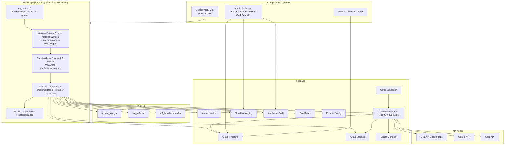

# Công nghệ sử dụng trong Internly

Tài liệu này liệt kê toàn bộ công nghệ đang có trong repo, theo ba phần cho mỗi mục: **khái niệm**, **nguyên lý hoạt động**, và **cách implement trong code**. Nội dung phản ánh code tại thời điểm viết, không phải kế hoạch.

Nguồn đối chiếu chính: `pubspec.yaml`, `functions/package.json`, `tools/admin-dashboard/package.json`, `e2e_test/pyproject.toml`, `lib/`, `functions/src/`, `firebase/`, `tools/admin-dashboard/`.

## Sơ đồ phân lớp



## Phiên bản đang pin

| Thành phần | Phiên bản |
|---|---|
| Flutter / Dart | 3.47.3 stable / 3.13.3 |
| `flutter_riverpod` | 3.4.3 |
| `go_router` | 18.1.1 |
| `firebase_core` / `cloud_firestore` | 5.0.0 / 7.0.0 |
| `firebase_auth` / `firebase_storage` | 7.0.0 / 14.0.0 |
| `firebase_analytics` / `firebase_crashlytics` / `firebase_remote_config` | 13.0.0 / 6.0.0 / 7.0.0 |
| `firebase_messaging` | 17.0.0 |
| `cloud_functions` | ^7.0.0 |
| `google_sign_in` / `file_selector` / `url_launcher` | 7.2.0 / 1.1.0 / 6.3.3 |
| `material_symbols_icons` | 4.2960.0 |
| Cloud Functions runtime | Node.js 22, `firebase-functions` ^6, `firebase-admin` ^13, TypeScript ^5.7 |
| Admin dashboard | Node ≥ 20, Express ^4.21, `@google-analytics/data` ^7.3 |
| E2E | Python ≥ 3.12, ARTEMIS commit `351ca84`, pytest 9.1.1 |
| Nền tảng | Android min SDK 24 / target 36; iOS 15.0 (CocoaPods) |

---

## 1. Ngôn ngữ và nền tảng

### 1.1 Dart 3.13 + Flutter 3.47

- **Khái niệm:** ngôn ngữ và UI toolkit đa nền tảng; một codebase build ra Android và iOS.
- **Nguyên lý:** Flutter dựng widget tree và tự vẽ bằng engine (Impeller/Skia); Dart chạy JIT khi dev, AOT khi release.
- **Implement:** `pubspec.yaml` khai báo `sdk: ^3.13.3` và các package; entry point `lib/main.dart` chỉ gọi `bootstrap()`; UI nằm trong `lib/features/<feature>/screens`.

### 1.2 Android — Gradle Kotlin DSL, JDK 17

- **Khái niệm:** nền tảng được chấm điểm chính, đóng gói APK/AAB.
- **Nguyên lý:** Gradle áp plugin Flutter, `com.google.gms.google-services` và `com.google.firebase.crashlytics`; biên dịch Java/Kotlin sang DEX và ký bằng keystore.
- **Implement:** `android/app/build.gradle.kts` (namespace `com.group3.internly`, Java/Kotlin 17); đọc `DEBUG_KEYSTORE_BASE64` từ `.env` để cả nhóm dùng chung debug keystore, tránh phải đăng ký nhiều SHA-1.

### 1.3 iOS + CocoaPods

- **Khái niệm:** nền tảng phụ vẫn build được.
- **Nguyên lý:** CocoaPods quản lý pod Firebase/GoogleSignIn; Swift Package Manager bị tắt vì xung đột phiên bản `gtm-session-fetcher`.
- **Implement:** `pubspec.yaml` mục `config: enable-swift-package-manager: false`; quyết định ghi ở G-20 trong `docs/records/handoff-gaps.md`.

---

## 2. Kiến trúc và quản lý trạng thái

### 2.1 MVVM

- **Khái niệm:** tách View, ViewModel và Model/Service.
- **Nguyên lý:** phụ thuộc chỉ đi xuống — View → ViewModel → Service → SDK. View không import Firebase và không chứa business logic; ViewModel không giữ `BuildContext`; Service dịch lỗi SDK thành `AppException`.
- **Implement:** `lib/features/<feature>/screens` (View), `lib/features/<feature>/viewmodels` (ViewModel), `lib/services` (Service), `lib/models` + `lib/features/<feature>/models` (Model). Quy ước ở `AGENTS.md` và `docs/architecture.md` §1.

### 2.2 Riverpod 3

- **Khái niệm:** state management và dependency injection.
- **Nguyên lý:** provider là nguồn dữ liệu có dependency; `Provider` cho service, `StreamProvider` cho auth, `NotifierProvider.autoDispose` cho state màn hình; provider tự rebuild khi dependency đổi; test override bằng `overrideWithValue`.
- **Implement:**
  - `lib/app/bootstrap.dart` tạo `ProviderContainer`, gọi service khởi tạo, rồi bọc `UncontrolledProviderScope`.
  - `lib/services/auth_service.dart`: `authServiceProvider`, `authStateChangesProvider`, `currentUserIdProvider`.
  - `lib/features/home/viewmodels/home_viewmodel.dart`: `NotifierProvider.autoDispose<HomeViewModel, HomeState>`.
  - Quy tắc: đọc provider trước `await` đầu tiên; sau `await` kiểm tra `ref.mounted`; bỏ qua tap lặp khi `state.isLoading`.

### 2.3 go_router 18 + StatefulShellRoute

- **Khái niệm:** router khai báo theo URL, hỗ trợ nested route và nhiều navigation stack.
- **Nguyên lý:** `GoRouter` so khớp path; `StatefulShellRoute.indexedStack` giữ stack riêng cho 5 tab; `redirect` chặn route theo trạng thái auth; `refreshListenable` kích hoạt redirect khi auth đổi.
- **Implement:** `lib/app/router.dart` (`AppRoutes`, `routerProvider`, `authRedirect`, `_tab`, `_internshipDetail`); shell và bottom navigation ở `lib/app/app_shell.dart`. Mỗi route có `name`, được log thành `screen_view` và ghi Crashlytics key `last_screen`.

### 2.4 ViewState dạng sealed class

- **Khái niệm:** mô hình trạng thái đóng gồm loading / empty / error / data.
- **Nguyên lý:** sealed class cho phép `switch` exhaustive, compiler bắt thiếu nhánh; View render đúng component cho từng trạng thái.
- **Implement:** `lib/core/state/view_state.dart` (`ViewLoading`, `ViewEmpty`, `ViewError`, `ViewData`, `ViewState.fromData`); View dùng `lib/core/widgets/state_view.dart` và `lib/core/widgets/skeleton.dart`.

### 2.5 Material 3 + design tokens + ThemeExtension

- **Khái niệm:** hệ thống thiết kế thay vì hard-code màu, font, spacing.
- **Nguyên lý:** token → `ThemeData`/`ColorScheme`; giá trị không có slot trong Material (success/warning) đưa vào `ThemeExtension`.
- **Implement:** `lib/theme/app_colors.dart`, `app_typography.dart`, `app_spacing.dart`, `app_radii.dart`, `app_sizes.dart`, `app_elevation.dart`; `lib/theme/app_theme.dart` (`AppTheme.light()`, `AppStatusColors`).

### 2.6 Inter + Material Symbols

- **Khái niệm:** font chữ và icon set.
- **Nguyên lý:** font bundle trong app để không phụ thuộc mạng; icon là font ligature.
- **Implement:** `pubspec.yaml` mục `fonts` (Inter 400/500/600/700) và `material_symbols_icons`; dùng `Symbols.home_rounded`… trong `lib/app/app_shell.dart`.

### 2.7 Shared component library

- **Khái niệm:** widget dùng chung thay cho UI tự phát minh.
- **Nguyên lý:** component dùng từ 2 feature trở lên đặt ở `core/widgets`, phải map với component trong Figma.
- **Implement:** `lib/core/widgets/` (`app_button`, `app_text_field`, `app_top_bar`, `internship_card`, `status_badge`, `cv_file_tile`, `state_view`, `skeleton`…).

---

## 3. Thư viện thiết bị

### 3.1 google_sign_in 7

- **Khái niệm:** lấy ID token từ tài khoản Google.
- **Nguyên lý:** mở account picker native → nhận `idToken` → đổi thành `GoogleAuthProvider.credential` → `signInWithCredential`.
- **Implement:** `lib/services/auth_service.dart` (`_ensureGoogleInitialized`, `signInWithGoogle`, map `GoogleSignInException`/`FirebaseAuthException` sang `AppException`).

### 3.2 file_selector

- **Khái niệm:** mở document picker của hệ điều hành.
- **Nguyên lý:** trả `XFile`, đọc byte vào RAM; không cần quyền storage.
- **Implement:** `lib/services/document_picker_service.dart` (`FileSelectorDocumentPicker.pickPdf`, lọc `application/pdf`).

### 3.3 url_launcher + mailto (RFC 6068)

- **Khái niệm:** mở trình duyệt, trình xem PDF hoặc app email.
- **Nguyên lý:** gọi URL scheme/intent của hệ điều hành; `mailto:` nhận `subject` và `body` đã URL-encode.
- **Implement:** `lib/services/external_link_service.dart`; `lib/core/utils/mailto.dart` (`Uri.encodeComponent`, newline thành `%0A`).

---

## 4. Firebase

### 4.1 firebase_core + FlutterFire

- **Khái niệm:** khởi tạo và cấu hình Firebase cho từng nền tảng.
- **Nguyên lý:** đọc `DefaultFirebaseOptions` do `flutterfire configure` sinh ra, khởi tạo trước `runApp`.
- **Implement:** `lib/firebase_options.dart`; `lib/app/bootstrap.dart` (`Firebase.initializeApp`). Nếu cấu hình lỗi, app chuyển sang service local thay vì crash.

### 4.2 Firebase Authentication

- **Khái niệm:** xác thực người dùng và phát hành UID/token.
- **Nguyên lý:** `authStateChanges()` phát user hiện tại rồi mỗi lần đăng nhập/đăng xuất; router và mọi provider dữ liệu người dùng bám stream này để xoá dữ liệu khi đăng xuất.
- **Implement:** `lib/services/auth_service.dart` (`FirebaseAuthService`, `authStateChangesProvider`, `currentUserIdProvider`); model `lib/models/app_user.dart`.

### 4.3 Cloud Firestore

- **Khái niệm:** NoSQL document database có realtime listener.
- **Nguyên lý:** `collection().doc()` + `snapshots()` phát snapshot mỗi khi dữ liệu đổi; `SetOptions(merge: true)` ghi từng phần; `FieldValue.serverTimestamp()` lấy giờ server; query `where` + `orderBy`; batch tối đa 500 writes.
- **Implement:**
  - Listing: `lib/services/internship_service.dart` (`where('expiresAt', isGreaterThan: Timestamp.now())`).
  - Hồ sơ + CV library: `lib/services/user_profile_service.dart` (`_merge`, `defaultCvId`, migration `users/{uid}.cv`).
  - Ứng tuyển: `lib/services/application_service.dart` (`createApplication`, `withdraw`, `undoWithdrawal`).
  - Saved, search history, notification: `lib/services/saved_internship_service.dart`, `search_history_service.dart`, `notification_service.dart`.
  - Parse phòng thủ: `lib/core/utils/firestore_reader.dart` — field bắt buộc ném `FormatException`; service bỏ qua document lỗi và ghi Crashlytics.

### 4.4 Firestore Security Rules

- **Khái niệm:** phân quyền ở server, không tin client.
- **Nguyên lý:** mỗi request so khớp `match`; `request.auth.uid` phải trùng `{uid}`; `/internships` chỉ đọc; `/sync` cấm client.
- **Implement:** `firebase/firestore.rules` (`isOwner`, `isReasonableWrite`, `users/{uid}/**`, `internships/{key}`, `sync/{doc}`).

### 4.5 Cloud Storage for Firebase

- **Khái niệm:** lưu file PDF (CV, báo cáo).
- **Nguyên lý:** `putData` upload, `snapshotEvents` báo tiến độ, `getDownloadURL` lấy link; rules giới hạn chủ sở hữu, PDF và ≤ 10 MB.
- **Implement:** `lib/services/file_storage_service.dart` (`uploadPdf`, `deletePdf`, kiểm tra signature `%PDF-`, path `cvs/{uid}/{slug}-{random}.pdf`, map mã lỗi); `firebase/storage.rules`.

### 4.6 Cloud Functions for Firebase v2

- **Khái niệm:** serverless function chạy trên hạ tầng Google.
- **Nguyên lý:** `onSchedule` chạy theo cron; `onCall` là RPC có auth context; secret bind qua `defineSecret`; lỗi chuẩn hoá bằng `HttpsError`; dependency được inject để test không cần Firebase.
- **Implement:** `functions/src/index.ts` (`syncInternshipsJob`, `validateCv`, `matchCv`, `selectCv`, `composeCoverLetter`); `functions/package.json` (Node 22, `firebase-admin`, `firebase-functions`).

### 4.7 Cloud Scheduler (qua `onSchedule`)

- **Khái niệm:** cron managed của Google Cloud.
- **Nguyên lý:** khai báo `schedule: 'every 6 hours'`, `timeZone`, `retryCount`, `timeoutSeconds`, `memory`.
- **Implement:** `functions/src/index.ts`; logic đồng bộ ở `functions/src/sync.ts` và `functions/src/selection.ts`.

### 4.8 Firebase Cloud Messaging (FCM)

- **Khái niệm:** push notification.
- **Nguyên lý:** xin quyền → lấy registration token → lưu `users/{uid}.fcmToken`; xử lý ba trạng thái: foreground (`onMessage`), background tap (`onMessageOpenedApp`), terminated (`getInitialMessage`); background isolate có handler riêng.
- **Implement:** `lib/services/notification_service.dart` (`requestPermission`, `token`, `tokenRefreshes`, `foregroundMessages`, `firebaseMessagingBackgroundHandler`); điều phối ở `lib/app/notification_coordinator.dart`; handler đăng ký trong `bootstrap.dart`.

### 4.9 Firebase Analytics (GA4)

- **Khái niệm:** đo hành vi người dùng.
- **Nguyên lý:** `logEvent(name, parameters)`, `logScreenView`, `setUserId`; tên event phải khớp regex và không dùng prefix reserved; lỗi analytics bị nuốt để không làm hỏng flow.
- **Implement:** `lib/services/analytics_service.dart` (`AnalyticsNames.isValidEventName`, `_guard`); log `screen_view` trong `lib/app/router.dart`; event nghiệp vụ trong các ViewModel.

### 4.10 Firebase Crashlytics

- **Khái niệm:** báo cáo crash và non-fatal.
- **Nguyên lý:** gắn handler toàn cục cho lỗi Flutter/nền tảng, ghi breadcrumb + custom key, gửi report ở lần chạy sau.
- **Implement:** `lib/services/crashlytics_service.dart` (`registerGlobalErrorHandlers`, `recordError`, `log`, `setCustomKey`); gọi trong `bootstrap.dart`; `last_screen` set trong `router.dart`.

### 4.11 Firebase Remote Config

- **Khái niệm:** feature flag và tham số cấu hình từ xa.
- **Nguyên lý:** nạp defaults từ asset trước, fetch nền, activate, lắng nghe realtime; app vẫn chạy offline bằng defaults.
- **Implement:** `lib/services/remote_config_service.dart` (`initialize`, `setDefaults(loadRemoteConfigDefaults)`, `fetchAndActivate`, `onConfigUpdated`); defaults ở `firebase/remote-config-defaults.json`; dùng trong `lib/features/home/viewmodels/home_viewmodel.dart`.

### 4.12 Secret Manager

- **Khái niệm:** kho secret managed.
- **Nguyên lý:** function đọc secret qua `defineSecret`; quyền gắn theo từng function (least privilege); key không nằm trong APK hoặc repo.
- **Implement:** `functions/src/index.ts` (`serpApiKey`, `geminiApiKey`, `groqApiKey`), bind `secrets: [ … ]` ở từng function.

---

## 5. API ngoài và AI

### 5.1 SerpAPI — Google Jobs

- **Khái niệm:** API tìm kiếm việc làm của Google.
- **Nguyên lý:** gọi `https://serpapi.com/search.json` với `engine=google_jobs`, `q`, `location`, `gl=vn`, `hl=vi`, `start`; đọc `jobs_results`; trang rỗng được SerpAPI trả về dưới dạng chuỗi lỗi riêng.
- **Implement:**
  - `functions/src/serp.ts` (`buildSearchUrl`, `fetchJobs`, `parseJobs`, timeout 20 s).
  - `functions/src/sync.ts`: upsert `/internships/{jobKey}` với `raw`, `searchKeyword`, `searchRank`, `syncedAt`, `expiresAt`; xoá listing hết hạn theo batch.
  - `functions/src/config.ts`: 8 keyword cho intern/fresher/junior tại Việt Nam; `selection.ts`: backfill tất cả lần đầu, sau đó 1 keyword mỗi 6 giờ.

### 5.2 Google Gemini API + pdf-parse

- **Khái niệm:** LLM kiểm tra chất lượng CV.
- **Nguyên lý:** tải PDF từ Storage → `pdf-parse` trích text → gửi rubric + text vào Gemini với `temperature: 0` và `responseMimeType: application/json` → parse `{isValid, reason}`; output không parse được thì fail-open.
- **Implement:** `functions/src/validate-cv.ts` (rubric, `parseValidationResponse`), `functions/src/cv-shared.ts` (`GoogleGenerativeAI`, `PDFParse`, `assertOwnedCvPath`); package `@google/generative-ai` và `pdf-parse` trong `functions/package.json`.

### 5.3 Groq API

- **Khái niệm:** LLM tốc độ cao cho các bước advisory.
- **Nguyên lý:** POST `https://api.groq.com/openai/v1/chat/completions` với `response_format: json_object`, `reasoning_effort: low`, `max_completion_tokens`, timeout 25 s; lỗi hoặc output không parse được thì dùng fallback deterministic.
- **Implement:** `functions/src/groq.ts` (`askGroq`), dùng bởi:
  - `functions/src/match-cv.ts` + `match-cv-score.ts`: chấm điểm rule-based, Groq chỉ viết summary và gợi ý.
  - `functions/src/select-cv.ts`: chọn CV tốt nhất, Groq viết lý do.
  - `functions/src/compose-cover-letter.ts`: viết subject + cover letter, fallback template theo ngôn ngữ listing.
  - `functions/src/skill-extraction.ts`: rubric trích technology, alias canonical, fallback vocabulary.

### 5.4 Ghi chú về việc dùng model

- Bước **chặn** (blocking) là `validateCv` dùng Gemini; các bước **advisory** (`matchCv`, `selectCv`, `composeCoverLetter`) dùng Groq.
- Một số doc comment cũ trong `lib/services/cv_match_service.dart` còn nhắc Gemini, nhưng code và `docs/architecture.md` hiện tại gọi Groq. Khi sửa comment, giữ nguyên hành vi.

---

## 6. Công cụ backend và vận hành

### 6.1 TypeScript 5.7 + Node 22 + `node:test`

- **Khái niệm:** ngôn ngữ và test runner cho Cloud Functions.
- **Nguyên lý:** `tsc` build sang `lib/*.js`; test chạy bằng `node --test`; dependency được inject để test không cần Firebase.
- **Implement:** `functions/tsconfig.json`, `functions/src/*.test.ts`, script `npm test` trong `functions/package.json`.

### 6.2 Express + Firebase Admin SDK

- **Khái niệm:** web server nội bộ để gửi FCM và xem dữ liệu.
- **Nguyên lý:** Express phục vụ static + REST API; Admin SDK dùng service account đọc/ghi Firestore, Auth, Messaging; multicast chia lô 500.
- **Implement:** `tools/admin-dashboard/server.js` (`/api/send`, `/api/test-crash`, `/api/users`, `/api/notifications`, `resolveRecipients`, `deliver`); UI ở `tools/admin-dashboard/public/`; test ở `tools/admin-dashboard/test/`.

### 6.3 Google Analytics Data API (GA4 realtime) + google-auth-library

- **Khái niệm:** đọc số liệu realtime từ GA4.
- **Nguyên lý:** tạo JWT client từ service account, gọi `runRealtimeReport`, cache 10 giây.
- **Implement:** `tools/admin-dashboard/server.js` (`analyticsClient`, `/api/analytics/realtime`); helper ở `tools/admin-dashboard/lib/analytics.js`.

---

## 7. Kiểm thử và chất lượng mã

### 7.1 flutter_test + ProviderContainer + fakes

- **Khái niệm:** unit, ViewModel và widget test.
- **Nguyên lý:** `ProviderContainer.test` cô lập provider; override service bằng fake; widget test ở hai độ rộng 360 và 412 dp; kiểm tra tap target bằng guideline.
- **Implement:** `test/helpers/fakes.dart` (`FakeInternshipService`, `FakeApplicationService`, `FakeAuthService`, `FakeUserProfileService`…); test theo feature ở `test/features/**` và `test/core/widgets/**`.

### 7.2 flutter_lints + analyzer strict

- **Khái niệm:** lint và phân tích tĩnh.
- **Nguyên lý:** bật `strict-casts`, `strict-inference`, `strict-raw-types`; thêm rule như `unawaited_futures`, `prefer_final_locals`, `directives_ordering`.
- **Implement:** `analysis_options.yaml`; quy trình kiểm tra là `dart format lib test`, `flutter analyze`, `flutter test`.

### 7.3 Google ARTEMIS + pytest stack

- **Khái niệm:** E2E bằng agent điều khiển app thật trên emulator/device.
- **Nguyên lý:** mỗi test gửi một instruction tự nhiên; agent thao tác UI; cuối cùng trả JSON để assert; mỗi run ghi `artifacts/runs.jsonl`; cold start bằng ADB; xác minh analytics qua Logcat.
- **Implement:** `e2e_test/conftest.py` (`run_case`, `parse_report`, `cold_start_app`, `push_sample_cv`, `logged_analytics_events`); `e2e_test/pyproject.toml` (`artemis-client`, `pytest`, `pytest-asyncio`, `pytest-repeat`, `python-dotenv`); các file `e2e_test/test_*.py`.

### 7.4 Firebase Emulator Suite

- **Khái niệm:** chạy Auth/Firestore local.
- **Nguyên lý:** `firebase emulators:start` map port và cung cấp UI debug.
- **Implement:** `firebase.json` mục `emulators` (`auth` 9099, `firestore` 8080, `ui`).

---

## 8. Kỹ thuật và thuật toán đáng chú ý

### 8.1 FNV-1a 64-bit job key (Dart ↔ TypeScript parity)

- **Khái niệm:** băm `job_id` dài thành document ID ngắn, URL-safe.
- **Nguyên lý:** FNV-1a trên từng byte UTF-8, mask 64 bit, in 16 ký tự hex; hai phía phải cho cùng kết quả.
- **Implement:** `lib/core/utils/job_key.dart` (`jobKeyFor`), `functions/src/job-key.ts` (`jobKeyFor`), test `functions/src/job-key.test.ts`.

### 8.2 Skill matcher bằng regex có biên từ

- **Khái niệm:** nhận diện technology trong text tự do.
- **Nguyên lý:** chỉ đặt word boundary ở đầu/cuối là ký tự alphanumeric để `C#`, `C++` vẫn khớp; loại skill bị skill dài hơn “che” (`React` khi text có `React Native`).
- **Implement:** `lib/core/utils/skill_matcher.dart` (`findSkills`, `knownSkills`), `functions/src/skills.ts` (`findKnownSkills`, `KNOWN_SKILLS`), parity test `functions/src/skills.test.ts`.

### 8.3 Recommendation scoring deterministic

- **Khái niệm:** xếp hạng listing theo hồ sơ sinh viên.
- **Nguyên lý:** lọc theo location; tính điểm theo target role và shared skills; level chỉ phá hoà; cuối cùng theo `searchRank`/recency.
- **Implement:** `lib/features/home/viewmodels/home_viewmodel.dart` (`recommendationScore`, `matchesWantedLevel`, `matchesPreferredLocation`, `compareBySyncRank`); helper ở `lib/core/utils/recommendation.dart`, `location_match.dart`, `job_level.dart`.

### 8.4 Defensive parsing + error mapping

- **Khái niệm:** một document lỗi không được làm hỏng cả danh sách; lỗi SDK không được lộ ra UI.
- **Nguyên lý:** parse qua `FirestoreReader`, ném `FormatException`; service bắt, bỏ qua và ghi Crashlytics; mọi lỗi SDK đổi thành `AppException(kind, message, cause)`.
- **Implement:** `lib/core/utils/firestore_reader.dart`, `lib/core/errors/app_exception.dart`; áp dụng trong tất cả service ở `lib/services/`.

### 8.5 Mermaid + Markdown làm tài liệu kiến trúc

- **Khái niệm:** diagram as code.
- **Nguyên lý:** Mermaid render từ text trong Markdown hoặc file `.mmd`.
- **Implement:** `docs/architecture.md`, `docs/records/data-model-erd.md`, `docs/records/apply-flow-class-and-sequence.md`, `docs/records/diagrams/*.mmd`.

---

## Phụ lục A — Secret và cấu hình

| Secret / cấu hình | Nơi đặt | Ai đọc |
|---|---|---|
| `SERPAPI_KEY` | Secret Manager | chỉ `syncInternshipsJob` |
| `GEMINI_API_KEY` | Secret Manager | chỉ `validateCv` |
| `GROQ_API_KEY` | Secret Manager | `matchCv`, `selectCv`, `composeCoverLetter` |
| `DEBUG_KEYSTORE_BASE64` | `.env` không track | Gradle debug build |
| Firebase app config | `android/app/google-services.json`, `lib/firebase_options.dart` | app |
| Remote Config defaults | `firebase/remote-config-defaults.json` | app (asset) |
| Service account (admin) | ngoài repo, `~/.internly-admin/service-account.json` hoặc biến môi trường | admin dashboard |

## Phụ lục B — Lệnh kiểm tra nhanh

```bash
flutter pub get
dart format lib test
flutter analyze
flutter test

cd functions && npm install && npm test && cd ..
cd tools/admin-dashboard && npm install && npm test && cd ..
cd e2e_test && uv sync && uv run pytest --count 3 -v
```
