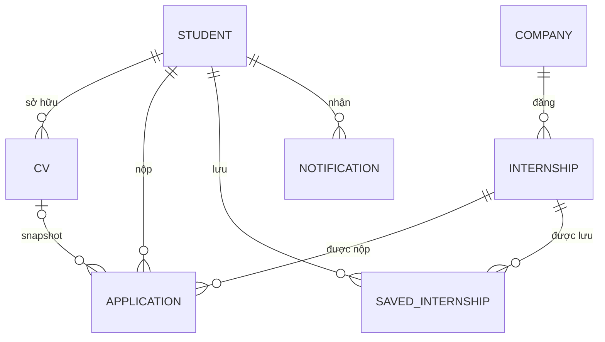

# Slide 02 — Business entity và định nghĩa nhất quán

> **Chủ đề:** Business entity và định nghĩa nhất quán.
> **Thời lượng:** 25 giây.
> **Minh chứng bắt buộc:** ERD có cardinality và business rule.
> **Miền nghiệp vụ:** Internly (Flutter internship finder).
> **Nguồn đối chiếu:** `docs/architecture.md` §6, `docs/business-rules.md` §3.1/§3.3/§3.4/§3.5/§3.7, `docs/design/persona.md`.

---

## Nội dung slide (paste-ready)

**Kicker:** PRM · INTERNLY · BUSINESS ENTITIES

**Title:** Business entity và định nghĩa nhất quán

**Subtitle:** 7 entity · 1 ERD khái niệm · actor ↔ nghiệp vụ

---

## 1. Business entity và định nghĩa nhất quán

| Entity | Nhãn | Định nghĩa | Actor / owner | Nơi lưu trong code |
|---|---|---|---|---|
| `STUDENT` | Sinh viên | Người dùng đã đăng nhập bằng Google; sở hữu hồ sơ, CV, đơn ứng tuyển, tin đã lưu và thông báo. | User (Student) | `users/{uid}` + Firebase Auth |
| `CV` | Hồ sơ | Tệp PDF do Student tải lên; có thể được chọn làm mặc định để đính kèm khi ứng tuyển. | Student | `users/{uid}/cvs/{cvId}`; mirror `users/{uid}.cv` |
| `COMPANY` | Công ty | Tổ chức tuyển dụng sở hữu một hoặc nhiều tin thực tập. | System (sync) | Snapshot trong `internships/{jobKey}` |
| `INTERNSHIP` | Tin thực tập | Tin tuyển dụng trong pool dùng chung, do hệ thống đồng bộ và chỉ đọc trong app. | System / Admin sync | `internships/{jobKey}` |
| `APPLICATION` | Đơn ứng tuyển | Bản ghi một lần Student nộp cho một Internship; giữ snapshot tin và trạng thái. | Student | `users/{uid}/applications/{jobKey}` |
| `SAVED INTERNSHIP` | Tin đã lưu | Liên kết Student–Internship để xem lại tin mà không cần ứng tuyển. | Student | `users/{uid}/savedInternships/{jobKey}` |
| `NOTIFICATION` | Thông báo | Bản ghi thông báo gửi tới một Student, do Admin hoặc hệ thống tạo. | Student (nhận) | `users/{uid}/notifications/{messageId}` |

### Quy ước thuật ngữ (một tên duy nhất)

| Dùng | Không dùng | Lý do |
|---|---|---|
| `STUDENT` | User, Ứng viên, Sinh viên (làm tên entity) | `User` là khái niệm kỹ thuật của Firebase Auth; entity nghiệp vụ là sinh viên. |
| `INTERNSHIP` | Job, Tin tuyển dụng (làm tên entity) | Thống nhất với model và tài liệu dự án. |
| `APPLICATION` | Request, Đơn xin việc | Đây là đơn ứng tuyển, không phải yêu cầu nội bộ. |
| `COMPANY` | Employer, Nhà tuyển dụng | `COMPANY` là thực thể; `employer` chỉ là vai trò. |
| `CV` | Resume, Hồ sơ xin việc | Code và UI dùng `CV`. |
| `SAVED INTERNSHIP` | Bookmark, Favorite | Đây là liên kết có ngữ nghĩa nghiệp vụ, không chỉ là icon. |
| `NOTIFICATION` | Message, Alert | `NOTIFICATION` là bản ghi lịch sử gửi tới Student. |

---

## 2. Quan hệ, cardinality, optionality chính



> `ADMIN` là actor gửi `NOTIFICATION` (1 Admin → 0..* Notification), không phải collection lưu trữ trong Firestore.

### Nếu công cụ không render Mermaid

```text
STUDENT 1 ──< 0..* APPLICATION
INTERNSHIP 1 ──< 0..* APPLICATION
STUDENT 1 ──< 0..* CV
APPLICATION 0..* >── 0..1 CV            (snapshot tùy chọn)
STUDENT 1 ──< 0..* SAVED INTERNSHIP
INTERNSHIP 1 ──< 0..* SAVED INTERNSHIP
COMPANY 1 ──< 0..* INTERNSHIP
STUDENT 1 ──< 0..* NOTIFICATION          (Admin gửi)
```

### Bảng cardinality và optionality

| Quan hệ | Cardinality | Optionality | Diễn giải |
|---|---|---|---|
| `STUDENT` – `APPLICATION` | 1 – 0..* | Application bắt buộc Student; Student có thể chưa nộp đơn. | Một sinh viên nộp nhiều đơn; mỗi đơn thuộc đúng một sinh viên. |
| `INTERNSHIP` – `APPLICATION` | 1 – 0..* | Application bắt buộc Internship; tin có thể chưa có đơn. | Mỗi đơn gắn đúng một tin; một tin nhận nhiều đơn. |
| `STUDENT` – `CV` | 1 – 0..* | CV bắt buộc Student; Student có thể chưa có CV. | Sinh viên sở hữu nhiều CV. |
| `CV` – `APPLICATION` | 0..1 – 0..* | Snapshot CV là tùy chọn trên Application. | Đơn có thể đính kèm 0 hoặc 1 CV; một CV được nhiều đơn tham chiếu. |
| `STUDENT` – `SAVED INTERNSHIP` | 1 – 0..* | Saved bắt buộc Student; Student có thể chưa lưu tin. | Một sinh viên lưu nhiều tin. |
| `INTERNSHIP` – `SAVED INTERNSHIP` | 1 – 0..* | Saved bắt buộc Internship; tin có thể chưa được lưu. | Một tin có thể được nhiều sinh viên lưu. |
| `COMPANY` – `INTERNSHIP` | 1 – 0..* | Internship bắt buộc Company; Company có thể chưa có tin. | Một công ty đăng nhiều tin; mỗi tin thuộc đúng một công ty. |
| `STUDENT` – `NOTIFICATION` | 1 – 0..* | Notification bắt buộc Student; Student có thể chưa có thông báo. | Một sinh viên nhận nhiều thông báo; mỗi thông báo thuộc đúng một sinh viên. |

> Ràng buộc “tối đa một Application cho mỗi cặp Student–Internship” không thể hiện bằng cardinality 1–N; nó được ghi thành **BR-03**.

---

## 3. Business rule chi phối quan hệ

| ID | Business rule | Quan hệ chi phối | Nguồn |
|---|---|---|---|
| **BR-01** | Mỗi `Application` thuộc đúng một `Student` và đúng một `Internship`. | `STUDENT`/`INTERNSHIP` – `APPLICATION` | BR-A4, BR-P1 |
| **BR-02** | `Application` đã ghi phải có ít nhất một snapshot của `Internship` (`title + companyName`) và đúng một trạng thái hợp lệ; không tồn tại application rỗng. | `APPLICATION` (thuộc tính bắt buộc) | BR-P8, BR-T1 |
| **BR-03** | Mỗi `Student` có tối đa một `Application` cho mỗi `Internship` (document ID = `jobKey`). | `STUDENT` – `INTERNSHIP` qua `APPLICATION` | BR-P1, BR-P2 |
| **BR-04** | `Application` tham chiếu 0..1 `CV`; CV đang được application đã gửi tham chiếu thì không được xóa khỏi Storage. | `CV` – `APPLICATION` | BR-C4, BR-T6 |
| **BR-05** | Mỗi `Saved Internship` thuộc đúng một `Student` và đúng một `Internship`; lưu lặp là idempotent. | `STUDENT`/`INTERNSHIP` – `SAVED INTERNSHIP` | BR-S1, BR-S2 |
| **BR-06** | Mỗi `Internship` thuộc đúng một `Company`; chỉ tin còn hạn (`expiresAt > now`) mới được đọc. | `COMPANY` – `INTERNSHIP` | BR-D1 |
| **BR-07** | Mỗi `Notification` gửi cho đúng một `Student`; Admin gửi một hoặc tất cả, không sửa dữ liệu khác. | `ADMIN` – `NOTIFICATION` | BR-N3 … BR-N7 |
| **BR-08** | `Student` chỉ ghi dữ liệu thuộc `users/{uid}`; chỉ đọc `Internship`/`Company`; không ghi pool chung. | Actor ↔ toàn bộ entity | BR-A4 |

---

## 4. Đối chiếu entity với actor và nghiệp vụ

| Actor | Entity chính | Đọc | Ghi | Không bao giờ |
|---|---|---|---|---|
| **Student** | `STUDENT`, `CV`, `APPLICATION`, `SAVED INTERNSHIP`, `NOTIFICATION` | `COMPANY`, `INTERNSHIP` (pool chung) | `STUDENT`, `CV`, `APPLICATION`, `SAVED INTERNSHIP`; cập nhật trạng thái đọc của `NOTIFICATION` | Ghi pool `INTERNSHIP`/`COMPANY`; đọc/ghi dữ liệu người khác |
| **Admin** | `NOTIFICATION`, `STUDENT` (directory) | Danh sách `STUDENT`, lịch sử `NOTIFICATION` | Gửi/xóa `NOTIFICATION` | Ghi `INTERNSHIP`/`COMPANY`; đọc `CV`/`APPLICATION` |
| **System / sync** | `COMPANY`, `INTERNSHIP` | — | `COMPANY`, `INTERNSHIP` (đồng bộ mỗi 6 giờ) | Ghi dữ liệu user |

### Đối chiếu với nghiệp vụ

| Entity | Nghiệp vụ | Actor | Bằng chứng trong code |
|---|---|---|---|
| `STUDENT` | Đăng nhập, hồ sơ, preferences, CV mặc định | Student | `users/{uid}`, `UserProfile` |
| `CV` | Thêm, chọn mặc định, xóa; đính kèm khi ứng tuyển | Student | `users/{uid}/cvs`, `cvs/{uid}` |
| `INTERNSHIP` | Tìm kiếm, xem chi tiết, lưu, ứng tuyển | Student đọc; System ghi | `internships/{jobKey}` |
| `COMPANY` | Hiển thị thông tin công ty trên tin và đơn | System ghi; Student đọc | Snapshot `companyName`/logo trong `internships` |
| `APPLICATION` | Nộp đơn, theo dõi trạng thái, rút đơn, hoàn tác | Student | `users/{uid}/applications/{jobKey}` |
| `SAVED INTERNSHIP` | Lưu/bỏ lưu tin, xem lại sau | Student | `users/{uid}/savedInternships/{jobKey}` |
| `NOTIFICATION` | Admin gửi thông báo; Student xem lịch sử và đánh dấu đã đọc | Admin gửi; Student nhận | `users/{uid}/notifications/{messageId}` |

---

## Speaker notes (25 giây)

**0–7 giây — Entity và actor**

> Chốt bảy thực thể: Student, CV, Company, Internship, Application, Saved Internship, Notification; hai actor: Student và Admin.

**7–17 giây — Cardinality chính**

> Trên ERD, mỗi Application thuộc đúng một Student và một Internship; mỗi Student có tối đa một đơn cho một tin. CV là snapshot 0..1 trên Application; Saved Internship là quan hệ nhiều-nhiều có thuộc tính.

**17–25 giây — Business rule và ranh giới actor**

> Business rule chặn xóa CV đang được đơn đã gửi tham chiếu; Admin chỉ gửi Notification, không ghi pool.

---

## Checklist minh chứng

- [x] ERD khái niệm có cardinality và optionality.
- [x] Có business rule chi phối từng quan hệ chính.
- [x] Mọi entity có định nghĩa một câu và actor/owner.
- [x] Tên entity dùng nhất quán trong ERD, định nghĩa, business rule và bảng actor.
- [x] Đối chiếu entity với actor và nghiệp vụ.
- [x] Không có `VARCHAR`, `INT`, `PK` vật lý hay field type trong ERD.
- [x] Có đường dẫn code để chứng minh entity khớp dự án.

## Tránh

- Không thêm kiểu dữ liệu vật lý (`VARCHAR`, `INT`, `TIMESTAMP`) vào ERD khái niệm.
- Không thêm khóa chính vật lý (`PK`, `id`) vào sơ đồ; `jobKey`/`uid` chỉ dùng trong phần đối chiếu code.
- Không dùng đồng thời `Request`/`Application`, `Job`/`Internship`, `Resume`/`CV` trong cùng một slide.
- Không mô tả `ADMIN` như một collection khi Admin chỉ là actor vận hành local dashboard.

---

## Nguồn

- `docs/architecture.md` §6 — data ownership và Firestore schema.
- `docs/business-rules.md` §3.1, §3.3, §3.4, §3.5, §3.7 — BR-A4, BR-S1/S2, BR-C4, BR-P1/P2/P8, BR-T1/T6, BR-N3…N7.
- `docs/design/persona.md` — actor Student.
